**相关阅读：** [事件视觉基础](/posts/event-vision-basics/) · [事件相机近眼注视追踪](/posts/event-based-gaze-tracking/)。建议先掌握事件、时间窗口与时空相关性，再阅读本文。

> 阅读目标：理解事件相机如何产生观测，为什么使用高斯事件斑块，怎样通过两类伪观测进行异步 EKF 更新，以及实验真正支持了哪些结论。
>
> 本文依据 18 页英文作者版本整理，并核对原论文中的关键公式、实验与消融图。论文：Ziwei Wang、Timothy Molloy、Pieter van Goor、Robert Mahony，*Asynchronous Blob Tracker for Event Cameras*，IEEE Transactions on Robotics，2024，DOI：10.1109/TRO.2024.3454410。对应预印本为 arXiv:2307.10593v3。
>
> 图像说明：“中文示意图”是为解释原理而绘制，点、曲线、间隔等均非实验数据；“论文原图”来自上述 PDF，保留图号并附中文读图说明。页码均指该 PDF 页码。本文是学习性解读，未声称已经验证作者代码。

## 目录与阅读顺序

1. [先建立论文全貌](#1-先建立论文全貌)
2. [基础一：事件、极性、混合事件帧数据](#2-基础一事件极性混合事件帧数据)
3. [基础二：高斯分布、椭圆与两种协方差](#3-基础二高斯分布椭圆与两种协方差)
4. [基础三：卡尔曼滤波与异步更新](#4-基础三卡尔曼滤波与异步更新)
5. [状态与运动模型](#5-状态与运动模型)
6. [核心创新：两类伪观测](#6-核心创新两类伪观测)
7. [联合 EKF 更新与完整算法](#7-联合-ekf-更新与完整算法)
8. [动态数据关联与多目标](#8-动态数据关联与多目标)
9. [非闪烁物体的双峰与极性补偿](#9-非闪烁物体的双峰与极性补偿)
10. [实验结果应该怎样解读](#10-实验结果应该怎样解读)
11. [下游应用：TTC 与距离](#11-下游应用ttc-与距离)
12. [复现要点、局限与公式核对](#12-复现要点局限与公式核对)
13. [阅读地图、术语和自测](#13-阅读地图术语和自测)
14. [参考资料与配图索引](#14-参考资料与配图索引)

**建议分三遍阅读：**第一遍读第 1、2、9、10 节建立直觉；第二遍读第 3～8 节掌握算法；第三遍读第 11～13 节准备汇报或复现。第一次不必逐项推导所有雅可比矩阵。

## 1. 先建立论文全貌

### 1.1 用一句话说清楚

**AEB Tracker 把目标产生的事件位置建模为随时间变化的高斯分布，并利用每个关联事件，通过带有两类伪观测的扩展卡尔曼滤波器，同时更新目标的位置、速度、方向和尺度。**

它主要面向在事件图像中形成紧凑斑块的目标，例如闪烁 LED、汽车尾灯、小型飞行器，以及移动的亮斑或暗斑。

### 1.2 输入、输出与边界

| 项目 | 内容 |
|---|---|
| 核心输入 | 原始事件流：位置、时间戳、极性 |
| 可选输入 | 相机陀螺仪角速度，用于旋转自运动预测 |
| 初始化 | 实验中手动点击或预设目标位置 |
| 基础输出 | 二维中心、二维速度、方向角、角速度、两个主尺度，共 8 维 |
| 非闪烁目标扩展 | 加入二维极性偏移，共 10 维 |
| 主要处理方式 | 与目标关联的事件到达后立即更新，无需先生成事件图像 |
| 下游示例 | 车辆碰撞时间估计、已知尺寸无人机测距 |
| 尚未完成的部分 | 通用自动检测、复杂遮挡和交叉目标的可靠身份保持 |

### 1.3 主要贡献在哪里？

“使用 EKF”本身不是论文最特别的地方。真正的难点是：**目标形状决定事件的空间分布，但形状本身也未知，必须和运动状态一起估计。**

作者构造了：

- 基于当前事件的**归一化位置偏差观测**；
- 基于短历史缓存的**卡方统计观测**。

二者配合，为中心和形状提供约束。算法不需要神经网络训练，但仍需要初始化、噪声设定及数据关联参数。

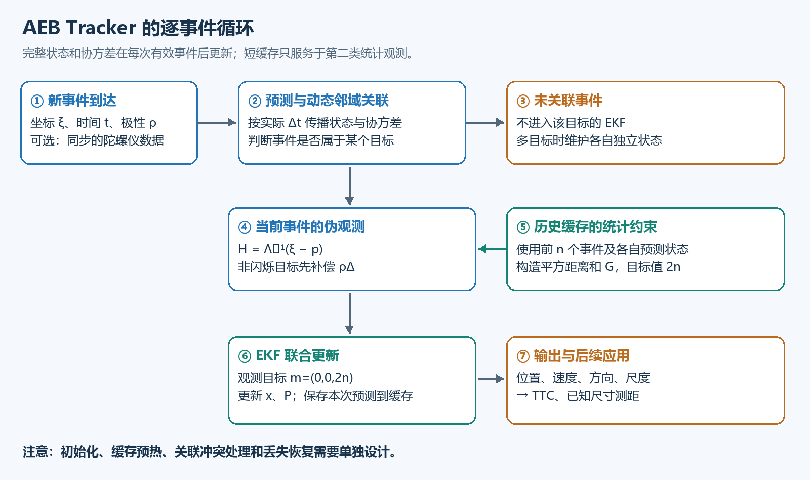

## 2. 基础一：事件、极性、混合事件帧数据

### 2.1 事件相机记录的是什么？

普通相机按固定时刻输出整张图像；事件相机的每个像素独立检查亮度变化。理想化地，令对数亮度为 $L=\log I$，相对上次触发基准的变化达到阈值时输出事件：

$$
L(x,y,t_k)-L(x,y,t_{\mathrm{last}})\approx \rho_k C,
\qquad \rho_k\in\{-1,+1\}.
$$

这里的阈值模型是事件视觉的背景知识，不是 AEB Tracker 另外发明的检测算法。

一个事件写为：

$$
e_k=(\xi_k,t_k,\rho_k),\qquad \xi_k=(x_k,y_k)^\top.
$$

- $\xi_k$：哪个像素触发；
- $t_k$：什么时候触发；
- $\rho_k$：变亮还是变暗。

**事件不是目标中心坐标。** 它只是目标某处或背景某处发生亮度变化的一次记录。跟踪器需要从许多这样的观测中递推估计状态。

### 2.2 极性与运动方向不是一回事

以暗背景上的亮物体向右运动为例：前缘覆盖像素，使该像素由暗变亮，产生正事件；后缘离开像素，使其由亮变暗，产生负事件。如果物体比背景暗，极性对应关系反过来。

**“非闪烁”是自身亮度不忽明忽暗；它仍然能通过移动改变固定像素看到的亮度。** 相对相机完全静止、照明也稳定的目标，则可能没有足够事件支持持续校正。

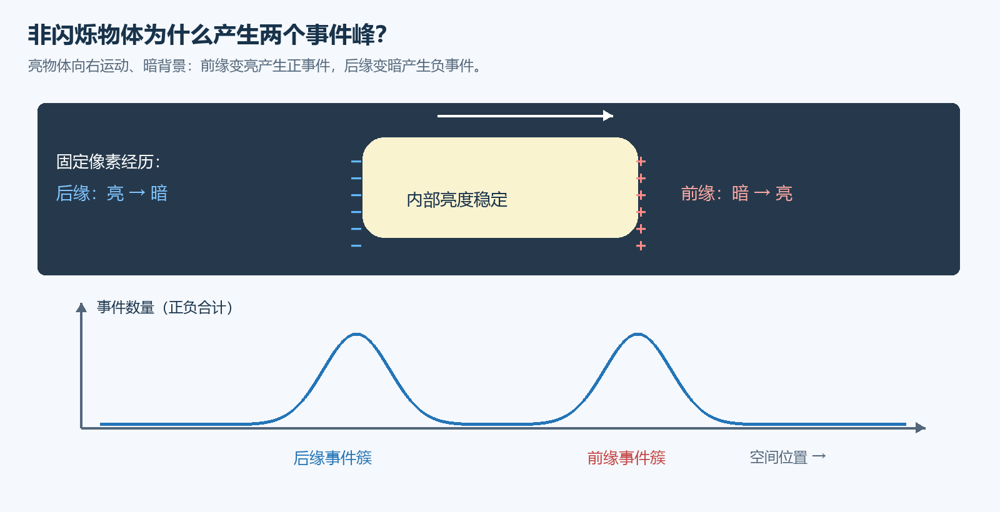

上图“双峰”指事件在**空间位置**上有两个主要聚集区。并不是简单指存在正负两种标签，也不是每次一定能观察到两个完全对称、同样高的峰。

### 2.3 混合事件帧与本文的关系

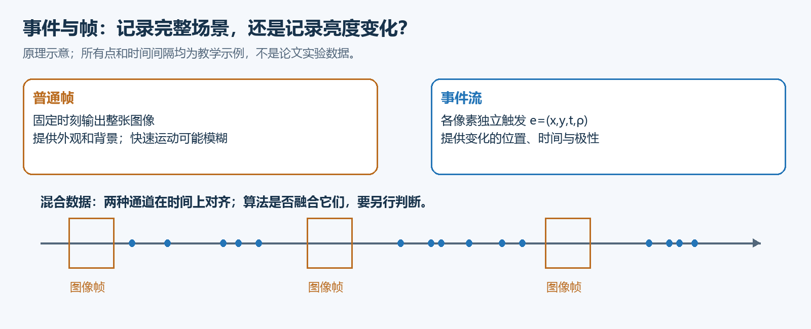

混合数据同时包含周期图像帧和异步事件流。它们可以来自同一台混合传感器，也可以来自同步、标定后的两台相机。

在本文中：

- AEB 跟踪滤波主要消费**原始事件**，可选融合陀螺仪；
- 户外实验使用事件相机和同步 RGB 相机；RGB 图像用于参考和可视化；
- 由事件重建的灰度图也主要用于展示，不应误写成算法必须先重建图像；
- 因而“实验有图像帧”不等于“跟踪器融合了帧”。

### 2.4 为什么事件适合这里的任务？

快速运动往往产生密集事件，能在普通相机帧间提供很多更新机会；亮度变化发生的时间也能保留下来。但效果仍依赖对比度、传感器设置、背景活动和读出能力。不能简单认为“速度越高，事件越多，跟踪就必然越准确”。

## 3. 基础二：高斯分布、椭圆与两种协方差

### 3.1 event blob 不是精确物体轮廓

作者先提出时空事件似然，再在每个已知事件时刻使用条件空间分布。可以直观理解为：**在时刻 $t$，属于这个目标的事件更可能出现在哪些位置？**

近似模型为：

$$
\xi_k\mid t_k\sim\mathcal N(p_k,\Lambda_k^2),
$$

等价的事件生成表达式为论文式 (4)：

$$
\xi_k=p_k+\Lambda_k\eta_k,
\qquad \eta_k\sim\mathcal N(0,I_2).
$$

这里并不是把真实轮廓假设成高斯，而是用高斯近似**事件位置的统计分布**。事件率随时间变化的因子并没有被作为独立状态完整估计，滤波更新时刻直接来自事件时间戳。

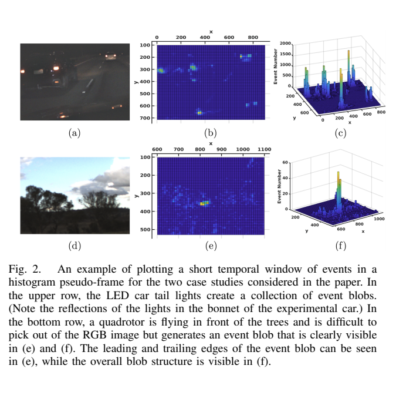

**读图要点：**尾灯会在局部产生密集事件；无人机在普通图像中受背景干扰，但事件分布可能更突出。图中的短时间累积直方图是为了展示分布，不代表滤波器必须用同样的窗口等待输入。

### 3.2 形状矩阵怎样表示椭圆？

论文式 (2)：

$$
\Lambda=R(\theta)
\begin{bmatrix}\lambda_1&0\\0&\lambda_2\end{bmatrix}
R(\theta)^\top,
\qquad \lambda_1,\lambda_2>0,
$$

$$
R(\theta)=
\begin{bmatrix}\cos\theta&-\sin\theta\\\sin\theta&\cos\theta\end{bmatrix}.
$$

$\lambda_1,\lambda_2$ 是两个主方向的标准差尺度，$\theta$ 决定主轴朝向。由于 $\Lambda$ 对称正定，事件位置协方差是 $\Lambda\Lambda^\top=\Lambda^2$，其特征值是 $\lambda_1^2,\lambda_2^2$。

绘图时经常显示满足下式的等值椭圆：

$$
(\xi-p)^\top\Lambda^{-2}(\xi-p)=c^2.
$$

图上半轴长度为 $c\lambda_1,c\lambda_2$；它还取决于选用的等值水平 $c$。**不要把 $\lambda_i$ 不加解释地当作物体半径、直径或检测框宽高。**

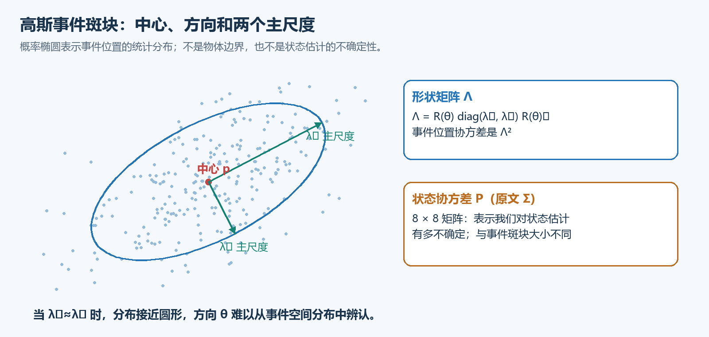

### 3.3 必须分清两种协方差

| 量 | 大小 | 描述的对象 |
|---|---|---|
| $\Lambda^2$ | $2\times2$ | 同一目标的事件在空间上分散到什么程度 |
| $P$，原文记作 $\Sigma$ | 基础模型 $8\times8$ | 我们对位置、速度、尺度等状态估计有多不确定 |
| $Q$ | 与状态维度一致 | 运动模型未解释的变化和扰动 |
| $R_m$ | $3\times3$ | 本文联合伪观测的噪声协方差 |

例如一个很大的事件斑块，其中心仍可能估计得非常稳定：事件分布大，不代表中心估计一定不确定。

为避免与二维旋转矩阵 $R(\theta)$ 混淆，下文把观测噪声协方差写为 $R_m$。

### 3.4 模型天然存在的方向歧义

当 $\lambda_1\approx\lambda_2$ 时，椭圆接近圆形，旋转角几乎不改变空间分布，因此方向很难从事件位置中辨认。椭圆方向还具有模 $\pi$ 的等价性；交换两条主轴并旋转 $\pi/2$ 也可表示同一形状。

这属于模型本身的性质。第二类观测增加尺度信息，并不意味着所有形状和运动条件下都能唯一恢复有物理意义的朝向。

## 4. 基础三：卡尔曼滤波与异步更新

### 4.1 预测与校正

卡尔曼滤波递推维护两个东西：状态估计 $\hat x$ 与其不确定性 $P$。

1. **预测：**根据上一时刻位置、速度和运动模型，推算新时刻状态；随着时间经过，不确定性通常增大。
2. **校正：**使用新观测修正预测；可信且有信息的观测能降低相关状态的不确定性。

这里的“观测”是带噪声的事件信息，不是精准的物体中心标注。

### 4.2 为什么用扩展卡尔曼滤波？

形状逆矩阵、旋转、尺度以及陀螺仪相关运动项产生非线性。EKF 在当前估计附近做一阶线性化，利用雅可比矩阵计算状态和观测对扰动的敏感程度，再使用卡尔曼更新。

它是局部近似：初值很差、模型失配很大或关联错误时，不能保证正确收敛。

### 4.3 “异步”的准确含义

对于某个目标，相邻有效事件之间的时间为：

$$
\delta_k=t_k-t_{k-1}.
$$

$\delta_k$ 不固定。每次预测都应使用实际时间差，而不是假设“所有事件间隔恒为 1 微秒”。不同目标有不同事件序列，应分别维护最近更新时间。

接收到属于目标的事件才进行测量更新；没有有效事件时，模型仍可向查询时刻传播预测，但**没有新事件就没有新的测量校正**。

## 5. 状态与运动模型

### 5.1 基础 8 维状态

论文式 (5)：

$$
x=(p_x,p_y,v_x,v_y,\theta,q,\lambda_1,\lambda_2)^\top.
$$

| 分量 | 含义 | 常用单位 |
|---|---|---|
| $p_x,p_y$ | 事件斑块中心 | 像素 |
| $v_x,v_y$ | 图像平面线速度状态 | 像素/秒 |
| $\theta$ | 事件分布主轴角度 | 弧度 |
| $q$ | 角速度状态 | 弧度/秒 |
| $\lambda_1,\lambda_2$ | 两个主尺度 | 像素 |

无 IMU 时，核心直觉是短时匀速：

$$
\dot p=v,\qquad \dot\theta=q,
$$

速度、角速度与尺度的变化由过程噪声允许。**这不表示真实目标永远匀速，而是滤波器在相邻事件之间采用简单预测。**

### 5.2 有陀螺仪时补偿什么？

设相机角速度为 $\Omega=(\Omega_x,\Omega_y,\Omega_z)$，定义：

$$
J=\begin{bmatrix}0&\Omega_z\\-\Omega_z&0\end{bmatrix}.
$$

论文式 (8) 的确定性部分可概括为：

$$
\dot p=v+f_p(p,\Omega),\quad
\dot v=Jv,\quad
\dot\theta=q-\Omega_z,\quad
\dot q=0,\quad\dot\lambda=0.
$$

各状态还分别叠加随机扩散。$f_p$ 根据像素位置、主点、焦距和角速度计算相机旋转造成的图像运动。若采用论文的符号约定，令 $\bar p_x=p_x-p_x^0$、$\bar p_y=p_y-p_y^0$：

$$
f_p=\begin{bmatrix}
\Omega_x\bar p_x\bar p_y/f-\Omega_y(f+\bar p_x^2/f)+\Omega_z\bar p_y\\
\Omega_x(f+\bar p_y^2/f)-\Omega_y\bar p_x\bar p_y/f-\Omega_z\bar p_x
\end{bmatrix}.
$$

复现时必须统一坐标轴方向、角速度单位、相机与 IMU 外参和时间基准。本文没有实现基于加速度计与目标深度的完整相机平移补偿；不能将它说成完整六自由度运动解耦。

有 IMU 时，$v$ 与实际总像素运动 $\dot p$ 需要区分，后者还包含 $f_p$。

### 5.3 协方差传播

令 $f(x,\Omega)$ 表示确定性运动函数，$A=\partial f/\partial x$，则：

$$
\dot P=AP+PA^\top+Q.
$$

采用一阶数值积分时，常用实现形式为：

$$
\hat x_k^-\approx\hat x_{k-1}+\delta_k f(\hat x_{k-1},\Omega_k),
$$

$$
F_k\approx I+\delta_k A_k,\qquad
P_k^-\approx F_kP_{k-1}F_k^\top+\delta_kQ_k.
$$

上标 $-$ 表示本次校正之前的预测值。论文在式 (34a) 使用了矩阵形式；对非线性自运动项，不能直接把局部雅可比 $A$ 当成完整的函数 $f$。相关核对见第 12 节。

## 6. 核心创新：两类伪观测

### 6.1 为什么原始事件生成式不方便直接使用？

从 $\xi=p+\Lambda\eta$ 可见，事件相对于中心的散布由 $\Lambda$ 决定。普通 EKF 写法常把观测噪声协方差当成已知量，但这里 $\Lambda$ 的参数正是待估状态。

作者将问题改写为“应当满足什么统计关系”，从而构造具有指定观测目标和噪声设定的伪观测。**伪观测是对已有事件的数学重表达，不是额外传感器测到了一个零向量或 $2n$。**

### 6.2 第一类：归一化位置偏差

论文式 (14)：

$$
H(x_k;\xi_k)=\Lambda_k^{-1}(\xi_k-p_k).
$$

按正确的尺度和方向把偏差归一化后，理想模型中的分布应当均值为零、协方差为 $I_2$。于是设置：

$$
y_k\equiv(0,0)^\top.
$$

把 $H$ 当作非线性观测函数，就能形成 EKF 创新。这里“目标值为零”是统计上的均值约束，并不要求每个事件真的位于目标中心。

**它为什么不够？**如果归一化偏差太大，有两种办法减小它：移动中心使它靠近事件，或增大尺度使同样的像素距离变得不显著。

例如一维类比中，偏差为 10 像素：尺度为 5 时归一化偏差为 2；尺度增大到 20 时就变成 0.5。中心没改善，归一化偏差却变小了。该例仅说明歧义，不是论文实测数值。

### 6.3 第二类：卡方统计量约束尺度

先回顾统计知识：若 $u\sim\mathcal N(0,I_2)$，则：

$$
\|u\|^2=u_x^2+u_y^2\sim\chi^2_2.
$$

若有 $n$ 个独立二维标准高斯变量，它们平方距离之和满足：

$$
S=\sum_{j=1}^{n}\|u_j\|^2\sim\chi^2_{2n},
\qquad \mathbb E[S]=2n,\qquad\operatorname{Var}(S)=4n.
$$

**直觉：形状估计正确时，归一化后的事件不能全部挤在中心，也不能整体散得太远。**

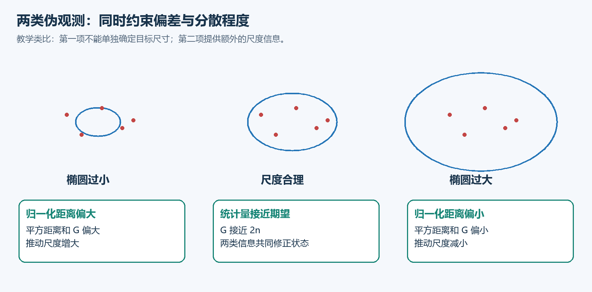

例如教学上取 $n=8$，理论目标均值为 16、方差为 32。它不是要求每次统计量恰好等于 16，而是允许其随机波动，由滤波器结合不确定性进行修正。

### 6.4 为什么要保存历史预测状态？

缓存包含前 $n$ 个事件 $\xi_{k-j}$，以及它们各自时刻的**更新前预测** $\hat p^-_{k-j}$、$\hat\theta^-_{k-j}$。

不能把所有历史事件直接减去当前中心 $p_k$：目标运动产生的位置变化会被误当成目标自身的空间散布，导致尺度估计偏大。

同时，使用各历史时刻更新前的信息，旨在减少把同一观测反复用于定位后又计算残差造成的依赖问题。真实滤波链和重叠缓存仍有相关性，不能把这一构造理解为所有样本严格独立的普遍保证。

论文式 (18) 将**当前待估尺度**与**历史预测方向**组合：

$$
\hat\Lambda_{k-j}=R(\hat\theta^-_{k-j})
\operatorname{diag}(\lambda_{1,k},\lambda_{2,k})
R(\hat\theta^-_{k-j})^\top.
$$

注意：这里不是直接读取历史时刻的尺度，而是利用这段短历史来约束当前尺度。它隐含短缓存内尺度变化可被近似处理。

### 6.5 论文具体怎样定义第二类观测？

按正文式 (19)～(20) 的书写：

$$
\chi_{k-j}=\frac{1}{1+\beta}\hat\Lambda_{k-j}^{-1}
(\xi_{k-j}-\hat p^-_{k-j}),
$$

$$
G(x_k;\hat P_k^-,\Xi_k)=\sum_{j=1}^{n}\|\chi_{k-j}\|^2.
$$

这里 $\hat P_k^-$ 是论文对**历史位置和方向缓存**的记号，不是本文用来表示状态协方差的 $P$。$\Xi_k$ 是事件位置缓存；$\beta$ 用于近似补偿历史中心预测的不确定性。

随后设置第二个伪观测目标：

$$
z_k\equiv 2n.
$$

作者用 $\mathcal N(2n,4n)$ 近似相应卡方统计量，并将其并入 EKF。卡方分布在小自由度下偏斜，高斯近似并非任意 $n$ 都同样准确。论文实现中通常取 $n<10$，应通过实验检查该近似影响。

> **公式核对提示：**正文的 $\beta$ 缩放与方差解释、式 (21) 的噪声均值存在值得核查的表述问题。本节保留正文构造以便对照；第 12 节区分原文写法、统计解释与复现建议，不能把本节直接当作已验证实现。

### 6.6 两类约束各自提供什么信息？

| 组成 | 使用数据 | 目标 | 作用 |
|---|---|---|---|
| $H$ | 当前事件 | $(0,0)$ | 利用位置偏差修正状态，但单独使用存在尺度膨胀歧义 |
| $G$ | 短历史事件及各自预测状态 | $2n$ | 提供整体分散程度约束，改善尺度估计 |

第二项不是单独直接测出两个尺度；它通过连续观测与联合滤波逐步提供尺度信息。不要将“双伪观测”机械理解为“一个只更新位置，另一个只更新大小”：第一项也依赖方向和尺度，整体更新还会经状态互协方差影响其他状态。

### 6.7 补充算例：第二观测怎样阻止尺度无限增大？

暂时忽略 $\beta$ 和中心预测误差，只考虑八个归一化二维残差。在理想尺度下，其平方距离和的期望是 16。若把两个尺度同时扩大两倍，归一化残差会减半，平方距离和则缩小为原来的四分之一，期望约为 4。

此时第二观测的创新 $2n-G$ 约为 $16-4=12$，说明模型把事件解释得过于集中。滤波器结合雅可比与协方差对尺度进行校正，避免第一观测仅通过放大椭圆来减小残差。

这只是用于理解机制的期望值算例。真实单次样本会波动，且尺度校正方向和幅度取决于联合滤波状态，不能将它当作“每次直接把尺度除以二”的更新规则。

### 6.8 补充：短缓存也有物理时间跨度

设缓存长度为 $n$、目标的有效关联事件率约为 $r$，缓存覆盖的时间量级约为 $n/r$。以 $n=8$ 为例，100 kEvents/s 时约为 80 μs，1 kEvents/s 时约为 8 ms。

这不是额外等待整批数据的固定延迟，而是参与统计的历史范围。事件变稀疏后，同样长度的缓存会跨越更长时间，短时间内尺度近似不变的假设也可能变弱。因此复现时除了记录事件数量，还应记录缓存最早和最新事件的时间差，并分别评估快速尺度变化与低事件率场景。

## 7. 联合 EKF 更新与完整算法

### 7.1 联合观测模型

定义：

$$
m=\begin{bmatrix}0\\0\\2n\end{bmatrix},\qquad
h(x)=\begin{bmatrix}H(x;\xi_k)\\G(x;\hat P_k^-,\Xi_k)\end{bmatrix},
\qquad R_m=\operatorname{diag}(1,1,4n).
$$

在线性化点 $\hat x_k^-$ 计算：

$$
C_k=\left.\frac{\partial h}{\partial x}\right|_{\hat x_k^-}
\in\mathbb R^{3\times8}.
$$

然后使用标准 EKF 形式：

$$
r_k=m-h(\hat x_k^-),\qquad
S_k=C_kP_k^-C_k^\top+R_m,
$$

$$
K_k=P_k^-C_k^\top S_k^{-1},
$$

$$
\hat x_k=\hat x_k^-+K_kr_k,\qquad
P_k=(I-K_kC_k)P_k^-.
$$

**维度检查：**创新为 3 维，$S_k$ 为 $3\times3$，卡尔曼增益为 $8\times3$；非闪烁扩展中状态改成 10 维，对应矩阵也需扩展。

### 7.2 雅可比应该理解到什么程度？

至少要知道：

- $\partial H/\partial p=-\Lambda^{-1}$；
- $H$ 还随尺度和方向变化；
- $H$ 对速度与角速度的直接偏导为零；
- $G$ 在作者构造中主要通过当前尺度变化，其历史中心和方向被视为缓存参数。

虽然单次观测不直接包含速度，预测模型建立的位置—速度相关性仍使速度能够通过观测递推校正。论文附录 XI-A 列出偏导；实施前还应对照自动微分或有限差分检查，尤其是尺度导数的幂次和符号。

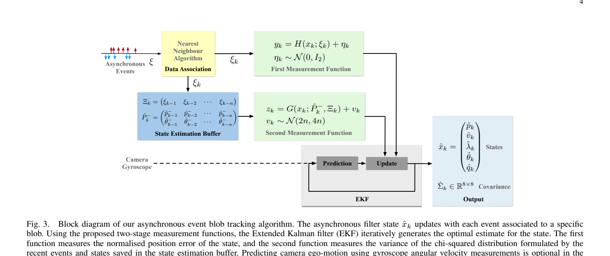

**读图顺序：**左侧事件进入关联模块；历史缓存进入第二观测函数；两类观测共同进入 EKF；可选陀螺仪进入预测；右侧输出状态和协方差。

### 7.3 初始化与预热

论文使用手动或预设位置初始化，线速度、角速度初值设为零，初始尺度至少设为预期最大 blob 尺度的两倍，以增加初始捕获范围。

滤波器还需要 $P_0$、过程噪声 $Q$、关联半径、缓存长度 $n$ 等。由于完整第二观测需要历史缓存，作者提到先运行 bootstrap 过程生成初始缓存。**缓存尚未填满时不能直接假装已经有 $n$ 个真实历史样本。**

论文未在正文提供一套可不加选择地用于所有场景的完整预热细节；具体应核对配套代码。本文不将某一种自行设计的预热方式冒充作者原实现。

### 7.4 概念级伪代码

以下表达算法依赖顺序，供阅读和设计使用，不是可直接运行的官方代码。为避免误导，未展开未核实的初始化细节。

```text
输入：按时间排列的事件流；可选陀螺仪数据
每个目标维护：状态 x、协方差 P、最后有效更新时间、关联半径 σ
              前 n 个事件和对应更新前预测状态的缓存

初始化目标与噪声参数，按作者实现完成缓存预热

对每个新事件 e=(ξ,t,ρ)：
    为候选目标计算其在 t 时刻的预测中心
    用动态邻域规则进行关联；未关联事件丢弃

    对被关联目标：
        使用真实 Δt 和运动函数预测 x_minus、P_minus
        若使用极性补偿：以 ξ - ρΔ 构造当前位置观测
        由当前事件构造 H
        由此前 n 个历史事件及历史预测状态构造 G
        计算联合观测函数、雅可比、创新和卡尔曼增益
        更新状态及协方差
        根据估计尺度更新时间相关联半径
        保存“本次事件 + 本次更新前预测”，供后续事件使用
        维护固定长度缓存和最后有效更新时间
        输出状态；按需计算 TTC 或距离
```

关联时可以临时预测多个候选状态，实际存储的传播时间必须一致，避免对同一个时间间隔重复积分。本次事件在形成 $G$ 时不应提前混入历史缓存。

## 8. 动态数据关联与多目标

### 8.1 怎样判断事件属于目标？

论文采取最近邻与动态距离阈值：

$$
\|\xi_k-\hat p_k^-\|<\sigma_k.
$$

距离门控本身采用圆形邻域；不能因为目标用概率椭圆表示，就把本文关联规则自动写成马氏距离椭圆门控。

关联半径随估计最大尺度变化，采用低通滤波：

$$
\dot\sigma=-\alpha\sigma+b\alpha\max(\hat\lambda_1,\hat\lambda_2),
$$

$$
\sigma_k=a_k\sigma_{k-1}
+b(1-a_k)\max(\hat\lambda_{1,k},\hat\lambda_{2,k}),
\qquad a_k=e^{-\alpha\delta_k}.
$$

论文这里把 $a_k$ 写作 $\beta_k$；本文改名是为了避免和第二伪观测中的 $\beta$ 混淆。

| 参数或选择 | 增大后的典型影响 |
|---|---|
| $b$ | 接受范围更宽，更容易混入背景或邻近目标 |
| $\alpha$ | 邻域尺寸响应更快，也更敏感于尺度估计波动 |
| 过程噪声 $Q$ | 容许更急剧运动，预测更不确定，可能更容易受噪声影响 |
| 缓存长度 $n$ | 统计更平滑，但时间跨度和尺度滞后可能增加，计算也增多 |

这些是机制层面的常见权衡，具体效果需要结合事件率和场景测试。

### 8.2 多目标怎样处理？

每个目标独立维护一个滤波器，事件经关联后更新对应状态。它没有仅凭一个共享高斯同时表示所有目标。

当两个高事件率目标交叉、门控区域重叠或强背景进入目标区域时，简单邻域关联可能出错。复杂冲突消解、遮挡后重识别、自动新生与删除轨迹等工程细节，需要另外核实或设计。

### 8.3 复杂度与“逐事件”的边界

论文以 $N$ 表示输入事件数、$M$ 表示进入 EKF 的事件数、$n$ 表示缓存长度，给出关联 $O(N)$、滤波 $O(nM)$ 的分析，实际常设 $n<10$。

这主要是对事件数量和固定规模配置的讨论。若实现中每个事件都搜索全部 $K$ 个目标，关联还会受到 $K$ 的影响；不能将 $O(N)$ 理解成任意目标数量都无额外成本。

**有缓存仍然可以逐事件更新。** 系统不必等新收满一批事件才输出，但第二观测确实使用短历史统计；因此也不能说它完全没有时间聚合或完全无记忆。

## 9. 非闪烁物体的双峰与极性补偿

### 9.1 直接使用单峰模型会发生什么？

前后两簇事件交替进入滤波时，单高斯跟踪器可能偏向一侧边缘，或者在两个边缘之间切换。这种中心摆动还会污染速度估计。

这与“事件属于哪个目标”的关联问题不同：即使两簇都来自正确目标，单峰表示仍可能不合适。

### 9.2 增加二维极性偏移

作者把状态扩为：

$$
x=(p,v,\theta,q,\lambda,\Delta),\qquad
\Delta=(\Delta_x,\Delta_y)^\top\in\mathbb R^2.
$$

可以把扩展模型理解成两个极性条件分布：

$$
\xi\approx p+\rho\Delta+\Lambda\eta.
$$

当 $\rho=+1$ 时，簇中心约为 $p+\Delta$；当 $\rho=-1$ 时，约为 $p-\Delta$。因此**两簇中心之间的向量约为 $2\Delta$，$\Delta$ 是相对共同中心的偏移**。

以 $\xi'=\xi-\rho\Delta$ 补偿位置后，两类事件可以落到同一中心附近。论文式 (32)：

$$
H^+(x_k;\xi_k)=\Lambda_k^{-1}(\xi_k-\rho_k\Delta_k-p_k).
$$

第二统计观测也做相应极性补偿。偏移的运动模型为 $\dot\Delta=J\Delta$ 加随机扩散。

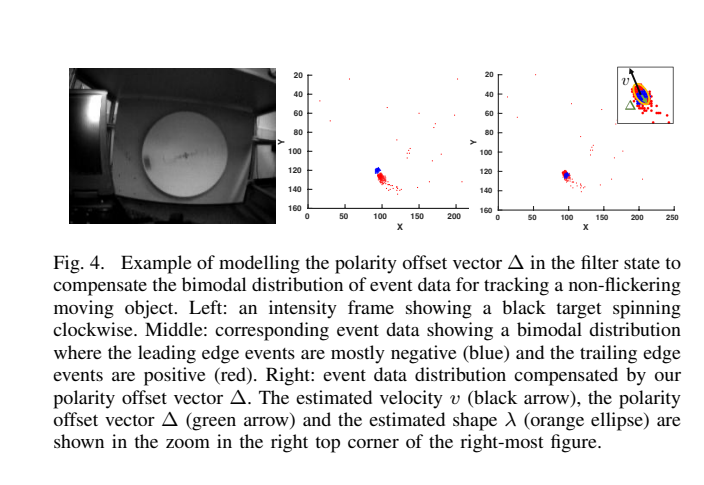

**读图要点：**左图为普通强度图；中图显示两种极性的空间分离；右图为补偿后分布，橙色椭圆表示估计形状。颜色与正负极性的对应可能因绘图约定变化，应以图注为准。

### 9.3 这一步的重要意义

基础模型把正负事件等同处理；扩展模型明确使用极性解释结构。因此不能概括为“本文始终丢弃极性”。同时，它只对特定的前后缘结构作简洁补偿，不是任意形状、任意多峰分布的通用解决方案。

## 10. 实验结果应该怎样解读

### 10.1 高速旋转目标

实验用白色旋转盘上的黑色目标，目标速度逐渐增大。Prophesee Gen4 事件相机分辨率为 $1280\times720$。算法没有被告知目标一定做圆周运动，主要使用局部匀速模型。

论文表 I 报告的可靠持续跟踪速度：

| 方法 | 该实验的最大速度（像素/秒） |
|---|---:|
| ACE | 914 |
| HASTE correction | 939 |
| HASTE correction* | 925 |
| HASTE difference | 992 |
| HASTE difference* | 1,476 |
| Prophesee | 2,620 |
| jAER | 9,830 |
| 本文 AEB Tracker | **>11,320** |

星号沿用论文表格中的算法变体名称。大于号表示在实验装置达到的高速范围内仍能跟踪，不能改写为算法理论上限恰为 11,320。

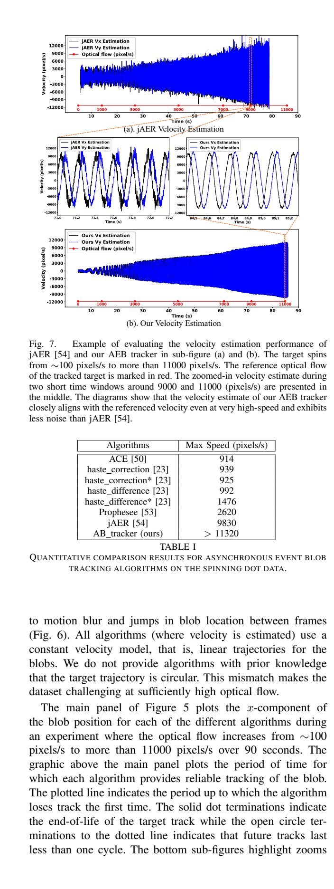

**读图要点：**速度曲线中本文估计在高速阶段仍较稳定；jAER 在这一测试中噪声更明显。比较口径也要保留：Prophesee 使用默认参数，jAER 在其作者协助下手动调参；角点/模板跟踪器与 blob 跟踪器任务表示不同。

因此，这组实验有力支持**特定高速 blob 场景的跟踪优势**，不支持“所有物体、所有背景、所有参数下均优于所有方法”。这里单位为像素/秒，也不是车辆的米/秒或公里/小时。

### 10.2 快速相机运动与 IMU

手持相机快速晃动，目标在图像中发生急剧方向变化。比较有无陀螺仪补偿：使用 IMU 后，滞后和转向过冲减少，某些导致无 IMU 版本丢失的片段仍能保持跟踪。

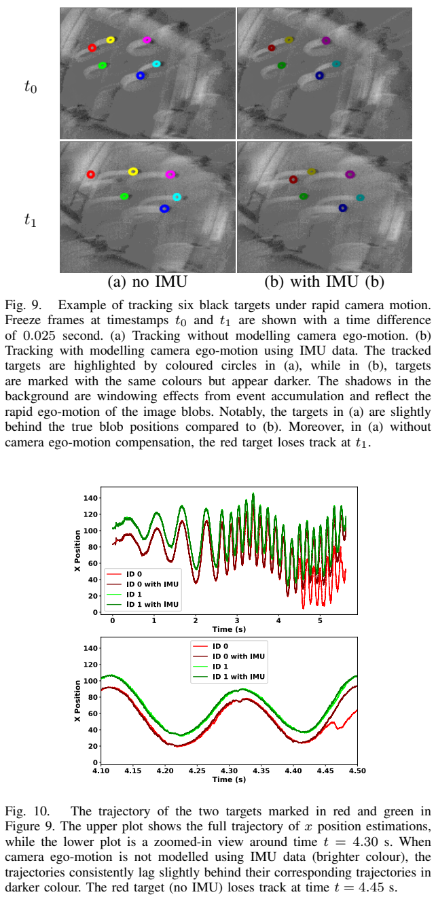

这验证了旋转运动先验的帮助，但没有提供完整六自由度运动补偿的证据。

### 10.3 夜间尾灯

论文跟踪多辆车尾灯，并由左右尾灯的位置和速度估计 TTC。LED 的闪烁使事件率很高，报告了超过 100 kHz 的更新。

作者还调整了相机 bias，以保留高频 LED 事件并减少背景自运动事件，提高信噪比。**这项结果需要连同场景、LED 特性和传感器设置一起理解。**

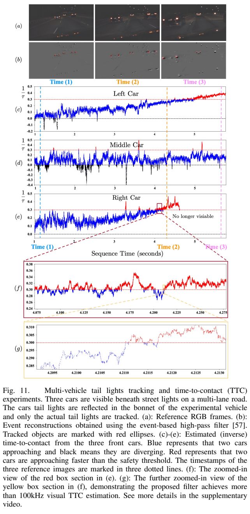

### 10.4 无人机与测距

无人机案例展示了复杂背景、不同照明和相机运动条件下的跟踪。论文给出的图像速度平均约 150 像素/秒，快速翻转等动作可达约 400 像素/秒，不能把旋转盘的 11,000 以上像素/秒直接移用为无人机实验速度。

测距例子中，无人机从约 17 米接近到不足 8 米。滤波更新超过 50 kHz，但 RTK-GPS 参考只有 5 Hz。

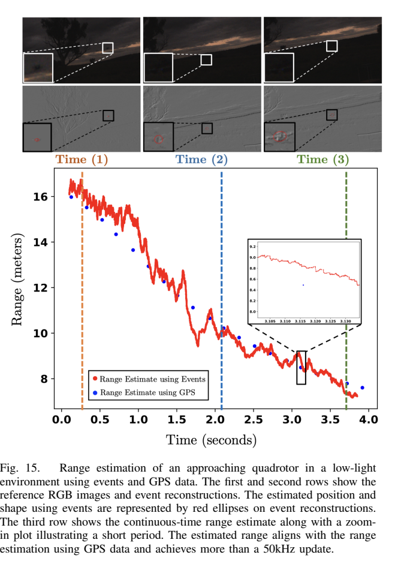

它支持距离趋势和应用可行性的展示；缺少足够高频真值，无法证明每个 50 kHz 输出都具有已知的瞬时误差水平。

### 10.5 最能解释核心贡献的消融

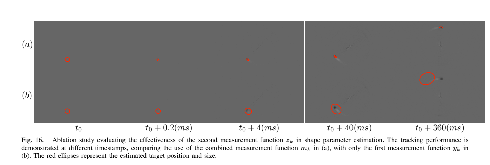

- 上排 (a)：使用联合观测，初始较大椭圆收缩并持续跟随目标；
- 下排 (b)：仅第一观测，尺寸逐渐增大，最后丢失目标。

这是理解“为什么需要第二观测”的最直接实验。它说明该约束在此案例中很重要，但不是对所有条件下形状全局可观测性的数学证明。

### 10.6 更新率、延迟、带宽、精度要分开


如果某目标每秒产生 100,000 个有效事件、每个事件更新一次，那么平均输出更新率约 100 kHz，平均间隔约 10 微秒。但其中还未包含传感器响应、传输、排队与运算的完整延迟。

相邻输出还共享状态和重叠历史缓存，因此高度相关。**输出 100,000 次，不等于每秒有 100,000 个相互独立、同等准确的完整目标观测。**

## 11. 下游应用：TTC 与距离

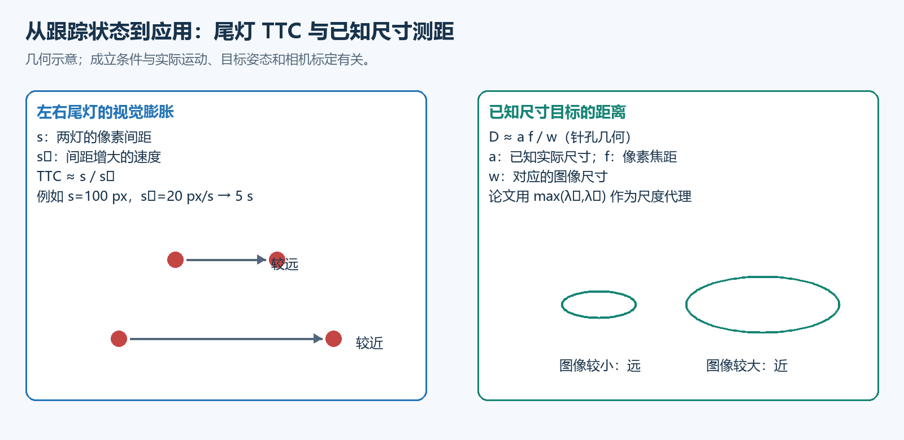

### 11.1 通过尾灯间距估计碰撞时间

设左右尾灯中心为 $p_L,p_R$，定义：

$$
d=p_L-p_R,\qquad s=\|d\|.
$$

两灯间距增长速度为：

$$
\dot s=\frac{d^\top(v_L-v_R)}{\|d\|}.
$$

若两灯的物理间距和投影关系可近似保持，视觉尺度约与距离成反比，在相对速度近似恒定的条件下：

$$
\tau=\frac{s}{\dot s},\qquad
\frac1\tau=\frac{d^\top(v_L-v_R)}{\|d\|^2}.
$$

例如 $s=100$ 像素、$\dot s=20$ 像素/秒，则 $\tau=5$ 秒。这是解释公式的数值示例，不是论文实验结果。

- 正逆 TTC 表示视觉上接近；负值表示视觉上远离；
- $\dot s$ 接近零时直接计算 $\tau$ 很不稳定，因此常使用逆 TTC；
- 正确的左右尾灯配对非常关键；
- 转弯、姿态变化、相机晃动和遮挡都可能改变图像间距，使简单接近解释失真。

正文使用的 $v_L,v_R$ 应按实际像素运动含义一致地使用；若启用了分离自运动的预测，应注意总像素速度与内部速度状态的区别。

论文例示的逆 TTC 阈值 $0.3\ \mathrm{s}^{-1}$ 对应约 3.3 秒，仅是展示选择，不能作为所有车辆系统通用的安全阈值。

### 11.2 利用已知尺寸估计距离

针孔相机的简单关系为：

$$
w\approx\frac{fa}{D}\quad\Rightarrow\quad D\approx\frac{fa}{w}.
$$

其中 $a$ 为实际尺寸，$f$ 为以像素计的焦距，$w$ 为对应的像素尺寸。论文式 (39) 使用：

$$
\mathrm{Range}=\frac{af}{\max(\lambda_1,\lambda_2)}.
$$

这里必须核对从统计尺度到实际图像直径的对应关系：高斯尺度不是天然等于物体直径。迁移到新目标时，可能需要标定比例，统一尺寸定义，并检查目标姿态、事件产生部位和传感器设置造成的变化。

它需要实际尺寸先验与相机标定，不是无尺寸先验的单目绝对测距，也没有单独恢复完整三维姿态。

## 12. 复现要点、局限与公式核对

### 12.1 实现前应确认的事项

| 类别 | 要确认的内容 | 常见后果 |
|---|---|---|
| 时间 | 时间戳单位、排序、回绕、重复时间、IMU 对齐 | 速度量级错误、预测跳变 |
| 几何 | 图像坐标、主点、焦距、相机—IMU 外参 | 自运动补偿方向错误 |
| 极性 | 数据编码如何映射到 $\pm1$ | 极性补偿把两簇进一步拉开 |
| 初始化 | 初始中心、尺度、$P_0$、缓存预热 | 初始目标被拒绝或估计发散 |
| 状态约束 | 尺度正值、方向的周期、主轴交换 | 逆矩阵失效、角度无意义跳变 |
| 噪声 | $Q$、$R_m$、$\beta$ 的尺度与单位 | 过度平滑或过度追随噪声 |
| 关联 | 半径、目标冲突、异常事件 | 身份切换或被背景劫持 |
| 输出 | 有效事件率、实际运算耗时、延迟 | 误把离线高密度轨迹当成完整实时性能 |

### 12.2 数值实现建议：属于工程建议，不等同于论文已实现

- 计算增益时用线性方程求解替代显式求逆。
- 可采用 Joseph 形式维护协方差：$P=(I-KC)P^-(I-KC)^\top+KR_mK^\top$，并检查对称性与正定性。
- 对尺度正值设置明确保障，例如合适参数化或约束；改变参数化时雅可比也应改变。
- 对角度使用周期一致的处理方式，并单独测试近圆形目标。
- 用有限差分检查雅可比，特别是尺度导数与极性扩展部分。
- 高事件率时监测积压、丢事件和 CPU 占用；异步公式本身不能保证任意硬件都实时。

### 12.3 正文中值得核对的公式细节

以下是**阅读中发现的一致性疑点**，不是未经查验代码就认定算法无效。

**（1）式 (21) 与式 (23) 的噪声均值。** 式 (21) 写成 $z=G+v$、$v\sim\mathcal N(2n,4n)$，又令 $z\equiv2n$；而式 (23) 的联合噪声为零均值。若按字面同时采用，会重复引入 $2n$。与“$G$ 应围绕 $2n$ 波动”的解释一致的实现，应让创新围绕 $2n-G$，而不是再次额外叠加 $2n$。最终需核对作者代码与版本。

**（2）式 (19) 的 $\beta$ 缩放与方差描述。** 正文写有 $1/(1+\beta)$ 的幅度缩放，但随后方差分解的叙述并不能仅由该幅度缩放直接推出。一般地，随机变量乘以 $c$，协方差应乘以 $c^2$。应对照原始 PDF、代码以及归一化后的经验协方差确认，而不自行把它改成某个“看起来正确”的公式后仍声称忠实复现。

**（3）式 (34a) 的状态传播。** 正文用 $(I+\delta A)\hat x$ 的矩阵式描述预测；无 IMU 的线性匀速情形比较直接。有非线性 $f_p$ 时，雅可比 $A$ 只描述局部扰动，不通常满足 $f(x)=Ax$。应直接积分完整确定性运动函数，并核对原代码如何处理仿射和非线性项。

**（4）卡方到高斯的近似。** 理论论述使用“$n$ 足够大”，实现却常用 $n<10$。小缓存的时间响应有优势，但应量化小样本偏斜、重叠缓存相关性和估计尺度偏差。

**（5）尺度与物理直径。** 明确 $\lambda$、绘制椭圆半轴与真实目标图像尺寸的换算，避免距离存在固定比例偏差。

这些核对事项的价值在于帮助复现和解释结果，不应掩盖论文通过实验展示的有效性。

### 12.4 论文明确或实际存在的限制

1. **表示范围有限：**单个高斯斑块及其极性扩展不能描述所有物体和任意多峰结构。
2. **依赖事件信息：**目标静止、对比度不足或事件被传感器设置抑制时，无法保持相同测量更新密度。
3. **关联较简单：**目标交叉、相机剧烈转动和高纹理背景可能造成误关联。
4. **缺少完整自动检测链：**初始化、重新发现、遮挡恢复不是本文已解决的通用能力。
5. **高频真值不足：**高频输出与高频误差验证之间存在证据差距。
6. **速度场景不同：**旋转盘的高速结果、夜间尾灯的高事件率和无人机的真实运动案例应分别汇报。

### 12.5 建议怎样验证自己的复现？

按由简到难的顺序：

1. **合成单高斯事件：**已知中心、速度与尺度，检查滤波能否收敛，避免一开始就被真实数据噪声混淆。
2. **第一项与联合观测消融：**复查尺度膨胀现象与第二观测收益。
3. **双峰事件：**检查 $\rho\Delta$ 的符号、$2\Delta$ 的簇间距与补偿后分布。
4. **作者高速数据：**使用一致的初始化、参数和丢失判据比较轨迹与速度。
5. **相机运动与多目标：**分别测量 IMU 收益、身份切换、遮挡与重捕获。
6. **独立计时：**报告每事件运算时间、可持续吞吐、积压和端到端延迟。

评估应至少区分位置误差、速度误差、尺度误差、跟踪保持率、身份切换与恢复时间。若只知道低频真值，就明确其能验证的时间尺度。

## 13. 阅读地图、术语和自测

### 13.1 回看原文时最值得看的位置

| 原文位置 | 学习重点 |
|---|---|
| 第 1～2 页，摘要与引言 | 输入输出、贡献和应用范围 |
| 第 3 页，式 (1)～(2)、图 2 | event blob 的统计含义 |
| 第 4 页，式 (4)～(8)、图 3 | 事件生成、8 维状态、可选 IMU |
| 第 5～6 页，式 (14)～(24) | 两类伪观测，是理论核心 |
| 第 6 页，式 (25)～(28) | 联合 EKF 校正 |
| 第 7 页，式 (29)～(30) | 初始化、关联与多目标 |
| 第 8 页，式 (31)～(34)、图 4 | 极性补偿、积分和复杂度 |
| 第 9～11 页，图 5～10、表 I | 高速与自运动实验 |
| 第 12～15 页，式 (35)～(39) | TTC、无人机与测距 |
| 第 15～16 页，局限、附录与图 16 | 能力边界、雅可比和消融 |

### 13.2 关键术语

| 英文 | 中文 | 在本文中的含义 |
|---|---|---|
| Asynchronous | 异步 | 以各事件的真实到达时间进行预测和更新 |
| Event blob | 事件斑块 | 空间条件分布呈斑块状的一类事件源 |
| Generative model | 生成模型 | 用状态和随机变量解释事件位置怎样产生 |
| Pseudo measurement | 伪观测 | 将已有数据转换成可用于滤波的统计约束 |
| Innovation | 创新、观测残差 | 观测目标减去预测观测 |
| Observability | 可观测性 | 能否从观测及动态关系辨别状态 |
| Data association | 数据关联 | 判断一个事件属于哪个目标 |
| Ego-motion | 自运动 | 相机自身运动引起的图像变化 |
| Polarity offset | 极性偏移 | 描述正负事件簇相对共同中心的偏移 |
| Time-to-contact | 接触/碰撞时间 | 在适用运动假设下，距离闭合所需时间 |

### 13.3 能回答这些问题，就掌握了主线

1. **单个事件是不是物体中心？**不是，它只是一次亮度变化的位置。
2. **为什么非闪烁物体也会产生事件？**它的运动让固定像素看到的亮度变化。
3. **双峰是什么意思？**前后缘在空间上形成两簇事件，通常极性相反。
4. **$\Lambda$ 和 $P$ 有什么区别？**前者描述事件分布形状，后者描述状态估计不确定性。
5. **第一伪观测为什么不够？**减小归一化偏差既可移动中心，也可膨胀尺度。
6. **第二伪观测为什么使用 $2n$？**$n$ 个二维标准高斯变量的平方范数和期望为 $2n$。
7. **为什么历史事件要减各自历史中心？**否则目标运动被错误计入目标尺寸。
8. **为什么有缓存仍叫逐事件？**每个有效事件均可触发新输出，缓存只用于额外统计约束。
9. **$\Delta$ 是两个峰之间的全部距离吗？**不是，两簇中心差约为 $2\Delta$。
10. **100 kHz 是否等于 10 微秒端到端延迟？**不等于，前者只是更新频度。
11. **测距是否需要目标大小？**需要，还要核对统计尺度到物理尺寸的对应。
12. **本文是否完成通用检测与跟踪系统？**没有，自动检测和复杂关联仍需补足。

### 13.4 可用于汇报的一段概括

> 本文提出 AEB Tracker，将目标事件位置表示为具有时变中心和形状的高斯分布，并通过异步 EKF 联合估计位置、速度、方向与尺度。方法用归一化位置偏差和历史事件的卡方统计量构造两类伪观测，缓解仅凭位置偏差导致的尺度膨胀；对非闪烁物体再以极性偏移补偿前后边缘双峰。实验展示了高速旋转目标、快速相机运动、夜间尾灯和无人机跟踪，以及 TTC 与测距应用。其局限主要在简单数据关联、手动初始化、分布建模范围和高频真值验证不足。

## 14. 参考资料与配图索引

### 14.1 论文与代码入口

- 原论文 DOI：[10.1109/TRO.2024.3454410](https://doi.org/10.1109/TRO.2024.3454410)。
- 预印本：[arXiv:2307.10593](https://arxiv.org/abs/2307.10593)。本指南以本地 v3 作者版本为准。
- 论文列出的代码与数据入口：[ziweiwwang/AEB-Tracker](https://github.com/ziweiwwang/AEB-Tracker)。本次未审查其当前代码，文中的公式疑点需在正式复现时核对。

### 14.2 图像来源

| 配图 | 来源与作用 |
|---|---|
| 中文图 01～07 | 本指南原创教学示意，解释事件、双峰、椭圆、尺度约束、算法流程、性能指标和应用 |
| 论文图 2 | PDF 第 3 页，展示实际事件 blob |
| 论文图 3 | PDF 第 4 页，算法框架 |
| 论文图 4 | PDF 第 8 页，极性补偿 |
| 论文图 7、表 I | PDF 第 10 页，高速与速度估计结果 |
| 论文图 9、10 | PDF 第 11 页，IMU 对照 |
| 论文图 11 | PDF 第 12 页，尾灯 TTC |
| 论文图 15 | PDF 第 15 页，无人机测距 |
| 论文图 16 | PDF 第 16 页，第二观测的消融证据 |

原论文图像版权归原作者及相应出版方，本指南用于个人阅读、学习与原文对照。


## 15. 与近眼注视追踪论文放在一起看

| 对比项 | 近眼注视追踪 | AEB Tracker |
| --- | --- | --- |
| 目标表示 | 瞳孔边界的二次曲线 | 目标事件位置的高斯分布 |
| 核心输入 | 灰度帧与事件 | 事件，可选陀螺仪 |
| 更新方法 | 带遗忘的最小二乘统计量 | 运动预测与双伪观测 EKF |
| 历史信息 | 小矩阵和向量 | 状态、协方差及短事件缓存 |
| 恢复线索 | 新帧可以重新提供定位 | 仍依赖关联与初始化，不能假设自动重捕获 |
| 下游任务 | 个人标定后的屏幕注视点 | 目标速度、TTC 和已知尺寸测距 |

两者虽然都画椭圆，但含义不同：瞳孔椭圆近似的是边界，AEB 椭圆描述的是事件散布尺度。不能把前者的轮廓拟合残差直接当成后者的概率模型，也不能把后者的高斯尺度不经标定就当作瞳孔或物体直径。

共同的启发是：单个事件不足以独立确定完整目标，必须利用历史和模型；高频更新的价值也需要用误差、延迟与恢复能力共同衡量。可结合[近眼注视追踪文章](/posts/event-based-gaze-tracking/)的标定与更新率讨论交叉阅读。

## 16. 论文效果分析与总结

论文最有价值的成果是：**直接利用异步事件，同时估计目标的位置、速度和形状，并在高速、弱光及相机运动场景下展示了跟踪能力。**

### 16.1 主要取得了哪些效果？

| 实验 | 论文报告的结果 | 可以得出的结论 |
| --- | --- | --- |
| 高速旋转目标 | 持续跟踪速度 **超过 11,320 像素/秒**；同一实验中 jAER 为 9,830，Prophesee 为 2,620 | 对该类高速斑块目标，跟踪保持能力较强；11,320 不是理论速度上限 |
| 相机快速运动 | 加入陀螺仪后，转向滞后和过冲减小，部分原本丢失的片段能够继续跟踪 | 相机旋转先验能改善预测，但不等于完成全部六自由度运动补偿 |
| 夜间车辆尾灯 | 更新率超过 **100 kHz**，进一步估计碰撞时间 TTC | 能利用高频闪烁事件提供密集状态更新；结果依赖 LED 特性及传感器设置 |
| 无人机接近与测距 | 展示了约 **17 米至不足 8 米**的接近过程，更新率超过 **50 kHz** | 支持已知目标尺寸条件下的测距可行性，但不能证明每次高频输出都同样准确 |

上述结果对应原论文表 I、图 9—11 和图 15，具体实验条件见本文第 10 节。

这里尤其要区分：**更新率高，不等于端到端延迟低，也不等于精度高。** 无人机测距的 RTK-GPS 参考只有 5 Hz，无法逐一验证 50 kHz 输出的瞬时误差。

### 16.2 为什么能取得这些效果？

**第一，更新及时。** 每个有效关联事件都可以触发滤波，减少等待固定时间窗口结束的需要。不过，第二类观测仍使用短历史缓存，算法并非完全没有时间聚合。

**第二，同时约束位置和尺度。** 这是论文最重要的算法贡献。仅使用第一类观测时，滤波器可能通过不断放大椭圆来减小归一化残差。第二类观测约束事件的整体分散程度，缓解了这个问题。

图 16 的消融实验最直接地支持这一点：

- 使用两类观测：初始较大的椭圆收缩，并持续跟踪目标。
- 仅使用第一类观测：尺度逐渐膨胀，最终丢失目标。

**第三，针对非闪烁物体补偿极性分布。** 正负事件常集中在运动物体的不同边缘。引入极性偏移后，可以减少模型在前后边缘之间摆动的问题。

### 16.3 如何评价论文的贡献与局限？

论文较有力地证明了：**对能形成紧凑事件斑块的目标，合理的统计模型与异步滤波，可以实现高速跟踪，并为速度、TTC 和距离估计提供输入。**

但它还不是通用目标跟踪系统：初始化、目标交叉时的关联、遮挡后的重捕获，以及复杂形状的表示仍有不足。高速实验中的优势，也不能直接推广到所有目标和背景。

### 16.4 总结

> AEB-Tracker 将事件斑块表示为动态高斯分布，通过双伪观测异步 EKF 联合估计位置、速度和形状。实验展示了高速跟踪、旋转自运动补偿及高频下游估计的潜力，其中尺度约束消融为核心设计提供了直接证据。其主要局限在于目标表示和数据关联较简单，以及高频输出缺少同等频率的独立真值验证。

原论文图片与数据的权利归原权利人所有，不适用本站默认文章许可。
