相机标定的核心是确定一个投影函数：**给定空间点和相机位姿，它应当落在哪个像素？** 张正友法用多张平面标定板图像约束这个函数，DLT 用已知三维点约束它，自标定则利用多张图像之间的对应关系。双目、手眼和相机–IMU 标定还要求出设备之间的坐标变换。

| 参数 | 含义 | 典型用途 |
|---|---|---|
| 内参 $K$ | 像素单位的焦距 $f_x,f_y$，主点 $c_x,c_y$，以及通常设为零的轴间斜切项 | 把像素转换成相机坐标系中的视线 |
| 畸变参数 $D$ | 描述实际镜头的投影如何偏离理想模型，例如径向畸变和切向畸变 | 去畸变、提高边缘区域的投影精度 |
| 外参 $R,t$ | 两个坐标系之间的旋转和平移 | 把标定板、另一台相机、机械臂或 IMU 的坐标转换到指定坐标系 |

> 全文配图用于说明投影、坐标变换和残差等几何关系。图中的点位和误差为示意值。

## 阅读路线

- 第 1–2 节从针孔投影和畸变出发，推导张正友法如何用不同姿态的平面靶标求内参。
- 第 3–5 节介绍立体靶标、多视图与消失点，以及双目、手眼和相机–IMU 标定各自求解的参数。
- 第 6 节给出采集和验收步骤。第 7 节结合 FreeMoCap，串起 ChArUco 角点检测后的标定、束调整和三维重建。

## 1. 针孔投影、内参和畸变

### 从三维点到像素

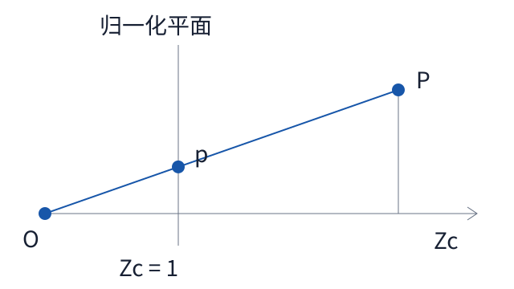

*图 1　针孔投影*

图中光心 $O$、归一化像点 $p$ 和空间点 $P$ 在同一直线上。设三维点的世界坐标为 $\mathbf X_w$，先通过外参将它变换到相机坐标系，再用相似三角形得到归一化坐标：

$$
\begin{aligned}
&\mathbf X_c=
\begin{bmatrix}X_c\\Y_c\\Z_c\end{bmatrix}
=R\mathbf X_w+t,  \\
&x=\frac{X_c}{Z_c}, \\
&y=\frac{Y_c}{Z_c}.
\end{aligned}
$$

将归一化坐标映射到像素，得到：

$$
\begin{aligned}
&K=
\begin{bmatrix}
f_x & \gamma & c_x\\
0 & f_y & c_y\\
0 & 0 & 1
\end{bmatrix},  \\
&\begin{bmatrix}u\\v\\1\end{bmatrix}
=K\begin{bmatrix}x\\y\\1\end{bmatrix}.
\end{aligned}
$$

其中 $f_x,f_y$ 以像素为单位，$(c_x,c_y)$ 是主点，$\gamma$ 是斜切项，常规 OpenCV 针孔模型将其设为零。将前两步合并，可写成齐次形式：

$$
Z_c
\begin{bmatrix}u\\v\\1\end{bmatrix}
=K[R\mid t]
\begin{bmatrix}X_w\\Y_w\\Z_w\\1\end{bmatrix}.
$$

这里的 $R,t$ 表示**世界到相机**的变换。若要的是相机光心在世界坐标系中的位置，将 $\mathbf X_c=0$ 代入即可得到 $\mathbf C_w=-R^\top t$。这个方向区别在机械臂和多传感器标定中尤其重要。

### 普通镜头的径向与切向畸变

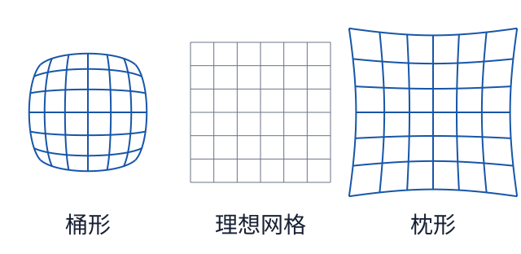

*图 2　径向畸变网格*

三张网格采用相同坐标比例。图中只改变一阶径向系数 $k_1$，负值产生桶形畸变，正值产生枕形畸变。常用的五参数模型写作：

$$
\begin{aligned}
&r^2=x^2+y^2, \\
&L(r)=1+k_1r^2+k_2r^4+k_3r^6,
\end{aligned}
$$

$$
\begin{aligned}
&x_d=xL(r)+2p_1xy+p_2(r^2+2x^2),\\
&y_d=yL(r)+p_1(r^2+2y^2)+2p_2xy,\\
&u=f_xx_d+c_x, \\
&v=f_yy_d+c_y.
\end{aligned}
$$

$k_1,k_2,k_3$ 控制径向缩放，$p_1,p_2$ 控制切向偏移。OpenCV 常用的五参数顺序是 $(k_1,k_2,p_1,p_2,k_3)$。由于径向项包含 $r^2,r^4,r^6$，**靠近中心的点对畸变参数约束较弱**。如果标定板始终出现在图像中央，即使拟合误差小，边缘的去畸变结果也可能偏差较大。

### 鱼眼镜头的角度模型

鱼眼常用入射角 $\theta$ 描述成像半径。以 OpenCV 的鱼眼模型为例，先取 $x=X_c/Z_c,\ y=Y_c/Z_c$，再计算：

$$
\begin{aligned}
&r=\sqrt{x^2+y^2}, \\
&\theta=\arctan r,
\end{aligned}
$$

$$
\begin{aligned}
&\theta_d=\theta(1+k_1\theta^2+k_2\theta^4+k_3\theta^6+k_4\theta^8),  \\
&(x_d,y_d)=\frac{\theta_d}{r}(x,y).
\end{aligned}
$$

光轴处取连续极限。直观上，理想针孔的归一化半径按 $\tan\theta$ 增长，鱼眼模型在畸变系数为零时按 $\theta$ 增长。标定时仍可使用多姿态平面板，区别在于优化所用的投影函数。

## 2. 张正友标定法｜从平面单应推导内参

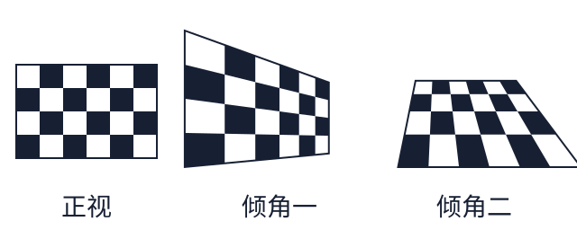

*图 3　标定板的三种姿态*

**同一块板以不同倾角拍摄，每张图提供两条关于同一组内参的约束。** 棋盘格、圆点阵列和 ChArUco 都能提供板面坐标与像素的对应关系。

#### 标定板角点应该覆盖哪里

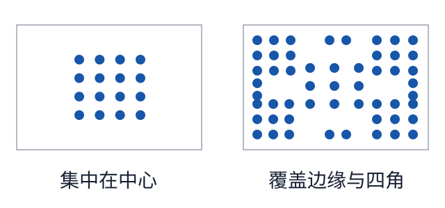

*图 4　角点覆盖*

每个框叠加了多张照片的角点。右图在中心、边缘和四角都有采样，能更好地约束畸变。**覆盖画面**靠改变板的位置和距离，**约束内参**还需要改变板面的倾角。

### 第一步：每张图求一个单应矩阵

把标定板定义为 $Z_w=0$。先忽略畸变，令旋转矩阵 $R=[r_1\ r_2\ r_3]$，则：

$$
s\begin{bmatrix}u\\v\\1\end{bmatrix}
=K[r_1\ r_2\ t]\begin{bmatrix}X\\Y\\1\end{bmatrix}
=H\begin{bmatrix}X\\Y\\1\end{bmatrix}.
$$

设 $H$ 的三行为 $a^\top,b^\top,c^\top$，板面齐次坐标为 $\mathbf m=(X,Y,1)^\top$。消去尺度 $s$，每个角点给出两个线性方程：

$$
\begin{aligned}
&(a^\top-u c^\top)\mathbf m=0,  \\
&(b^\top-v c^\top)\mathbf m=0.
\end{aligned}
$$

$H$ 去掉整体尺度后有 8 个自由度。理想情况下，4 对满足无三点共线的对应点就足以求解。实际使用整张板的可见角点，对板面点和像点分别平移到零均值，再将它们到原点的平均距离缩放为根号 2。用归一化后的点构造线性方程，用 SVD 取最小奇异值对应的右奇异向量，重排为单应矩阵，然后撤销两边的归一化。

### 第二步：用旋转列的正交约束求 $K$

写成 $H=[h_1\ h_2\ h_3]$。由于 $K^{-1}h_1$ 和 $K^{-1}h_2$ 分别与 $r_1,r_2$ 成同一比例，而 $r_1^\top r_2=0$、$\|r_1\|=\|r_2\|=1$，令

$$
B=K^{-\top}K^{-1},
$$

便得到每张图的两条约束：

$$
\begin{aligned}
&h_1^\top B h_2=0, \\
&h_1^\top B h_1-h_2^\top B h_2=0
\end{aligned}
$$

它们对 $B$ 的元素是**线性的**。例如，对任意 $h_i=(a_i,b_i,c_i)^\top$、$h_j=(a_j,b_j,c_j)^\top$，有：

$$
\begin{aligned}
h_i^\top B h_j={}&
a_i a_j B_{11}
+(a_i b_j+b_i a_j)B_{12}
+b_i b_j B_{22}\\
&+(a_i c_j+c_i a_j)B_{13}
+(b_i c_j+c_i b_j)B_{23}
+c_i c_j B_{33}.
\end{aligned}
$$

$B$ 对称，有 6 个独立元素，且只能确定到整体尺度。对一般五参数内参模型，理论上至少需要 **3 张提供独立约束的图**。如果标定板朝向固定，只在画面中平移，主要变化的是 $h_3$，而上面的内参约束只依赖 $h_1,h_2$。这就是**移动板的位置可以改善角点覆盖，改变板的倾角才能补充这部分内参约束**的原因。

将各视图的方程堆叠后用 SVD 求 $B$。在无噪声模型下，$B$ 可选取正定的尺度符号。若估计出的 $B$ 正定，可用上三角 Cholesky 分解 $B=U^\top U$，得到 $K\propto U^{-1}$，再令 $K_{33}=1$。

### 第三步：恢复每张图的外参，并联合优化

有了 $K$，可从单应矩阵恢复每张图的位姿初值：

$$
\begin{aligned}
&|\lambda|=\frac{1}{\|K^{-1}h_1\|},  \\
&r_1=\lambda K^{-1}h_1, \\
&r_2=\lambda K^{-1}h_2, \\
&r_3=r_1\times r_2, \\
&t=\lambda K^{-1}h_3.
\end{aligned}
$$

选择使板上点位于相机前方的符号。受噪声影响，初算的 $R$ 可能略微偏离旋转矩阵，可用 SVD 投影到 $SO(3)$。最后加入畸变模型，以各角点的像素误差为目标联合优化：

$$
\min_{K,D,\{R_i,t_i\}}
\sum_i\sum_j
\left\|
\mathbf u_{ij}^{\mathrm{obs}}
-
\pi(K,D,R_i\mathbf X_j+t_i)
\right\|_2^2
$$

这里 $\mathbf X_j$ 是板上第 $j$ 个角点，$\pi$ 是前面推导的完整投影函数。线性步骤给出初值，最后一步直接拟合观测到的像素。

## 3. 三维 DLT 和 Tsai 法｜用已知空间点标定

### DLT：直接估计投影矩阵

设控制点 $\widetilde{\mathbf X}_j=(X_j,Y_j,Z_j,1)^\top$，投影矩阵 $P$ 的三行为 $p_1^\top,p_2^\top,p_3^\top$。每对 3D–2D 对应点给出：

$$
\begin{aligned}
&u_j=\frac{p_1^\top\widetilde{\mathbf X}_j}{p_3^\top\widetilde{\mathbf X}_j}, \\[0.7em]
&v_j=\frac{p_2^\top\widetilde{\mathbf X}_j}{p_3^\top\widetilde{\mathbf X}_j}.
\end{aligned}
$$

消去分母后，对每个点可构建两行：

$$
\begin{bmatrix}
\widetilde{\mathbf X}_j^\top & 0 & -u_j\widetilde{\mathbf X}_j^\top\\
0 & \widetilde{\mathbf X}_j^\top & -v_j\widetilde{\mathbf X}_j^\top
\end{bmatrix}
\begin{bmatrix}p_1\\p_2\\p_3\end{bmatrix}=0.
$$

将所有点堆叠成 $A\mathbf p=0$，取 $A$ 最小奇异值对应的右奇异向量。$P$ 有 12 个元素，去掉整体尺度后有 11 个自由度，因此至少需要 **6 对非退化的 3D–2D 对应点**。若全部控制点满足 $Z_j=0$，$P$ 中乘 $Z_j$ 的那一列就不会出现在方程里，完整 $P$ 无法确定。

有了 $P=[M\mid p_4]$，对 $M$ 做 RQ 分解得到 $M=KR$，统一符号和尺度后可求 $t=K^{-1}p_4$。三维 DLT 适合已有精密立体靶标的场景。镜头畸变明显时，可将 DLT 结果作为初值，再拟合带畸变的投影模型。

#### 三维 DLT 的点如何对应

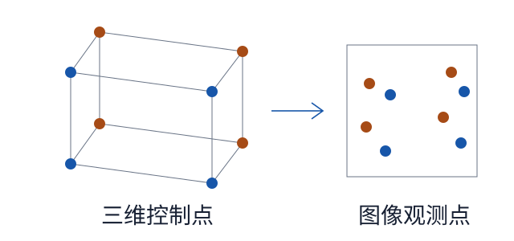

*图 5　三维控制点与二维像点*

左侧是位于两个深度平面的已知三维控制点，右侧是对应的二维像点。每组对应为投影矩阵 $P$ 提供两条线性方程。如果所有控制点都落在同一个平面上，一张图只能确定该平面到图像的单应关系。

### Tsai 法：利用径向对准约束

设 $(x_d,y_d)$ 是相对于畸变中心的观测坐标，已统一横纵轴的坐标尺度。纯径向畸变只改变点到中心的距离，因此观测方向与理想投影方向 $(X_c/Z_c,Y_c/Z_c)$ 共线：

$$
\det
\begin{bmatrix}
x_d & X_c/Z_c\\
y_d & Y_c/Z_c
\end{bmatrix}=0
\quad\Longrightarrow\quad
x_dY_c-y_dX_c=0.
$$

代入 $X_c=r_1^\top\mathbf X_w+t_x$、$Y_c=r_2^\top\mathbf X_w+t_y$，其中 $r_1^\top,r_2^\top$ 是 $R$ 的前两**行**，得到：

$$
x_d(r_2^\top\mathbf X_w+t_y)
-
y_d(r_1^\top\mathbf X_w+t_x)=0.
$$

这个方程消去了深度分母和径向缩放。第一阶段利用它估计旋转和平移的部分分量，第二阶段再利用完整投影关系估计有效焦距、沿光轴的平移 $t_z$ 和径向畸变等参数。

## 4. 无专用标定板｜多视图自标定与消失点法

### 多视图自标定

同一个空间点在两张图中的齐次像点 $\tilde{\mathbf u}_1,\tilde{\mathbf u}_2$ 满足极线约束：

$$
\tilde{\mathbf u}_2^\top F\tilde{\mathbf u}_1=0.
$$

若两帧共享同一组内参 $K$，且镜头畸变已处理，则：

$$
E=K^\top F K=[t]_\times R.
$$

其中 $[t]_\times v=t\times v$。从匹配点估计 $F$ 后，可以要求 $K^\top FK$ 具有本质矩阵的结构，即两个相等的非零奇异值和一个零奇异值。多对视图共同约束 $K$。经典自标定还可用 Kruppa 方程或多视图的绝对对偶二次曲面来表述。实际可恢复哪些参数，取决于内参先验、视角变化和场景结构。没有已知长度时，重建通常仍有全局尺度不确定性。

### 消失点法

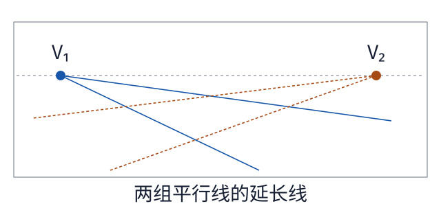

*图 6　两组平行线的消失点*

想象地面上的方砖。沿砖缝的两个方向各取一组平行线，延长后分别交于 $V_1$ 和 $V_2$。两组线在真实空间中正交，这个已知角度可以用来约束焦距。

平行线沿空间方向 $\mathbf d_i$ 延伸，其消失点满足 $\tilde{\mathbf v}_i\sim KR\mathbf d_i$。如果两组方向正交，则：

$$
\tilde{\mathbf v}_i^\top K^{-\top}K^{-1}\tilde{\mathbf v}_j=0.
$$

例如，已知主点 $(c_x,c_y)$，假设 $f_x=f_y=f$、斜切为零，两个有限消失点 $(u_i,v_i)$、$(u_j,v_j)$ 就给出：

$$
f^2=-
\big[(u_i-c_x)(u_j-c_x)+(v_i-c_y)(v_j-c_y)\big].
$$

因此，一张建筑或室内照片在满足这些假设时就可能估计焦距。这个推导只使用空间**方向**，平移 $t$ 没有进入方程。若还要恢复相机位置和尺度，需要已知点、尺寸或其他场景约束。

## 5. 双目、手眼与相机–IMU 标定

### 双目标定与深度

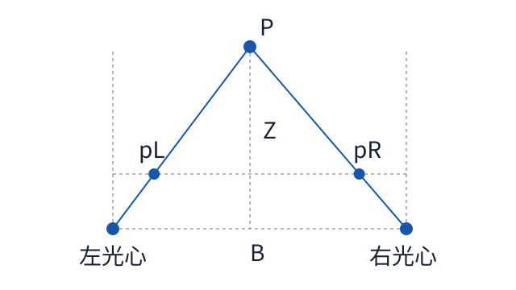

*图 7　双目测距*

双目标定要求左右相机的内参和畸变，以及左相机到右相机的固定变换 $\mathbf X_R=R_{RL}\mathbf X_L+t_{RL}$。标定后做立体校正。对于光轴平行、基线水平、校正后焦距和横向主点相同的情况，设基线长度为 $B$，空间点在左相机中的横坐标为 $X$，则：

$$
\begin{aligned}
&u_L=f\frac{X}{Z}+c_x, \\
&u_R=f\frac{X-B}{Z}+c_x.
\end{aligned}
$$

两式相减得到视差 $d=u_L-u_R$：

$$
\begin{aligned}
&d=\frac{fB}{Z}, \\
&Z=\frac{fB}{d}.
\end{aligned}
$$

一阶误差传播给出：

$$
|\Delta Z|\approx
\left|\frac{\partial Z}{\partial d}\right||\Delta d|
=\frac{Z^2}{fB}|\Delta d|.
$$

例如 $f=800$ 像素、$B=0.12$ m、视差误差为 $0.5$ 像素，在 2 m 处对应约 **2.1 cm** 的深度误差，在 5 m 处约为 **13 cm**。这里仅计算了视差误差的影响。

### 手眼标定

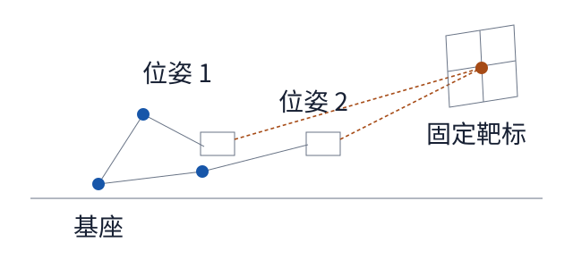

*图 8　手眼标定的两个位姿*

机械臂带着相机从位姿 1 移到位姿 2，两次都观测同一个固定靶标。机器人报告末端的运动，相机从靶标图像估计自身的运动，$AX=XB$ 用两种运动求相机与末端之间的固定变换。采集时应让末端绕不同轴转动。

以相机装在机械臂末端、标定板固定为例，记 ${}^{a}T_b$ 为从坐标系 $b$ 到 $a$ 的变换。第 $i$ 帧中，机器人给出 ${}^{b}T_{g_i}$，图像给出 ${}^{c_i}T_o$，所求为固定的相机到末端变换 $X={}^{g}T_c$。因为板相对基座固定：

$$
{}^{b}T_{g_i}X\,{}^{c_i}T_o
=
{}^{b}T_{g_j}X\,{}^{c_j}T_o.
$$

整理得到 $AX=XB$，其中：

$$
\begin{aligned}
&A=({}^{b}T_{g_j})^{-1}{}^{b}T_{g_i},  \\
&B={}^{c_j}T_o({}^{c_i}T_o)^{-1}.
\end{aligned}
$$

把齐次变换拆成旋转和平移：

$$
\begin{aligned}
&R_A R_X=R_X R_B, \\
&(R_A-I)t_X=R_Xt_B-t_A.
\end{aligned}
$$

这也解释了为何要让末端**绕不同轴转动**。单次旋转中，$R_A-I$ 在旋转轴方向上为零，该次运动无法约束 $t_X$ 沿该轴的分量。

### 相机–IMU 标定

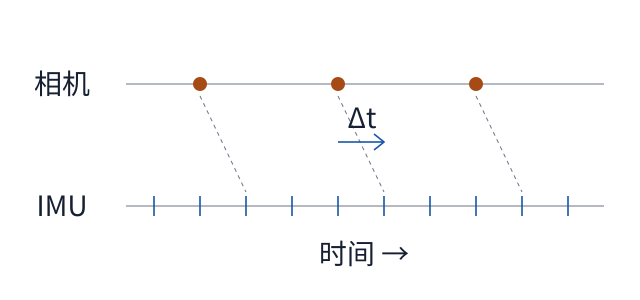

*图 9　相机与 IMU 时钟对齐*

圆点是相机曝光时刻，短刻线是更密集的 IMU 采样。斜虚线连接**同一个物理时刻**在两套时钟上的位置，横向间隔就是 $\Delta t$。对齐后，曝光时刻仍可能落在两次 IMU 采样之间，此时需要在该时刻计算轨迹位姿。

若 $T_{WI}(t)$ 表示时刻 $t$ 从 IMU 到世界的位姿，$T_{IC}$ 表示相机到 IMU 的固定变换，并约定相机时刻 $t_k$ 对应 IMU 时钟 $t_k+\Delta t$，则：

$$
T_{WC}(t_k)=T_{WI}(t_k+\Delta t)T_{IC}.
$$

世界点 $\mathbf X_j^W$ 的预测像素可写成：

$$
\widehat{\mathbf u}_{kj}
=
\pi\!\left(K,D,\ T_{WC}(t_k)^{-1}\mathbf X_j^W\right).
$$

视觉残差约束预测像素，陀螺仪和加速度计残差约束轨迹。联合优化可估计 $T_{IC}$ 和时间偏移 $\Delta t$。相机若几乎静止，改变 $\Delta t$ 对预测像素影响很小。采集时加入不同方向的转动和加减速，能提供更充分的约束。

## 6. 采集流程与结果验收

普通镜头可从刚性平面棋盘格或 ChArUco 板开始。实测格长，固定部署时的焦距、对焦、裁切和分辨率。可以先采集约 15–30 张清晰图像作为工程起点，依据覆盖和残差补采。棋盘格检测所填的行列数是**内角点数**。先为每个有效视图建立两组同序数组：以实际格长生成的靶标三维点，以及检测到的像素角点。将两组数组和图像宽高传入 `cv2.calibrateCamera`，返回全局重投影 RMS、内参、畸变，以及每张图各自的旋转和平移。棋盘格可用 `findChessboardCorners` 配合 `cornerSubPix` 检测和细化角点。ChArUco 板可用检测到的角点 ID 查找板上坐标，因此同一块板在不同帧可以使用不同的可见角点。已知内参和畸变、只需要估计一帧靶标位姿时，使用 `solvePnP`。固定工作平面上的测量也可以先去畸变，再用单应矩阵做二维坐标转换。

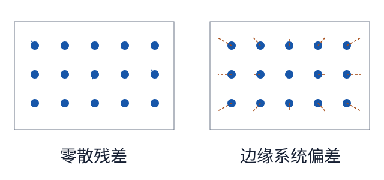

*图 10　重投影残差分布*

圆点表示模型预测的位置，短线末端表示检测到的位置。左图的残差方向较零散，右图的残差在边缘一致向外。即使两个标定结果的总体 RMS 接近，右图这种空间规律也值得回查镜头模型和边缘采样。

设全部角点共 $N$ 个，残差为 $\mathbf e_{ij}=\mathbf u_{ij}^{\mathrm{obs}}-\widehat{\mathbf u}_{ij}$。常看的指标是**每个点的二维像素距离 RMS**：

$$
\mathrm{RMS}=\sqrt{\frac{1}{N}\sum_{i,j}\|\mathbf e_{ij}\|_2^2}.
$$

实际验收可以依次看三件事：

1. **看误差分布。** 按图像和画面区域查看残差。单帧异常可回查模糊、反光或角点匹配。边缘出现成片同方向的残差时，检查镜头模型、标定板平整度和边缘采样。
2. **用独立图像验证。** 固定 $K,D$，对未参与拟合的图片只求板位姿，再检查重投影误差。采集验证图时覆盖实际工作的视角和距离。
3. **用已知尺寸验证物理尺度。** 如果真实格长是 25 mm，输入却是 24 mm，理想情况下平移、双目基线和由此计算的深度都会变为真实值的 $24/25=96\%$，而像素重投影误差可以几乎不变。做测距或定位时，还要直接测量毫米误差或深度误差。

## 7. FreeMoCap 如何从 ChArUco 视频得到多相机标定

以下以本文查阅的 FreeMoCap headless 代码副本为例。求解器默认值、阈值和输出字段以所用版本及配置为准。整个流程是 **按帧收集角点 → 初始化每台相机 → 用共同观测建立相机间关系 → 联合优化 → 保存标定 → 用于三维重建**。配置默认选择 **Anipose**，也可选择 **PyCeres**。两条路径使用同一块板和同一类观测，对板几何的处理方式有所不同。

### 7.1 输入：相机、同步帧和角点 ID

`run_posthoc_calibration_task` 接收已经按帧组织的各相机观测。它检查观测是否包含 ChArUco 检测结果，将有效角点整理为相机 ID、帧索引、角点 ID 和二维像素，并保存到 `output_data/charuco_observations.json`。角点 ID 用来查询板上的已知坐标。若单格边长为 $s$，第 $j$ 个角点在板坐标系中的位置可以写为：

$$
\mathbf X_j^B=(m_js,\ n_js,\ 0)^\top .
$$

$m_j,n_j$ 由板型定义给出。配置中的 `square_length_mm` 应填写实际打印并实测的单格边长，它为三维结果提供毫米尺度。录制时要让板在工作区域内移动、倾斜，并保证不同相机在同一物理时刻有共同观测。例如，A 与 B 共享一些有效帧，B 与 C 共享另一些有效帧，就可以通过 B 将 A、C 放进同一个坐标系。若某台相机与其余相机没有共同观测形成的连接，即使它单独看到了很多板角点，也缺少确定其相对位姿的约束。

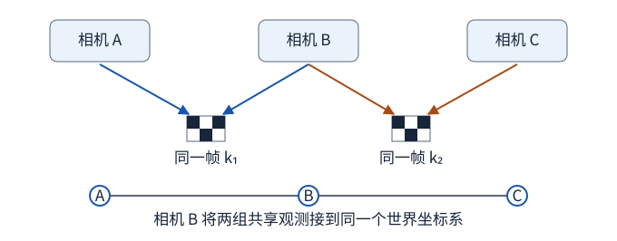

*图 11　A 和 C 可以在不同帧观测标定板。B 分别与它们共享有效帧，就能把两组相机间变换连起来。*

### 7.2 初值：先估计每台相机，再把相机连起来

1. **初始化内参。** Anipose 将观测转换成按相机、帧排列的表，逐台调用 `cv2.initCameraMatrix2D`，使用每帧至少 7 个匹配角点的视图初始化焦距和主点。PyCeres 调用 `cv2.calibrateCamera` 初始化每台相机的内参和畸变。这里的结果会作为后续联合求解的起点。
2. **估计板相对各相机的位姿。** 给定内参和一帧角点对应，`solvePnP` 求出板到相机的变换 $T_{cB_k}$。Anipose 路径使用的板位姿例程要求每帧至少 6 个匹配角点。
3. **用共享帧建立相机间变换。** 约定 $T_{ab}$ 把 $b$ 系坐标变到 $a$ 系。对于相机 $a,b$ 同时看到板的第 $k$ 帧，从 $a$ 到 $b$ 的变换可以通过板坐标系相接：

$$
T_{ba}=T_{bB_k}T_{aB_k}^{-1}.
$$

板在这一帧的摆放姿态被消去。利用多帧共享观测，可以初始化相机间的变换。Anipose 合并各相机的观测表，再根据共享板位姿计算外参初值。PyCeres 从相机两两之间的变换构造生成树，沿树将相机连到同一参考系，并用已初始化的相机外参将各帧板位姿转换到共同世界系。

### 7.3 束调整：两条求解路径怎样用标定板几何

设 $T_{cW}$ 是世界到相机的变换，$T_{WB_k}$ 是第 $k$ 帧板到世界的变换，$\pi$ 表示带畸变的像素投影。两条路径都希望同一个板角点在各相机中的预测像素与实测像素尽量接近。区别在于三维角点怎样进入优化。

**Anipose（默认）。** 先用当前相机参数对共同观测到的角点进行三角测量，得到每帧的三维点初值。随后把相机参数、这些三维点和每帧板位姿一起放进 SciPy `least_squares`。以 $\mathbf X_{kj}$ 表示作为优化变量的世界坐标，代码拼接两组残差：

$$
\begin{aligned}
&\mathbf e^{\mathrm{pix}}_{ckj}=\mathbf u_{ckj}-\pi(K_c,D_c,T_{cW}\widetilde{\mathbf X}_{kj}),\\
&\mathbf e^{\mathrm{board}}_{kj}=\frac{2}{s_0}\bigl(\mathbf X_{kj}-\mathbf X^{W,\mathrm{board}}_{kj}\bigr),\\
&\widetilde{\mathbf X}^{W,\mathrm{board}}_{kj}=T_{WB_k}\widetilde{\mathbf X}_j^B .
\end{aligned}
$$

波浪号表示齐次坐标。$s_0$ 是源码用于缩放板几何残差的最小正板坐标值。第一组残差让三维点投回各相机时贴近观测。第二组残差让这些点贴近按已知板尺寸和板位姿算出的世界位置，从而把板的尺度和形状引入优化。各轮依据重投影误差筛选角点。这个本地实现的相机参数块包含三维旋转向量、三维平移、一个由 $f_x,f_y$ 共用的焦距和一阶径向畸变 $k_1$，主点沿用初值。

**PyCeres（可选）。** 将已知板角点直接通过当帧板位姿变换到世界系，再变到相机系并投影。每条观测的残差为：

$$
\mathbf e^{\mathrm{pix}}_{ckj}
=\mathbf u_{ckj}-
\pi(K_c,D_c,T_{cW}T_{WB_k}\widetilde{\mathbf X}_j^B).
$$

这样同一帧所有角点都跟随同一个板位姿。Ceres 为相机位姿、各帧板位姿和允许调整的内参建立参数块，对像素残差使用 Huber 损失，并分轮剔除超过当前像素门限的观测。本地默认配置允许在这一步继续调整焦距，主点和畸变系数沿用初始化结果。

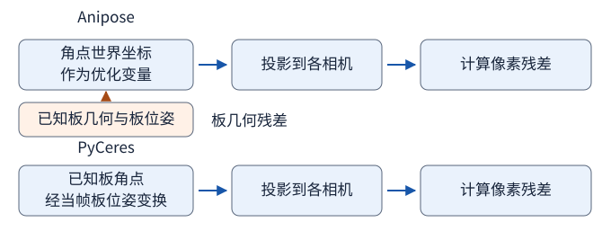

*图 12　上图中的 Anipose 对角点世界坐标单独求解，并用板几何残差约束它。下图中的 PyCeres 用当帧板位姿直接生成角点的世界坐标。*

### 7.4 输出：世界坐标系与标定文件

参考相机确定共同世界系的原点和朝向。启用地面对齐时，可用录制开始时平放的 ChArUco 板设置地面。无论选哪个求解器，最后都写成 Anipose 兼容的 TOML。每台相机的 `matrix` 保存内参，`distortions` 保存畸变，`rotation` 是世界到相机的 Rodrigues 旋转向量，`translation` 是同方向的平移。若把旋转向量转成矩阵 $R_c$，相机光心在世界系中的位置就是 $\mathbf C_c=-R_c^\top t_c$，对应文件里的 `world_position`。元数据还记录求解器、标定板规格和重投影误差。

### 7.5 重建：读取标定参数，逐帧三角测量

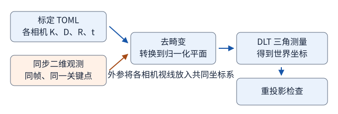

*图 13　内参与畸变用来校正二维观测。外参和校正后的像点一起进入 DLT，求出的三维点再投回图像检查误差。*

重建端可用 `Triangulator.from_anipose_calibration_toml` 读取相机模型。输入可以按相机 ID 提供，也可以是按相机、帧、关键点、像素坐标排列的四维数组。使用数组时，相机轴顺序要与标定对应。同一帧、同一关键点索引应指向同一时刻的同一物理点。对这些像素观测，FreeMoCap 先用 `cv2.undistortPoints` 把各相机像素转换为去畸变归一化坐标 $(x_c,y_c)$。此时用外参矩阵 $P_c=[R_c\mid t_c]$，每台相机提供两条约束：

$$
\begin{aligned}
&(x_c P_{c,3}-P_{c,1})\widetilde{\mathbf X}=0,  \\
&(y_c P_{c,3}-P_{c,2})\widetilde{\mathbf X}=0.
\end{aligned}
$$

堆叠后用 SVD 取最小奇异值对应的右奇异向量，得到齐次三维点，再除以第四分量恢复空间坐标。这里的 DLT **以已知相机求未知点**，第 3 节的 DLT 标定则**以已知点求未知相机矩阵**。

本地副本默认至少要有 2 台相机提供该点的有效观测。视角不足的点输出 `NaN`。默认启用的异常视角处理会先用全部可见相机三角测量，并在去畸变归一化平面上计算平均重投影距离。如果平均距离小于门限 $\tau=0.02$，直接使用该解。否则尝试去掉至多 2 个视角，且每个候选仍保留至少 2 台相机。每个候选用其保留视角的平均误差 $\bar e_s$ 计算权重：

$$
\begin{aligned}
&w_s=\exp(-5\bar e_s/\tau),  \\
&\widehat{\mathbf X}=\frac{\sum_s w_s\widehat{\mathbf X}_s}{\sum_s w_s}.
\end{aligned}
$$

候选包括全视角解。若权重和过小，代码回退到误差最低的候选。$\tau$ 的单位是归一化图像坐标，像素误差还取决于焦距。验证时可分别记录三维误差、像素重投影误差和丢点率。

### 7.6 扩展：将 NOKOV 与事件相机对齐

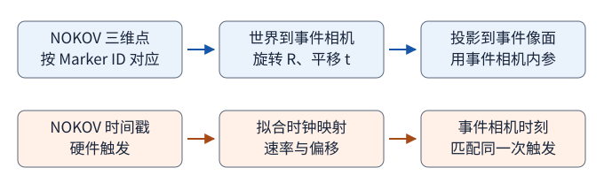

*图 14　上排确定三维点应投到哪个事件像素。下排确定应与哪个事件时刻的观测比较。*

这个方案还需要测出事件相机自身的内参和畸变、NOKOV 世界到事件相机的变换，以及两套设备的时钟关系。FreeMoCap 的 ChArUco 世界系由相机与靶标决定。要把它或 NOKOV 输出的点投到事件相机上，需要明确坐标系之间的转换。

**空间对齐。** 先用能可靠提取靶标角点的事件图像表示或设备的帧图像标定 $K_E,D_E$。再采集配对观测：同一 Marker ID 的 NOKOV 三维点 $\mathbf X_i^M$，以及同一物理时刻在事件图像中的像素 $\mathbf u_i^E$。使用空间分布充分的对应点，以 PnP 初始化并优化：

$$
(R_{EM}^*,t_{EM}^*)=
\underset{R\in SO(3),\,t\in\mathbb R^3}{\arg\min}
\sum_i\left\|\mathbf u_i^E-\pi(K_E,D_E,R\mathbf X_i^M+t)\right\|_2^2.
$$

将点和平移统一为米。此方案的辅助类 `WorldToEventCalibration` 接收事件相机内参、畸变、世界到相机的旋转和平移及图像尺寸。它使用已标定的参数把 NOKOV 三维点投到事件像面。求解外参所需的三维点与事件像点对应关系，需要由实测数据提供。

**时间对齐。** 对至少三对一一匹配、严格递增的共同触发时间，确认 NOKOV `iTimeStamp` 的单位后统一为纳秒。令 $x_i=t_i^M-t_0^M$，$y_i=t_i^E-t_0^E$，拟合 $y_i=a x_i+b$：

$$
\begin{aligned}
&a=\frac{\sum_i(x_i-\bar x)(y_i-\bar y)}
        {\sum_i(x_i-\bar x)^2},  \\
&b=\bar y-a\bar x,  \\
&t^E\simeq t_0^E+a(t^M-t_0^M)+b.
\end{aligned}
$$

$a$ 描述时钟速率之比，$b$ 是减去两边参考时刻后的偏移。可以用最大拟合残差 $\max_i \lvert y_i-a x_i-b\rvert$ 和漂移 $10^6\lvert a-1\rvert$ ppm 检查对齐质量。此方案的辅助函数 `fit_trigger_clock_map` 实现了这种计算和检查。本地函数默认要求最大拟合残差不超过 1 ms、走速差不超过 1000 ppm，两项都可以配置。应使用两台设备对同一触发记录的硬件时间戳。电脑收到 SDK 回调的时间会混入传输和调度延迟。

**接到高频三维估计。** 一台事件相机在一个时刻给出一条空间射线 $\mathbf C+\lambda\mathbf d$。要估计沿射线的深度 $\lambda$，可用 NOKOV 的低频三维状态作为运动先验，或用已知多点刚体几何补充约束。若有两台及以上已标定、已同步的事件相机，则可对同一时刻和同一 Marker ID 的二维估计复用 FreeMoCap 的三角测量。两种情况下都应留出独立实测数据检验三维误差和时间对齐质量。

### 本地源码阅读顺序

以下路径相对于所查阅的 headless 代码副本中的 `freemocap/core` 目录。各步骤所需的输入、公式和输出已在上文说明。

| 想核对的步骤 | 文件与入口 |
|---|---|
| 验证角点观测、选择求解器、保存结果 | `tasks/calibration/posthoc_calibration_task.py` 的 `run_posthoc_calibration_task` |
| Anipose 初始化及两类束调整残差 | `tasks/calibration/anipose_calibration/helpers/bundle_adjust.py` 的 `calibrate_cameras_from_rows`、`_error_fun_bundle` |
| PyCeres 初始化、优化及异常剔除 | `tasks/calibration/pyceres_calibration/pyceres_calibration_pipeline.py`、同目录下的 `helpers/solver.py` |
| TOML 的字段及读写 | `tasks/calibration/shared/calibration_result.py` 的 `dump_anipose_toml`、`load_anipose_toml` |
| 像素去畸变、DLT、异常视角处理 | `tasks/triangulation/triangulator.py`、同目录下的 `helpers/triangulate_simple.py` 和 `helpers/outlier_rejection.py` |

## 参考资料

### 相机模型与标定

- [OpenCV 相机标定、位姿估计与三维重建](https://docs.opencv.org/4.x/d9/d0c/group__calib3d.html)
- [OpenCV 鱼眼模型](https://docs.opencv.org/4.x/db/d58/group__calib3d__fisheye.html)
- [张正友平面标定论文](https://www.microsoft.com/en-us/research/wp-content/uploads/2016/02/tr98-71.pdf)
- [Tsai 原论文](https://doi.org/10.1109/JRA.1987.1087109)
- [Hartley 多视图自标定论文](https://users.cecs.anu.edu.au/~hartley/Papers/reconstruction/cvpr94/final/recon.pdf)
- [消失点标定论文](https://globals.ieice.org/en_transactions/information/10.1587/e74-d_10_3369/_p)
- [ETH Zurich Kalibr](https://github.com/ethz-asl/kalibr)

### FreeMoCap

- [FreeMoCap 后端标定文档](https://docs.freemocap.org/build/backend/)
- [FreeMoCap 标定教程](https://docs.freemocap.org/tutorials/calibrate/)
- [标定故障排查](https://docs.freemocap.org/guides/calibration-troubleshooting/)
- [FreeMoCap 标定架构](https://github.com/freemocap/freemocap/blob/main/freemocap-docs/docs/architecture/backend-calibration.mdx)
- [FreeMoCap 标定原理](https://docs.freemocap.org/concepts/calibration/)
