**相关阅读：** [事件视觉基础](/posts/event-vision-basics/) · [AEB-Tracker 论文精读](/posts/aeb-tracker-paper/)。建议先掌握事件、时间窗口与时空相关性，再阅读本文。

> 论文：**Event-Based Near-Eye Gaze Tracking Beyond 10,000 Hz**  
> 作者：Anastasios N. Angelopoulos、Julien N. P. Martel、Amit P. Kohli、Jörg Conradt、Gordon Wetzstein  
> 阅读版本：Zotero 中的英文原文，arXiv:2004.03577v3，2022 年 8 月 8 日，共 12 页（含附录）。期刊论文 DOI 为 10.1109/TVCG.2021.3067784。  
> 本次整理核对了原论文的拟合算法、实验图与附录，并按“先理解任务，再理解公式，最后判断证据”的顺序编排。页码均指上述英文 PDF 页码。  
> 图像来源：标为“原图”的图片摘自论文并保留图注；标为“讲解图”的图片为本指南绘制。文中的“阅读分析”“实现建议”与作者实际报告的结果明确区分。

## 阅读路线

1. **先看第 1–4 节**：弄清系统输入、输出，以及帧和事件各负责什么。
2. **再看第 5–8 节**：理解 5 个参数、固定存储、递推融合和 Algorithm 1。
3. **结合第 9–12 节看原图**：理解标定、实验、图 7、图 8、图 9。
4. **最后看第 13–16 节**：区分已验证结果、局限和复现时需要核查的问题。

---

## 1. 先用一段话理解全文

论文用能够同时输出灰度帧和异步事件的 DAVIS 相机观察眼睛。低频帧提供较完整的瞳孔边界；事件提供两帧之间的运动信息。两种输入都转换为候选边界点，共同更新一个瞳孔椭圆模型。系统再从椭圆提取瞳孔中心，通过针对用户标定的多项式映射，得到屏幕上的注视点。扫视期间事件密集，系统约每 20 个事件更新一次，因此能达到约 10 kHz 的峰值更新率。

**关键贡献是建立了适合事件到来时快速更新、又能融合灰度帧信息的拟合方法，并通过双眼数据集展示其潜力。**

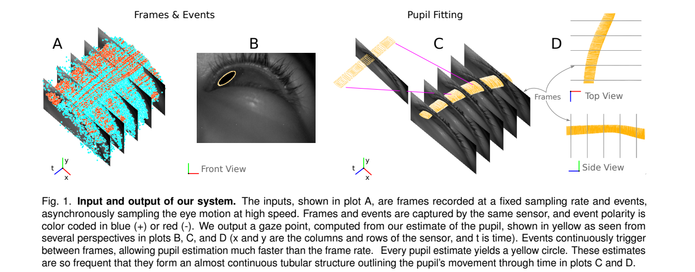

**原图 1 怎么看？**横向、纵向位置加上时间构成时空表示。黄色轮廓是一系列瞳孔估计，密集排列后形成管状轨迹。这表达的是“帧间持续更新瞳孔”，不是把事件重建成高帧率视频。

## 2. 需要掌握的基础概念

### 2.1 眼动追踪与注视估计

这篇论文包含两个不同层次的任务：

| 层次 | 输出 | 所在坐标系 | 例子 |
|---|---|---|---|
| 瞳孔跟踪 | 椭圆及其中心 | 相机图像坐标，单位像素 | 瞳孔中心在图像的 `(170, 120)` |
| 注视估计 | 屏幕点或视线方向 | 屏幕坐标或角度 | 正在看屏幕右上方 |

**检测到瞳孔中心，不等于已经知道用户在看哪里。**后者还取决于眼睛、相机、屏幕的相对位置以及个人差异，所以需要标定。

“Near-eye”指相机近距离观察眼睛，眼睛在图像中占据较大范围，不意味着主实验已经是在自由行走的眼镜设备上完成。

### 2.2 三种常见眼动

| 名称 | 通俗解释 | 与本论文的关系 |
|---|---|---|
| 注视 fixation | 盯住一个目标，仍可能有微小眼动 | 事件较稀疏，适合评估注视稳定性 |
| 扫视 saccade | 从一个目标快速跳到另一个目标 | 短时间产生大量事件，是高更新率的主要场景 |
| 平滑追踪 smooth pursuit | 跟随连续移动的目标 | 用于展示连续轨迹估计能力 |

微扫视是更细小的快速眼动。作者认为数据包含这类信息，但不能把这种观察等同于已完成有独立高频真值的微扫视定量验证。

### 2.3 帧相机与事件相机

普通相机定期输出整幅图像；事件像素独立响应亮度变化。一个事件可写作：

$$
e_k=(x_k,y_k,t_k,p_k)
$$

- $x_k,y_k$：发生变化的像素位置。
- $t_k$：时间戳。
- $p_k\in\{-1,+1\}$：亮度变化的极性。

理解事件生成时，常用对数亮度变化达到阈值的表达：

$$
\log I(x,y,t_k)-\log I(x,y,t_{\mathrm{prev}})\approx p_k C
$$

这是帮助理解传感器的背景模型，不是本文主要优化的目标函数。事件没有直接给出完整灰度值，也不等于一个“眼球位移读数”。

论文的椭圆更新主要使用筛选后的事件位置；不是把极性直接代入椭圆最小二乘。极性可以帮助理解运动时哪里变亮、哪里变暗。

### 2.4 为什么瞳孔运动容易产生事件？

在离轴近红外照明下，瞳孔较暗，周围虹膜较亮。边界扫过像素时形成明显亮度变化，因此事件往往集中在运动的边界附近。眼睑、反光和噪声也能产生事件，不能把所有事件都当成瞳孔边界。

## 3. 论文要解决什么问题？

传统高帧率方案需要持续传输和处理完整图像，带宽、功耗、分辨率与帧率互相制约。近眼图像里大量区域变化很小，整帧采样存在冗余。

事件相机在发生变化时才输出信息，使数据量随运动变化。作者希望同时获得：

- 快速眼动期间的高频更新；
- 较低的数据与计算负担；
- 接近传统近眼追踪方法的准确度。

论文将优势指向 AR/VR 注视点渲染、预测性显示和快速眼动研究。**这些是应用动机；论文没有把完整的渲染或临床系统作为主要实验对象。**

## 4. 整体系统：先拟合眼睛，再估计注视点

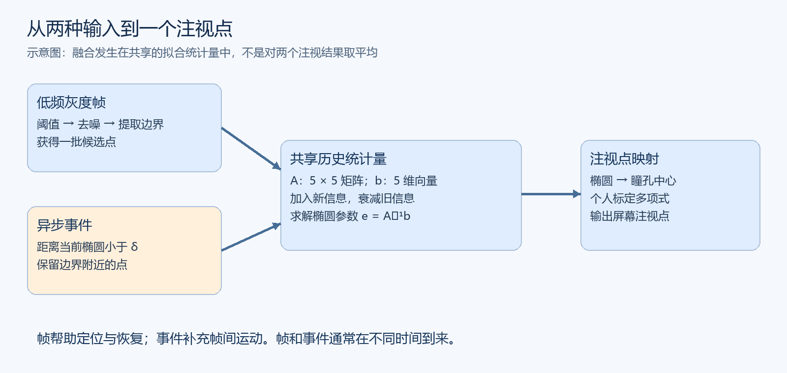

两条输入路径最终汇入同一个模型：

```text
灰度帧 → 分割、去噪、边缘提取 ─┐
                              ├→ 共享统计量 → 瞳孔椭圆 → 瞳孔中心 → 注视点
事件流 → 当前椭圆附近的事件筛选 ─┘                              ↑
                                                    个人标定得到的映射
```

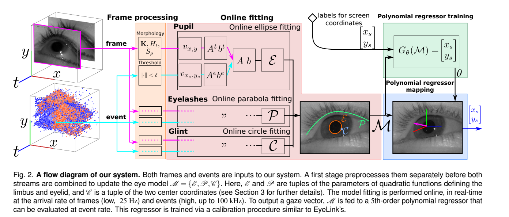

作者的完整概念模型包含：

| 组成 | 几何形状 | 作用 |
|---|---|---|
| 瞳孔 | 椭圆 $\mathcal E$ | 本文主要推导、评估的对象，可提取中心 |
| 眼睑/睫毛边缘 | 抛物线 $\mathcal P$ | 描述上眼睑附近轮廓 |
| 红外光源反光 glint | 圆 $\mathcal C$ | 描述角膜反光 |

这些形状可以分别拟合。不能仅因框架图画了三者，就认定实验中的注视回归一定使用了全部参数；实验与附录明确给出以瞳孔中心为输入的简化映射。

**帧与事件的分工：**帧即使在眼睛不动时也能提供边界信息；事件主要在变化时密集产生。帧能在眨眼或错误跟踪后重新提供定位信息，事件负责补充帧间运动。

## 5. 为什么用椭圆？为什么有 5 个参数？

### 5.1 从几何轮廓到代数方程

瞳孔边界在图像中可近似为椭圆。一般二次曲线写作：

$$
ax^2+hxy+by^2+gx+fy+d=0
$$

所有系数同时乘同一个非零常数，表示的曲线不变。作者固定 $d=-1$，得到：

$$
ax^2+hxy+by^2+gx+fy=1
$$

因此待估向量为：

$$
\mathbf e=(a,h,b,g,f)^\top\in\mathbb R^5
$$

每个候选边界点变成一个 5 维特征：

$$
\mathbf v_i=(x_i^2,x_iy_i,y_i^2,x_i,y_i)^\top
$$

理想边界点满足：

$$
\mathbf v_i^\top\mathbf e=1
$$

**重要理解：对坐标包含平方项，但对未知系数是线性的。**因此可以用线性最小二乘估计系数。

### 5.2 一个点不能独立确定椭圆

五个未知量至少需要五个独立约束，且点的分布不能退化。“每个事件更新一次”意味着用一个新点修正已有历史模型，不是用一个点从零拟合完整椭圆。

**实现建议：**一般二次曲线拟合不自动保证得到有效椭圆。复现时需要检查椭圆判别、中心和半轴是否有效，以及矩阵是否病态。这是数值实现注意事项，不能把简单的线性求解当成任何数据下都成立的几何保证。

## 6. 最小二乘、RWLS 与固定大小存储

### 6.1 最小二乘到底在最小化什么？

论文拟合的是代数残差：

$$
\hat{\mathbf e}=\arg\min_{\mathbf e}\sum_i(\mathbf v_i^\top\mathbf e-1)^2
$$

它让候选点尽量满足椭圆方程。这里的代数残差，与“点到椭圆的几何距离”不同：后者用于事件门控筛选，前者用于参数拟合。

对目标求导：

$$
\sum_i\mathbf v_i(\mathbf v_i^\top\mathbf e-1)=0
$$

整理为正规方程：

$$
\underbrace{\left(\sum_i\mathbf v_i\mathbf v_i^\top\right)}_{\mathbf A}\mathbf e
=\underbrace{\sum_i\mathbf v_i}_{\mathbf b}
$$

在可逆条件下：

$$
\hat{\mathbf e}=\mathbf A^{-1}\mathbf b
$$

### 6.2 为什么只存一个 $5\times5$ 矩阵和一个 5 维向量？

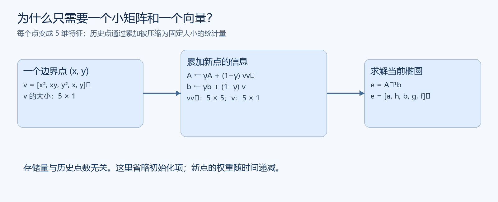

$\mathbf v_i$ 是 $5\times1$，所以其外积 $\mathbf v_i\mathbf v_i^\top$ 是 $5\times5$。无论积累了多少点，累加结果的维度都不变。

更直观地，把加权目标展开：

$$
\sum_iw_i(\mathbf v_i^\top\mathbf e-1)^2
=\mathbf e^\top\mathbf A\mathbf e-2\mathbf e^\top\mathbf b+\sum_iw_i
$$

其中：

$$
\mathbf A=\sum_iw_i\mathbf v_i\mathbf v_i^\top,
\qquad \mathbf b=\sum_iw_i\mathbf v_i
$$

最后一项与待估参数无关，不影响最优解。因此，求参数只需要 $\mathbf A,\mathbf b$，不用保留所有历史点。这是最小二乘问题的统计量压缩，不是任意历史信息都能无损恢复。

这里说的是**拟合所需的核心历史统计量**；程序还会保存当前模型、逆矩阵、传感器缓存等，并非整个系统只占 30 个数。

### 6.3 RWLS 形式有什么意义？

在本文语境下，RWLS 指历史观测组成的加权最小二乘形式：

$$
\hat{\mathbf e}_t=\arg\min_{\mathbf e}\sum_{i=1}^{t}w_{t,i}(\mathbf v_i^\top\mathbf e-1)^2
$$


若每轮接收一个点并按式（7）递推：

$$
\bar{\mathbf A}_t=\gamma\bar{\mathbf A}_{t-1}+(1-\gamma)\mathbf v_t\mathbf v_t^\top
$$

$$
\bar{\mathbf b}_t=\gamma\bar{\mathbf b}_{t-1}+(1-\gamma)\mathbf v_t
$$

忽略初始化项，且所有点均被接受、$\gamma$ 固定时，历史点的权重为：

$$
w_{t,i}=(1-\gamma)\gamma^{t-i}
$$

也就是指数遗忘：越旧的点影响越小。初始化的影响也会按 $\gamma^t$ 衰减。

| 好处 | 为什么适合本文 |
|---|---|
| 存储固定 | 历史信息汇总成小矩阵和向量 |
| 可以在线更新 | 新点到来只需增加新贡献 |
| 旧位置逐渐被忘记 | 避免大量旧点把椭圆拉在过去的位置 |
| 统一处理两类输入 | 帧点与事件点都能产生相同类型的统计量 |

**为什么作者说算法不完全等价于标准 RWLS？**因为一个事件是否加入，取决于它与当前估计椭圆的距离。被选中的观测集合随模型变化，不能把整个过程描述为对所有原始观测施加一组预先给定的衰减权重。对已经选定的点，最小二乘求解结构仍然成立。

## 7. 帧与事件到底怎样融合？

### 7.1 帧路径：提供一批边界点

在离轴红外照明下识别较暗的瞳孔区域，再执行：

```text
灰度帧 → 阈值分割 → 形态学开运算 → 边缘提取 → D_img
```

开运算通常由先腐蚀、后膨胀构成，用来抑制小噪声结构。得到的 $D_{\mathrm{img}}$ 是候选边界点，而不是整个暗区域里的所有像素。

### 7.2 事件路径：先筛选，再参与拟合

论文式（3）为：

$$
D_{\mathrm{evt}}=\{(x,y):\|P_{\mathcal E}(x,y)-(x,y)\|_2<\delta\}
$$

$P_{\mathcal E}$ 表示点到当前椭圆边界的投影，$\delta$ 是空间门限。这个门限用于拒绝远离瞳孔边界的眼睑事件、背景和噪声。

**阅读分析：**门控有利于稳定，但也依赖先验正确。若椭圆已经跟错，真正的边界事件可能被拒绝，导致系统难以仅靠事件自行恢复。这解释了帧重新定位的重要性。

### 7.3 共享统计量：真正的融合位置

每轮有效点来自：

$$
D=D_{\mathrm{img}}\cup D_{\mathrm{evt}}
$$

帧和事件通常在不同时间到来，上式表示统一处理接口，不要求每轮必须同时收到两种输入。

本轮点产生：

$$
\mathbf A_{\mathrm{new}}=\sum_{D}\mathbf v\mathbf v^\top,
\qquad \mathbf b_{\mathrm{new}}=\sum_D\mathbf v
$$

再与共享历史融合：

$$
\bar{\mathbf A}\leftarrow\gamma\bar{\mathbf A}+(1-\gamma)\mathbf A_{\mathrm{new}}
$$

$$
\bar{\mathbf b}\leftarrow\gamma\bar{\mathbf b}+(1-\gamma)\mathbf b_{\mathrm{new}}
$$

**它是在拟合统计量层面融合，不是先算两个椭圆再平均，也没有把事件重建成帧后统一处理。**

同样不能解释成“帧与事件各占 50%”：本轮点是求和加入的，影响取决于点数、遗忘因子、更新顺序和更新次数。没有点数归一化时，一批数百个点与一个点的贡献尺度也不同。

### 7.4 遗忘因子怎么理解？

按式（7）的约定，$\gamma$ 大表示更保留历史，$\gamma$ 小表示更信任新点。逐事件分支另用 $\gamma'$。

- 太保留历史：曲线较稳，但可能跟不上快速变化。
- 太依赖新点：响应快，但噪声或局部边界会引发剧烈变化。
- $\gamma=1$：停止加入新信息。
- 单点更新若 $\gamma=0$：只剩一个点的秩一信息，无法独立确定五参数椭圆。

这是按更新次数进行遗忘。**阅读分析：**在事件率变化时，相同遗忘因子对应的物理时间记忆长度也会变化；论文没有把它设计成完整的时间自适应方案。

### 7.5 补充推导：遗忘因子对应多长的记忆？

“保留历史”可以用半衰期量化。按前文式（7）的权重约定，经过 $k$ 次有效更新后，一份历史信息的权重乘上 $\gamma^k$。令它降至一半，得到：

$$
k_{1/2}=\frac{\log(1/2)}{\log\gamma}.
$$

例如教学上取 $\gamma=0.99$，半衰期约为 69 次更新。若有效更新率为 10,000 次/秒，对应约 6.9 ms；若降为 1,000 次/秒，则约为 69 ms。两者使用同一个参数，物理时间上的记忆长度却相差十倍。

这解释了为什么扫视和注视阶段可能需要不同的参数折中。上述计算假设每次按相同规则更新、更新率近似恒定；论文实际存在帧批量与事件更新两种路径，不能把该数字直接当作整套系统的精确时间常数。

如果工程上希望按真实时间衰减，可以考虑 $\gamma_k=\exp(-\Delta t_k/\tau)$，但这属于进一步的设计建议，不是论文已经验证的改进；更改后还需重新检查帧与事件批量贡献的归一化方式。

## 8. Algorithm 1 逐步解释

### 8.1 各变量表示什么？

| 变量 | 含义 |
|---|---|
| $\mathbf e$ / $\mathcal E$ | 当前瞳孔椭圆参数 |
| $D_{\mathrm{img}},D_{\mathrm{evt}}$ | 本轮帧与事件候选点 |
| $\mathbf A,\mathbf b$ | 本轮新点的信息 |
| $\bar{\mathbf A},\bar{\mathbf b}$ | 累积并带遗忘的历史信息 |
| $\bar{\mathbf A}_{\mathrm{inv}}$ | 历史矩阵的逆 |
| $\delta$ | 事件空间筛选门限 |
| $\gamma,\gamma'$ | 批量与单点更新的遗忘因子 |

### 8.2 按行号阅读

| 行号 | 在做什么 | 为什么需要 |
|---|---|---|
| 1–2 | 令历史矩阵为单位阵，历史向量为零，逆矩阵也为单位阵 | 提供可逆的数值初始状态 |
| 3–4 | 接收数据，清空本轮候选点集合 | 避免把上一轮点误当作本轮新点 |
| 5–6 | 收到帧则提取瞳孔边界 | 获得完整的空间约束 |
| 7–8 | 收到事件则执行椭圆附近门控 | 剔除不相关事件 |
| 9–12 | 构造特征，求本轮 $\mathbf A,\mathbf b$ | 把不同来源的数据统一表达 |
| 13–17 | 多个点时融合历史并完整求逆 | 处理帧或事件批次 |
| 18–21 | 一个点时利用 SMW 更新逆矩阵 | 加快逐事件更新 |

初始化得到的零参数并不是一个有效瞳孔椭圆，因此有效的初始检测很重要。单位阵可理解为一种初始数值正则化，但不能替代目标定位。

### 8.3 为什么一个事件能更新逆矩阵？

因为一个点贡献：

$$
\mathbf A_{\mathrm{new}}=\mathbf v\mathbf v^\top
$$

它是秩一矩阵。设旧逆矩阵为 $\mathbf P=\bar{\mathbf A}^{-1}$，更新目标为：

$$
\bar{\mathbf A}_{\mathrm{new}}=\gamma'\bar{\mathbf A}+(1-\gamma')\mathbf v\mathbf v^\top
$$

利用 Sherman–Morrison–Woodbury 恒等式：

$$
\mathbf P_{\mathrm{new}}
=\frac{1}{\gamma'}\left[
\mathbf P-
\frac{(1-\gamma')\mathbf P\mathbf v\mathbf v^\top\mathbf P}
{\gamma'+(1-\gamma')\mathbf v^\top\mathbf P\mathbf v}
\right]
$$

接着更新：

$$
\bar{\mathbf b}_{\mathrm{new}}=\gamma'\bar{\mathbf b}+(1-\gamma')\mathbf v,
\quad \mathbf e=\mathbf P_{\mathrm{new}}\bar{\mathbf b}_{\mathrm{new}}
$$

通常要求 $0<\gamma'<1$ 并检查分母有效。对于 $n$ 个参数，秩一逆更新的主要运算约为 $O(n^2)$，普通求逆约为 $O(n^3)$；本文 $n=5$，矩阵本身就很小。

### 8.4 更清楚的概念伪代码

```text
初始化历史矩阵、向量与有效瞳孔模型
循环接收传感器数据：
    收到帧：提取候选边界点
    收到事件：保留当前椭圆附近的候选点
    若没有候选点：跳过本次拟合
    将候选点转换成 A_new 和 b_new
    若只有一个候选点：
        使用单点遗忘因子和 SMW 更新逆矩阵
    否则：
        使用批量遗忘因子融合 A，再重新求逆
    更新历史 b
    求得新椭圆
    从椭圆求中心，再通过标定映射输出注视点
```

这段为帮助理解的整理版，不是逐字复刻原文。原文的 Algorithm 1 到椭圆参数为止，注视映射属于后续阶段。

### 8.5 原文伪代码需要小心的地方

**实现建议：**明确处理 $|D|=0$；检查矩阵与椭圆有效性；若同时维护矩阵及其逆，要保持两者同步。原文单点分支主要展示逆矩阵更新，直接照抄可能在随后切换到批量分支时产生状态不一致。公式附近还有交叉引用编号和新旧权重顺序不统一的表述，应以明确推导、代码和数值验证核对，不能认为伪代码就是可直接运行的程序。

## 9. 从瞳孔椭圆到注视点：标定映射

### 9.1 先求椭圆中心

令二次曲线对 $x,y$ 的一阶导数为零：

$$
2ax_c+hy_c+g=0,\qquad hx_c+2by_c+f=0
$$

解得：

$$
x_c=\frac{2bg-hf}{h^2-4ab},\qquad
y_c=\frac{2af-hg}{h^2-4ab}
$$

这是图像像素坐标中的瞳孔中心。

### 9.2 再通过标定映射到屏幕

用户依次看已知屏幕点，收集 $(x_c,y_c)$ 与 $(x_s,y_s)$ 的配对数据。实验与附录 B 给出的二阶映射可写为：

$$
\mathbf q=(x_c^2,x_cy_c,y_c^2,x_c,y_c,1)^\top
$$

$$
x_s=\boldsymbol\theta_x^\top\mathbf q,
\qquad y_s=\boldsymbol\theta_y^\top\mathbf q
$$

每个屏幕坐标有六个回归系数，可通过线性最小二乘拟合。注意它与“五参数椭圆拟合”是两个不同问题：前者估计注视映射，后者估计瞳孔轮廓。

**原文不一致：**第 3.2 节及图 2 提到五阶多项式，但实验章节和附录 B 明确写二阶，并列出二阶基函数。学习与复现时应指出这一差别；不能断言所有结果始终使用五阶。

### 9.3 为什么滑移会破坏映射？

映射隐含了固定的相机与眼睛相对关系。如果眼镜向下滑，即使用户仍看同一个屏幕点，瞳孔在相机中的位置也可能改变，原标定对应关系便不再适用。

固定距离的屏幕坐标还可结合几何关系换算成水平、垂直视角。方向有两个自由度，不意味着系统恢复了完整三维眼球结构或注视目标深度。

## 10. 实验设置与数据集：结果在什么条件下成立？

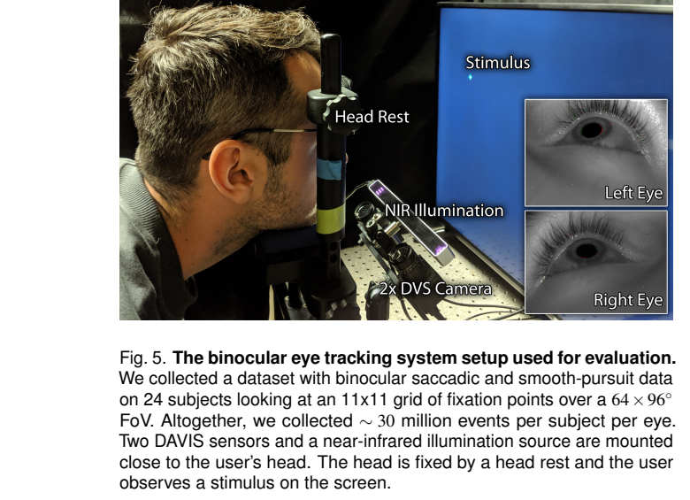

| 项目 | 主实验设置 |
|---|---|
| 被试 | 论文分析 24 名被试 |
| 相机 | 两台同步 DAVIS346b，分别观察双眼 |
| 帧分辨率 | $346\times260$，8 位灰度 |
| 帧率 | 采集设置约 25 FPS；引言另有 15–20 Hz 表述，不宜当作固定统一值 |
| 相机距眼睛 | 约 25 cm |
| 照明 | 近红外照明及滤光片 |
| 屏幕 | 40 英寸、1920×1080，距用户约 40 cm |
| 头部 | 头托与固定措施限制位移 |
| 扫视任务 | 11×11 网格，共 121 个目标位置，每个显示 1.5 秒 |
| 平滑追踪任务 | 目标沿可预测的轨迹连续移动 |

论文图 5 报告每位被试每只眼睛约 3000 万个事件。官方仓库描述包含 27 人，说明论文只使用其中第 4–27 人，前三人的采集设置不同；它与论文的 24 人口径应分开记录。

### 10.1 为什么不能把屏幕目标当成每一刻的真实视线？

屏幕知道目标在哪里，但不知道眼睛什么时候开始动、经过哪条轨迹，以及是否已经准确到达目标。目标位置可以支持注视阶段评估，不能直接充当扫视过程中每个微秒的独立真值。

### 10.2 标定与测试如何划分？

论文在某个视野内用部分目标点标定。例如较小视野测试包含 16 个点，使用 8 个点标定。但正文中 accuracy 与 precision 段落的划分描述不完全一致：前者写用一半点标定、在全体点上报告，后者写奇偶点交换训练与测试后平均。复现应按指标分别核实，不能统一写成严格独立的同一种测试划分。

精度评估还使用了以下筛选：

- 每个目标显示 1.5 秒，图 8 使用最后 0.5 秒的数据，尽量排除寻找目标和转移过程。
- 自动识别并排除眨眼及若干后续帧。
- 做 2.5% 水平的裁剪以减少异常值影响。

因此，结果主要描述筛选后的注视表现，不代表全过程都达到相同误差。

## 11. 按图读懂关键结果

### 11.1 图 7：更新频率与稳定性的折中

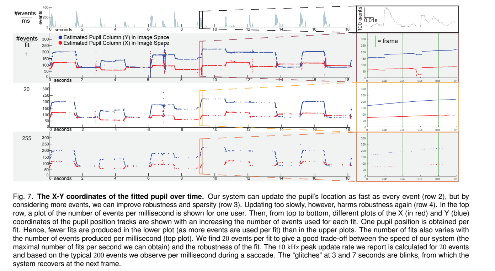

先看上方事件率：扫视期间出现高峰，注视时事件相对稀疏。下方是每次使用不同事件数时的瞳孔中心坐标随时间变化。

| 每次拟合的事件数 | 能看到什么 | 代价 |
|---|---|---|
| $N=1$ | 更新非常密集 | 噪声容易造成不稳定估计 |
| $N\approx20$ | 较细致地跟随帧间眼动 | 在本文数据中表现出较好的折中 |
| $N$ 很大，如数百 | 更新次数减少 | 快速运动期间轨迹变粗，难以细致跟随 |

图中的眨眼会导致异常，后续帧能帮助恢复。**20 是本文按经验平滑度选择的参数，不是任何相机、任何眼动条件的普遍最优值。**

### 11.2 图 8 前必须区分两个指标

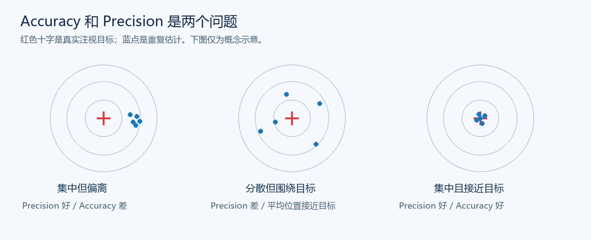

| 指标 | 核心问题 | 越小越好的是 |
|---|---|---|
| Accuracy 准确度 | 预测方向偏离参考方向多少？ | 方向误差 |
| Precision 精密度 | 重复估计有多分散？ | 标准差 |

上图中“分散但围绕目标”的平均位置虽接近目标，单次误差仍可能较大。论文附录实际给出的 accuracy 计算是角度坐标差的欧氏范数再求平均：

$$
\mathrm{Accuracy}=\frac1n\sum_i\|\hat{\mathbf d}_i-\mathbf d_i\|_2
$$

Precision 用重复估计的经验标准差描述。不要把“平均位置正确”直接替换成该平均误差公式，也不要混淆标准差和均方根误差。

### 11.3 图 8：四个子图分别回答什么？

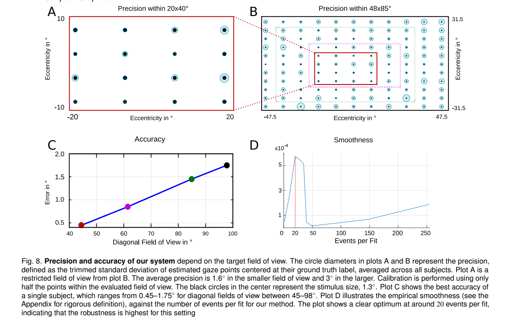

**A：中央小视野内的 precision。**横纵轴表示水平、垂直偏心角。每个位置对应一个目标，蓝色圆圈直径表示估计的分散程度，统计对所有被试平均。圆圈越小，重复估计越稳定。黑色圆表示目标大小，约 1.3°。

**B：更大视野下的 precision。**B 的红框区域对应 A。总体上边缘的圆圈更大，说明边缘区域估计更不稳定。图注报告小视野平均约 1.6°，大视野约 3°。正文、图内标题与图注对大视野边界的个别数字有出入，引用具体视野时应附图号并核对。

**C：视野扩大时，最佳被试的 accuracy。**横轴是评估区域的对角视野，纵轴是误差。数据约为：

| 对角视野 | 最佳单名被试的误差，约 |
|---|---|
| 45° | 0.45° |
| 63° | 0.85° |
| 83° | 1.45° |
| 98° | 1.75° |

除端点的报告范围外，中间值为读图近似值。**C 是最佳个体，A、B 是跨被试统计；不能把两者混成同一个平均结果。**

**D：每次拟合多少个事件？**横轴是事件数，纵轴是作者定义的经验平滑度，在约 20 附近出现峰值。其基本思想是相邻估计位置差越小，平滑度越高。它是间接选择依据，不是独立的准确度真值；过度平滑也可能压制真实细微眼动。

### 11.4 “45–98° 视野，0.45–1.75° 误差”是什么意思？

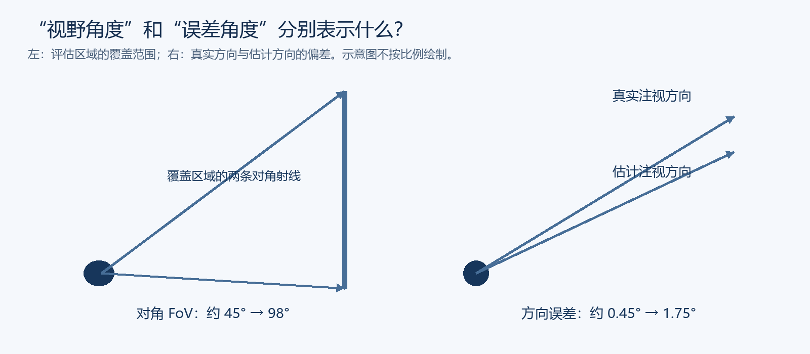

前一组角度表示覆盖范围，后一组表示估计偏差。可以把前者理解为从眼睛看向评估区域两个对角的张角；在具体论文里，对角 FoV 的数值也取决于使用的几何定义或近似，不能把它直接当成眼球转动量。

当只要求在中央小区域工作时，最佳被试误差约 0.45°；扩展到较大区域时，误差约 1.75°。这不表示“转动 45° 会产生 0.45° 误差”，也不表示每个人所有时刻的误差都在这个范围。

### 11.5 图 9：事件跟踪是否与帧提取结果一致？

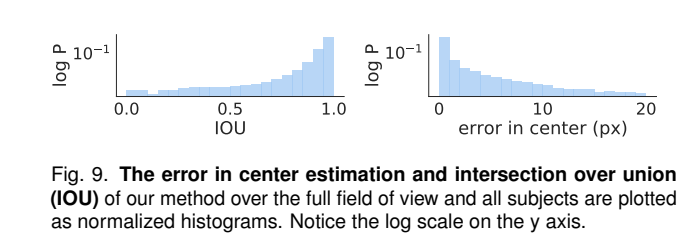

作者把**下一帧到来之前**的事件模型，与该帧提取的瞳孔结果比较，避免把刚刚经帧更新的模型拿去与同一帧比较。

- **中心误差**：两个瞳孔中心之间的像素距离。
- **IoU**：两个椭圆区域的交集面积除以并集面积。

$$
\mathrm{IoU}=\frac{|S_{\mathrm{event}}\cap S_{\mathrm{frame}}|}{|S_{\mathrm{event}}\cup S_{\mathrm{frame}}|}
$$

作者报告 IoU 很少低于 0.8，中心偏差很少超过 3 像素。纵轴使用对数尺度，以展示小概率误差。

**证据边界：**这支持“事件模型在帧到来前与帧提取结果吻合”，但帧提取也有误差，且没有覆盖每个高频时刻。它不是独立的 10 kHz 真实视线测量。

**原文核对：**正文印出的 IoU 式子分子分母疑似颠倒，按标准定义应使用交集/并集；图中 0–1 的尺度也与标准定义相符。

### 11.6 附录 G：不用事件会怎样？

作者构造帧基线：两帧之间保持瞳孔位置不变。注视时两者差别不大；扫视期间，加入事件通常降低中心误差。

**阅读分析：**这证明了相对“保持上一帧位置”基线的收益，但没有排除更强的运动预测帧基线。应避免据此宣称全面优于所有传统方法。

## 12. 10,000 Hz 是怎么得到的？

### 12.1 计算过程

扫视期间典型事件率约为：

$$
\rho\approx200\ \mathrm{events/ms}=200000\ \mathrm{events/s}
$$

按每 20 个事件更新一次：

$$
R=\frac{\rho}{N}=\frac{200000}{20}=10000\ \mathrm{updates/s}=10\ \mathrm{kHz}
$$

等效平均更新间隔为 0.1 ms。事件时序并不均匀，系统也不是全程按固定周期采样。

### 12.2 四个量必须分开

| 名称 | 表示什么 | 本论文能说明什么 |
|---|---|---|
| 事件率 | 每秒输出或处理多少事件 | 扫视期间事件密集 |
| 模型更新率 | 每秒求多少次瞳孔模型 | 按事件批量估算峰值约 10 kHz |
| 时间戳分辨率 | 能多细地记录事件发生时间 | 不等于完整系统响应速度 |
| 端到端延迟 | 真实眼动到系统给出结果的时间 | 作者明确未报告完整测量 |

**不能把“10 kHz 更新率”写成“实测 0.1 ms 延迟”。**感光、传输、缓存、排队、计算和输出都可能贡献延迟。

作者称系统能持续处理相关事件负载，但实际事件生成随眼动改变。眼睛不动时没必要强制保持高更新频率。论文中的部分单位排版有误，理解时以维度一致的上述计算为准。

## 13. 与传统方法、NVGaze 的关系

| 方法 | 主要输入 | 核心处理 | 与本文关系 |
|---|---|---|---|
| 传统帧式瞳孔跟踪 | 灰度图像 | 分割、边缘与几何拟合 | 可作为帧路径的基础 |
| NVGaze | 红外眼部图像 | 通过神经网络估计视线，也有瞳孔估计变体 | 可用于增强帧路径，增加学习与计算环节 |
| 本文 | 低频帧＋事件 | 在线几何拟合＋标定多项式 | 高频补充帧间眼动信息 |

NVGaze 代表基于学习的近眼估计路线。不同方法的训练对象、视野和评价协议不同，不能只比较各自报告的一个最佳误差数字。这里保留方法层面的对比，不作统一条件下的性能排名。

本文作者认为神经网络可增强鲁棒性，但可能增加计算与功耗。这是设计取舍讨论，不等于在完全相同硬件和协议下对所有替代模型做了实测比较。

同理，论文将结果与 EyeLink 等商业系统的公开性能和相似协议比较；不应描述成每位被试都同时佩戴商业设备进行完整同步对照实验。

## 14. 局限与结果边界

### 14.1 作者明确承认的主要局限

1. **相机滑移。**相机与脸的相对位置变化会破坏标定，需要重新校准。
2. **高频真值不足。**难以直接测量帧间每次事件更新的真实误差。
3. **未报告端到端延迟。**高更新率不能替代延迟测试。
4. **参数依赖人工调节。**遗忘因子、空间门限、事件批量需要权衡噪声与真实快速运动。

### 14.2 桌面实验与眼镜原型不能混为一谈

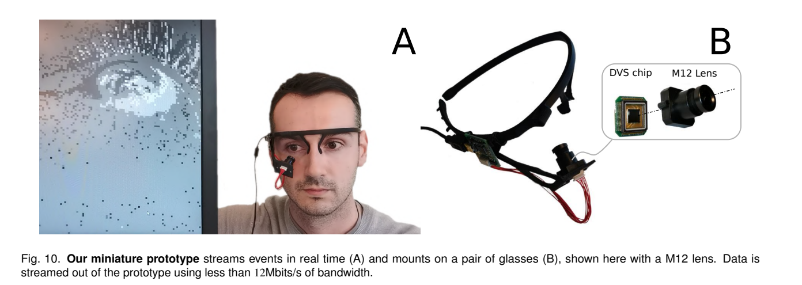

眼镜原型使用更低分辨率的 128×128 DVS，不输出帧，与主实验的 DAVIS346 不同。原型展示了小型化、实时事件传输的可能性，不等于已经在眼镜上完整复现主实验的混合算法、准确度与滑移鲁棒性。

### 14.3 阅读分析：哪些证据还可以更强？

- 用独立高频参考验证扫视轨迹、微扫视幅度和时刻。
- 同时测量延迟、功耗、失败比例、眨眼后恢复时间。
- 报告更多跨被试误差统计，而不仅是最佳个体。
- 加入帧式预测器、纯事件方法等更强基线。
- 验证自由头动、眼镜滑移、遮挡、不同光照与长期标定稳定性。

这些是研究分析与后续建议，不是论文已经完成的实验。

## 15. 如果要复现，你应该先掌握什么？

### 15.1 必要知识与对应位置

| 知识 | 至少理解到什么程度 | 对应章节 |
|---|---|---|
| 事件相机 | 事件位置、时间、极性，运动与事件率的关系 | 本指南第 2 节；论文第 3 页 |
| 线性代数 | 向量外积、矩阵秩、正规方程和求逆 | 本指南第 5–6 节 |
| 最小二乘 | 残差、加权求和、递推历史统计量 | 论文式（4）–（7） |
| 数值计算 | 病态矩阵、初始化、坐标尺度与有效椭圆检查 | 本指南第 8 节的实现建议 |
| 图像处理 | 阈值、形态学开运算、边缘检测 | 论文式（2） |
| 几何 | 椭圆中心、点到轮廓距离、视角与像素 | 论文式（3）、附录 B、D |
| 标定与回归 | 输入输出配对、二阶基函数、训练测试划分 | 本指南第 9–10 节 |
| 统计评价 | 平均误差、标准差、IoU、筛选规则 | 论文图 8–9、附录 C、E |

### 15.2 建议的实现顺序

1. 先做帧提取瞳孔边界，并检查拟合的椭圆是否有效。
2. 实现普通批量最小二乘，验证中心计算公式。
3. 加入历史统计量和遗忘因子。
4. 在合成点序列上验证单点 SMW 与直接求逆的数值一致性。
5. 加入事件空间门控，再测试不同事件批量。
6. 实现个人标定，将瞳孔中心映射到屏幕。
7. 按论文协议评估，再单独测试眨眼与跟踪恢复。

### 15.3 复现前的核查表

- [ ] 二阶还是五阶回归？按实验配置与实际代码核对。
- [ ] $\gamma$、$\gamma'$ 的新旧权重约定是否一致？
- [ ] 单点与批量分支切换时，矩阵及其逆是否同步？
- [ ] 零候选点如何处理？无效椭圆如何恢复？
- [ ] 点数变化是否改变每轮新信息的尺度？
- [ ] 事件时间戳、双眼同步和帧时间如何对齐？
- [ ] accuracy、precision 的训练测试划分分别是什么？
- [ ] 是否复现了眨眼排除、末 0.5 秒选择与异常值裁剪？
- [ ] 报告的是最佳个体、总体平均还是分位数？
- [ ] 更新率、事件率、延迟是否分别测量和标注？

### 15.3 补充：把“得到参数”与“得到有效瞳孔”分开

求解线性方程只意味着代数目标有一个解，并不保证结果是可用的瞳孔。令

$$
Q=\begin{bmatrix}a&h/2\\h/2&b\end{bmatrix},\qquad
\ell=\begin{bmatrix}g\\f\end{bmatrix},\qquad
c=-\tfrac12 Q^{-1}\ell.
$$

令 $u=(x,y)^\top$。将坐标平移到中心后，曲线变为

$$
(u-c)^\top Q(u-c)=1+c^\top Qc.
$$

如果右端非零，归一化矩阵 $B=Q/(1+c^\top Qc)$ 必须正定，才能得到实且非退化的椭圆；两条半轴长度为 $B$ 的特征值的倒数平方根。还应检查中心是否位于合理区域、半轴是否符合瞳孔尺寸，以及解的条件数是否异常。

这是由本文参数形式得到的补充推导，不是新增实验。实际计算宜解线性方程而不是反复显式求逆；若对像素坐标做中心化和缩放，输出时必须转换回原坐标，事件门控距离也必须使用一致单位。

一个便于定位错误的复现顺序是：先在静态帧上验证椭圆，再加入带时间戳的事件更新，最后进行屏幕标定。这样能分清问题来自轮廓拟合、时序融合，还是瞳孔到注视点的映射。

## 16. 常见误解与汇报时可以怎么说

| 容易误解的说法 | 更准确的说法 |
|---|---|
| “一个事件就能拟合出椭圆” | 一个事件修正由历史信息支持的模型 |
| “帧和事件各得到一个结果，再平均” | 两者共同更新最小二乘历史统计量 |
| “只需要 30 个数就能完成整个系统” | 核心拟合历史可压缩成 25＋5 个标量，其他状态另算 |
| “系统一直以固定 10 kHz 工作” | 更新率随事件产生情况变化，扫视期间峰值约 10 kHz |
| “延迟是 0.1 ms” | 0.1 ms 是 10 kHz 的等效平均间隔，端到端延迟未测 |
| “全体被试误差 0.45°” | 该数是最佳单名被试在较小视野下的结果 |
| “图 8 的圈越大越准确” | 圈越大表示离散程度越大，precision 越差 |
| “图 8D 证明 20 个事件最准确” | 它基于经验平滑度选择折中，不是独立真值误差最小化 |
| “已经验证自由佩戴眼镜的全部性能” | 主要定量评估在固定头部的桌面场景，眼镜原型展示小型化 |

### 一段适合口头汇报的总结

> 这篇论文提出一种帧与事件融合的近眼注视追踪系统。低频灰度帧提取瞳孔边界，高频事件补充帧间眼动，两者通过共享的递推最小二乘统计量更新椭圆模型，再将瞳孔中心映射到屏幕注视点。作者在 24 名被试的受控双眼数据上评估，按扫视事件率和每次 20 个事件拟合，估算峰值模型更新率约 10 kHz；最佳个体在不同视野下达到约 0.45°–1.75° 的注视误差。其主要价值是展示了计算量较小的高速融合路线，但高频瞬时精度、端到端延迟和佩戴滑移仍缺乏充分验证。

### 读完后应能回答的六个问题

1. 为什么事件适合补充帧间运动，为什么系统仍需要帧？
2. 为什么椭圆固定常数项后有五个待估参数？
3. 为什么所有历史点可汇总为一个小矩阵和向量？
4. 帧与事件在哪里融合，SMW 又节省了哪部分运算？
5. 图 8 的 A/B、C、D 各自说明什么，统计对象是否相同？
6. 为什么“10 kHz、0.45°、眼镜原型”不能不加条件地合并成一个性能承诺？

## 17. 论文效果分析与总结

论文最有价值的成果是：**让低频灰度帧与异步事件共同更新瞳孔模型，在保留帧定位信息的同时，捕捉两帧之间的快速眼动，并将瞳孔位置映射为屏幕注视点。**

### 17.1 主要取得了哪些效果？

| 实验或评价 | 论文报告的结果 | 可以得出的结论 |
| --- | --- | --- |
| 扫视期间的模型更新 | 典型事件率约 200 events/ms，采用每 20 个事件拟合一次，计算得到约 **10 kHz 峰值更新率** | 事件能够提供远密于灰度帧的模型更新；不是全程固定 10 kHz，也不是实测 0.1 ms 延迟 |
| 注视估计准确度 | 最佳单名被试在约 45°—98° 对角视野下，误差约 **0.45°—1.75°** | 受控条件下可以获得较小的注视误差；不能当作全体被试或扫视全过程的平均表现 |
| 注视估计精密度 | 图 8 报告跨被试的小视野平均约 **1.6°**、大视野约 **3°** | 视野扩大后估计的离散程度增加；精密度与准确度衡量的是不同问题 |
| 帧到来前的瞳孔一致性 | 与随后帧提取的结果比较，IoU 很少低于 **0.8**，中心偏差很少超过 **3 像素** | 事件更新的瞳孔模型通常与帧结果吻合，但帧提取不等于独立高频真值 |
| 不使用事件的对照 | 相比两帧之间保持上一帧位置，加入事件在扫视期间通常降低中心误差 | 事件对帧间运动有帮助；该对照不能代表所有更强的帧式预测方法 |
| 小型眼镜原型 | 展示低分辨率 DVS 的眼镜安装及实时事件传输 | 支持小型化的可能性，不代表在眼镜上完整复现了主实验的精度与鲁棒性 |

上述结果对应原论文图 7—10 及附录 G，细节见本文第 10—14 节。主实验使用 24 名被试的受控双眼数据，并限制头部移动；准确度和精密度的评价还涉及眨眼剔除、异常值裁剪及注视时段选择。

因此，**不能把“10 kHz 更新率”“0.45° 最佳误差”和“眼镜原型”拼成同一套可自由佩戴系统的性能承诺。** 它们分别来自更新率计算、特定被试与视野的评价，以及原型展示。

### 17.2 为什么能取得这些效果？

**第一，帧与事件的信息互补。** 灰度帧能够在眼睛相对静止时提供完整边界，也可以在眨眼或跟踪异常后重新提供定位信息；事件则在运动发生时补充帧间变化。二者共同更新模型，避免仅依赖稀疏帧，也减少只靠事件时缺乏静态信息的问题。

**第二，把历史信息压缩成固定大小的统计量。** 五参数拟合需要维护的核心统计量是一个 $5\times5$ 矩阵和一个 5 维向量，不必每次重新读取全部历史点。单点贡献为秩一矩阵，还能利用逆矩阵更新公式减少重复计算。这解释了高频更新在计算结构上的可行性，但不能替代整套系统的实测延迟和功耗。

**第三，在更新密度与稳定性之间选择折中。** 一个事件就更新一次虽然密集，却容易受噪声影响；积累过多事件又会降低对快速变化的响应。图 7 和图 8D 支持作者在其数据上选择约 20 个事件一次拟合。这个选择依据经验平滑度，不是任意场景下准确度最优的证明。

**第四，通过个人标定完成任务转换。** 瞳孔中心属于图像坐标，标定回归把它转换为屏幕注视点。因此，最终误差不只取决于瞳孔拟合，也受标定覆盖范围、用户差异和相机相对位置影响。

### 17.3 如何评价论文的贡献与局限？

论文较有力地展示了：**轻量的递推几何模型可以融合帧与事件，在快速眼动时提供高密度瞳孔估计，并在受控注视任务中获得有意义的准确度。** 相比只报告高事件率，论文还给出了注视评价、帧前一致性检查和不使用事件的对照，使效果证据更加完整。

不过，高频采样能力与高频误差验证仍有差距。屏幕目标不能提供扫视过程中每个时刻的真实视线，帧前比较也无法覆盖所有事件更新时间。作者未报告完整端到端延迟；自由头动、相机滑移、长期标定稳定性和复杂遮挡下的表现，也不能从桌面实验直接推得。

### 17.4 总结

> 这篇论文通过共享的递推最小二乘统计量融合灰度帧和事件，在线更新瞳孔椭圆，并通过个人标定估计屏幕注视点。实验展示了扫视期间约 10 kHz 峰值模型更新率，以及受控条件下的注视估计能力。其核心贡献是把帧的空间定位与事件的时间信息结合起来；主要限制是高频独立真值和端到端延迟验证不足，以及对标定、固定安装关系和参数选择的依赖。

## 18. 原文定位与资料链接

| 想查的内容 | 英文 PDF 位置 |
|---|---|
| 动机、贡献、为何需要高更新率 | 第 1–2 页 |
| 眼部模型、帧提取、事件门控 | 第 3 页，式（1）–（3） |
| 在线最小二乘与 Algorithm 1 | 第 4 页，式（4）–（7） |
| 注视回归、实验装置、更新率依据 | 第 5 页 |
| 不同事件批量的轨迹 | 第 6 页，图 7 |
| precision、accuracy、平滑度 | 第 7 页，图 8 |
| 帧前瞳孔验证 | 第 6–7 页，图 9 |
| 局限、微型原型 | 第 8–9 页 |
| 眼睑、反光、回归与指标公式 | 第 11 页，附录 A–D |
| 眨眼、平滑度定义、帧基线消融 | 第 12 页，附录 E–G |

- [论文 arXiv 页面](https://arxiv.org/abs/2004.03577)
- [论文 DOI](https://doi.org/10.1109/TVCG.2021.3067784)
- [作者实验室项目页](https://www.computationalimaging.org/publications/event-based-eye-tracking/)
- [官方数据集仓库](https://github.com/aangelopoulos/event_based_gaze_tracking)
- [NVGaze 官方介绍](https://research.nvidia.com/labs/amri/publication/kim2019/)


原图出处：Angelopoulos 等，*Event-Based Near-Eye Gaze Tracking Beyond 10,000 Hz*，本文所读为 arXiv:2004.03577v3 作者版本。原图保留原图号和图注，具体阅读位置见上表；其权利归原权利人所有，不适用本站默认文章许可。
