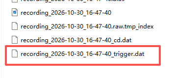
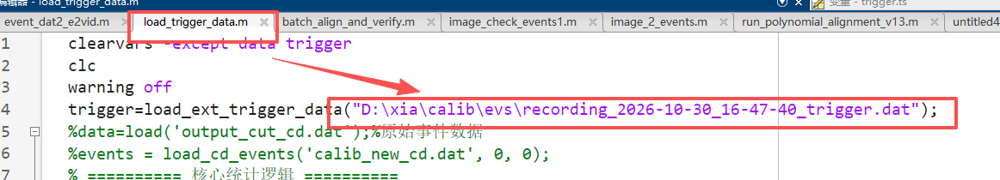
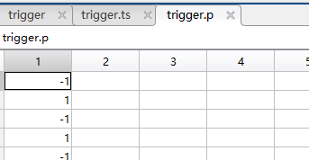
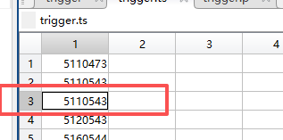
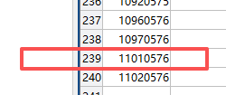
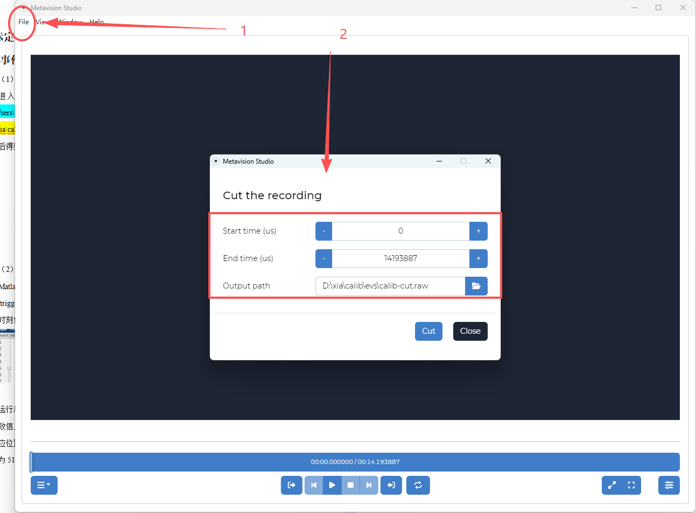
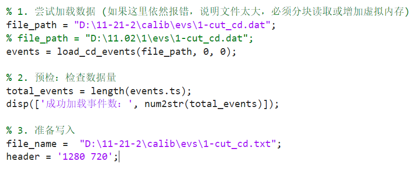
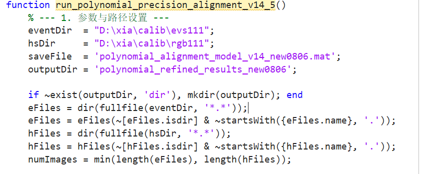
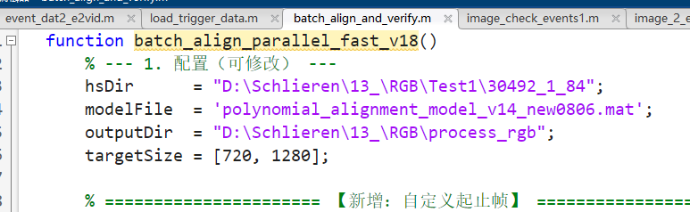

本文记录事件相机与高速相机的标定处理流程。先从采集到的 RAW 记录提取事件和触发数据，裁剪有效采集区间，再通过 E2VID 重建图像，最后挑选同步图像对，求解并验证两路图像之间的映射。

采集先打开事件相机，然后灰度相机，最后信号
采集完毕先关信号，然后灰度相机和事件相机

## 1. 原始事件数据转换

打开配置好相关工具的终端，进入 E2VID 项目文件夹。以下路径沿用原记录的示例，运行前改成实际位置。

```powershell
cd "C:\Users\admin\Desktop\rpg_e2vid-master\rpg_e2vid-master"
metavision_file_to_dat -i "D:\xia\calib\evs\recording_2026-10-30_14-26-05.raw"
```

命令中的 `.raw` 文件为拍摄保存的原始事件记录。转换后查看输出数据，并从触发记录中提取后续裁剪所需的时间边界。



*图 1　原始记录转换后的输出。*

## 2. 触发时间提取与事件裁剪

### 2.1 读取触发记录

在 MATLAB 中进入项目目录，打开 `load_trigger_data.m`，将 `input` 改为转换得到的触发数据文件，随后运行脚本。



*图 2　修改 `load_trigger_data.m` 的输入。*

原记录说明，脚本运行后得到三个变量，其中 `trigger.p` 表示触发信号极性，`triggers` 用于查看有效信息的时间刻度。具体名称和字段以脚本实际输出为准。

### 2.2 确定有效区间

按原记录中的采集约定，极性从 `-1` 到 `1` 对应一个信号采集周期。若图片比事件数少1，则有效区间从第二个 `-1` 开始，到最后一个 `-1` 结束，若相等，则一一对应。分别读取对应时间戳作为裁剪的左右边界。（关注是上升沿还是下降沿触发，则看`1`或`-1`）



*图 3　查看触发记录中的极性变化。*



*图 4　定位起始边界对应的时间戳。*



*图 5　定位结束边界对应的时间戳。*

原记录给出的起始时间刻度示例为 `5110543`（下降沿触发拍照）。填写裁剪边界前，需要确认数据时间戳与软件输入使用相同单位。


### 2.3 裁剪事件记录

打开事件相机采集软件，通过左上角的 `File` → `Cut the recording` 导入原始记录，填写确定的起止时间并执行裁剪。



*图 6　在软件中设置有效事件区间。*

原记录说明，裁剪结果自动保存在采集路径下。完成后检查输出文件名及时间范围。

## 3. 转换 TXT 并重建图像

### 3.1 生成 E2VID 输入

打开项目中的 `event_dat2_e2vid.m`，修改输入路径后运行，得到供 E2VID 使用的事件 TXT 文件。



*图 7　设置事件转换脚本的输入。*

> 如果要打开txt检查，记得用notepad，表头是事件相机的分辨率

### 3.2 执行 E2VID 重建

在配置好 E2VID 依赖的 Anaconda 环境中进入项目目录，执行下面的命令。这里已补齐原稿中各参数之间缺失的空格。

```powershell
python run_reconstruction.py -c pretrained/E2VID_lightweight.pth.tar -i "D:\xia\calib\evs\calib-cut_cd.txt" --fixed_duration -T 50000000 --auto_hdr -o "C:\Users\admin\Desktop\e2vid_output1" --display --show_events
```

| 参数 | 用途 |
|---|---|
| `-c` | 模型权重文件 |
| `-i` | 输入事件 TXT 文件 |
| `--fixed_duration`、`-T` | 按项目实现设置固定时间窗口 |
| `--auto_hdr` | 使用项目提供的自动 HDR 选项 |
| `-o` | 输出目录 |
| `--display`、`--show_events` | 显示重建结果及事件视图 |

> `-T n` 里面的n*fps = 10^9,为算法规定

运行后检查重建图像及其时间顺序，供后续挑选同步图像对使用。

## 4. 事件图像与高速帧配准

### 4.1 挑选同步图像对

选取同一脉冲对应的事件重建图像和高速帧，每对组成一组数据。原记录建议挑选约 15–20 组，用于角点坐标标定。

给出的序列对应关系如下。

$$
\begin{aligned}
&\text{事件图像序号}=a,\\[0.5em]
&\text{高速帧图像序号}=a+1.
\end{aligned}
$$

> 因为$\Delta t$事件内累计事件产生的图像对应下一张的灰度图像

### 4.2 求解映射模型

进入项目下的 `event_transfer` 文件夹，打开 `run_polynomial_alignment_v13.m`。将输入改为前一步挑选的事件图像和高速帧，运行程序，计算两路图像之间的映射关系。



*图 8　设置配对图像并求解映射。*

原记录给出的模型文件名为 `polynomial_alignment_model_v14_new0806.mat`。使用时确认它对应本次运行生成的模型。

### 4.3 批量应用映射并验证

打开同目录下的 `batch_align_and_verify.m`，将模型路径改为上一步得到的映射文件，检查输入和输出路径后运行。



*图 9　加载映射模型并验证配准结果。*
