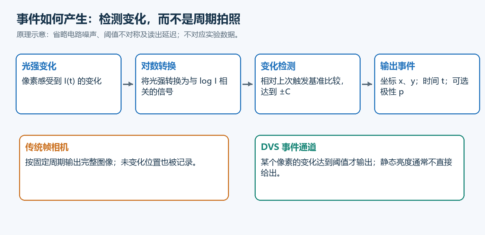
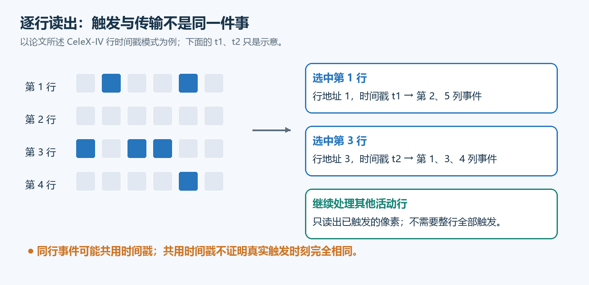
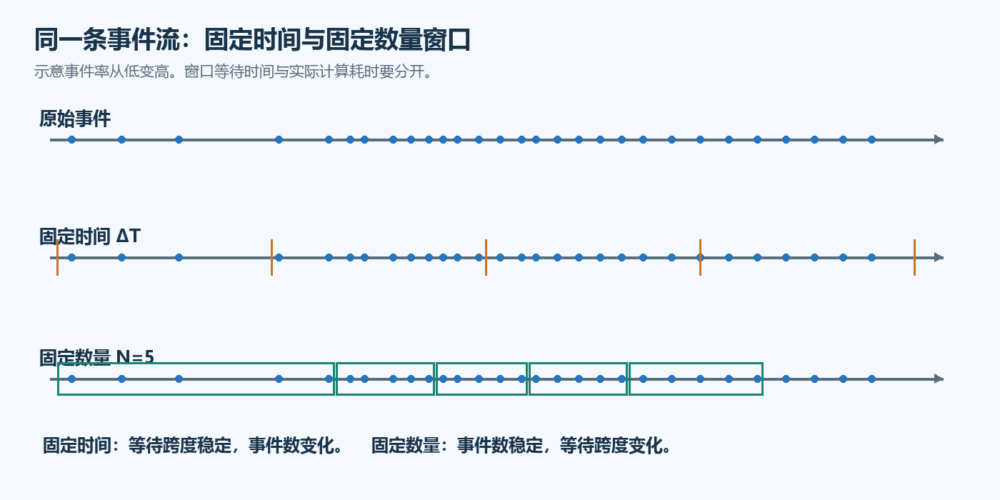
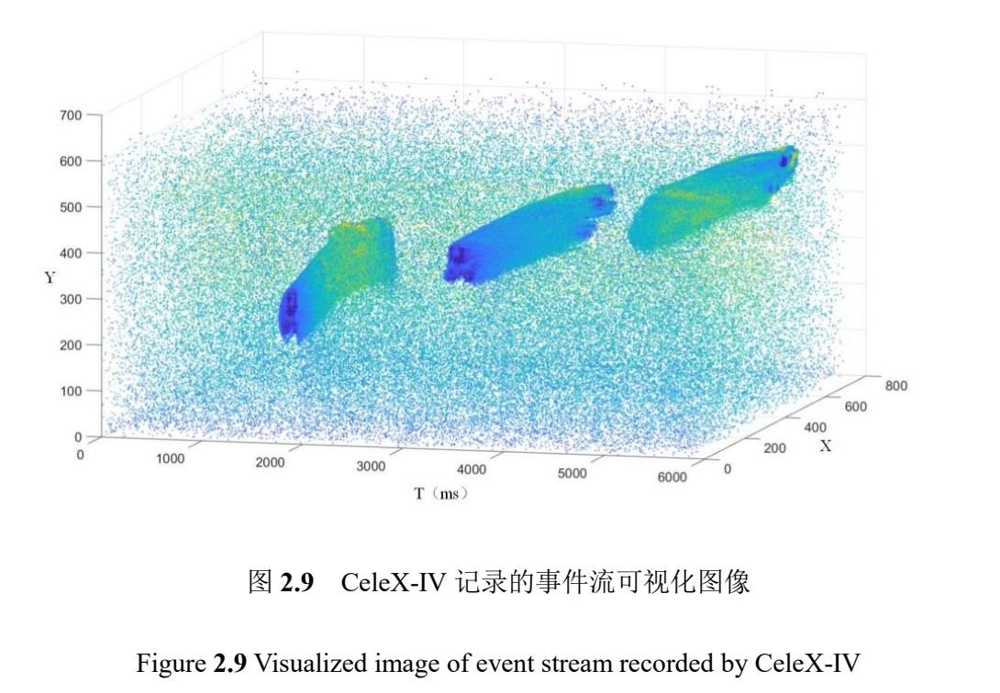
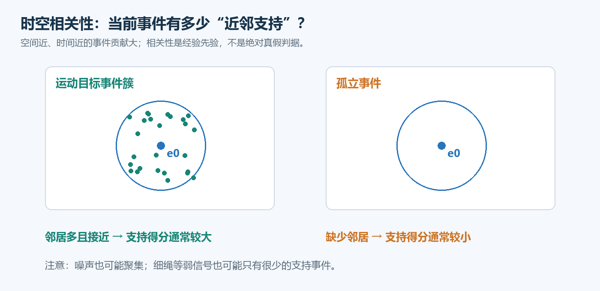
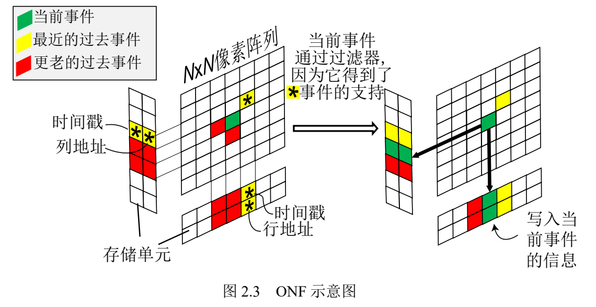
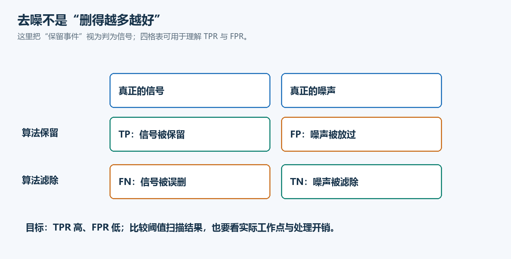
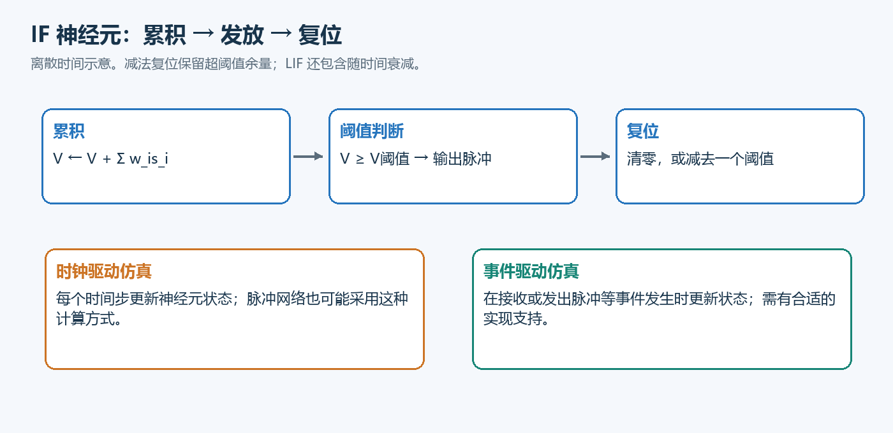
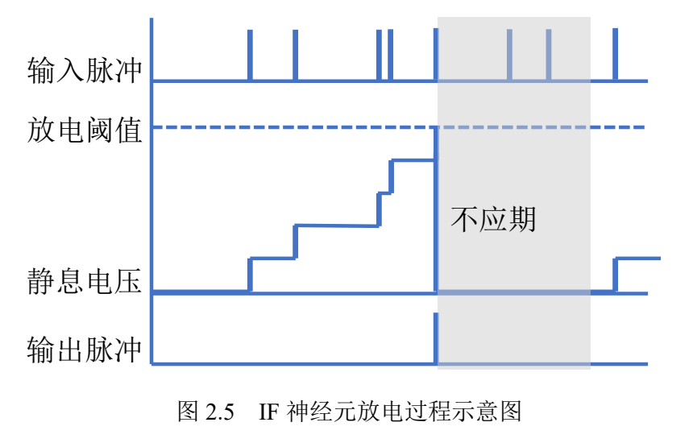

传统相机按帧记录场景，事件相机则记录像素亮度的变化。这样的变化让视觉数据拥有了不同的时间结构，也带来了新的问题：时间戳究竟代表什么？怎样把连续到来的事件交给算法？如何区分有效变化与噪声？又怎样利用脉冲神经网络处理这些数据？

本文合并整理两份论文阅读笔记，按照“事件生成 → 硬件与时间戳 → 数据表示 → 时空相关性 → 去噪与评价 → 脉冲计算”的顺序，建立一条连贯的学习路线。

> 整理依据为冯阳《动态视觉传感器事件流处理方法研究》和郭莎莎《面向动态视觉传感器的事件数据处理关键技术研究》的前两章详解笔记，并参照 Zotero 中的原论文核对第 2 章相关内容。本文包含学习示意图与论文原图节选，均在图下注明；原图保留原图号。未核验作者代码及后续实验，文中的教学计算示例不代表论文实验结果。

## 一、事件相机到底记录什么？

传统相机周期性曝光，输出完整图像。即使场景几乎不变，也会持续产生帧。动态视觉传感器（Dynamic Vision Sensor，DVS）的事件通道则关注每个像素的局部亮度变化：当变化达到阈值时，像素触发事件。

常用的理想模型为：

$$
\log I(x,y,t_k)-\log I(x,y,t_{k-1})\approx p_kC
$$

其中，$I$ 是光强，$C$ 是对比度阈值，$p_k\in\{+1,-1\}$ 表示变亮或变暗，$t_{k-1}$ 对应该像素上一次触发的参考时刻。真实电路还会受到噪声和非理想响应的影响。



*图 1｜事件生成的学习示意图。沿箭头阅读：传感器检测的是相对变化；静态亮度通常不会持续产生事件。参考两篇论文第 2 章。*

一个事件通常表示为：

$$
e_k=(x_k,y_k,t_k,p_k)
$$

| 字段 | 含义 | 不能直接推导的信息 |
| --- | --- | --- |
| $x_k,y_k$ | 触发像素的坐标 | 物体深度、目标类别 |
| $t_k$ | 事件时间戳 | 系统的端到端延迟 |
| $p_k$ | 亮度变化方向 | 像素的绝对亮度 |

不同设备和工作模式的事件字段不完全相同。例如，笔记讨论的部分 CeleX 模式可以使用 $(x,y,t)$ 表示事件；ATIS 的强度测量与 DAVIS 的 APS 图像通道，又提供了不同形式的补充信息。因此，读取数据之前应先确认型号、模式和格式。

事件驱动也不意味着数据量永远很小。光照闪烁、相机运动、复杂纹理和噪声，都可能让事件率迅速上升。

## 二、从像素触发到时间戳：硬件读出为什么重要？

冯阳论文笔记强调了一个容易被忽略的问题：**像素异步触发，不等于每个像素拥有独立的输出通道。**

事件还需要经过请求、仲裁、读出和传输。共享电路与时间戳赋值方式，会影响最终数据的时空结构。

### 1. 相同时间戳不一定意味着同时发生

笔记介绍的 CeleX-IV 数据具有按行组织输出的特点：先提供行信息，再输出该行的有效列信息。这并不意味着整行像素都触发，也不能直接理解为普通相机的固定逐行扫描。

如果时间戳在行读出阶段统一赋予，同一行的事件可能拥有相同或接近的时间戳，但其实际触发时刻未必完全一致。因此，事件点云中的横向聚集，可能同时包含真实运动和读出机制的影响。

笔记还讨论了 CeleX-V 的片上时间戳机制。理解这些硬件差异，比只比较标称时间精度更有助于解释数据。



*图 2｜行读出学习示意图。蓝色方块表示触发像素；同行事件共用时间戳，并不保证真实触发时刻完全一致。参考冯阳论文正文第 25—26 页、图 2.8。*

### 2. 时间分辨率、延迟和吞吐量是三个概念

- **时间分辨率**：时间戳能够区分多细的时间间隔。
- **延迟**：从场景变化到事件被系统使用，需要多长时间。
- **吞吐量**：单位时间内能够输出或处理多少事件。

时间分辨率高，并不能保证完整算法链路的延迟低。

### 3. 解码错误会直接改变算法结果

开始处理事件流之前，需要确认时间单位、坐标方向、极性编码、特殊记录和计数器回绕。

例如，一个周期为 1000 个计数单位的计数器输出：

```text
998, 999, 0, 1
```

展开后应为：

```text
998, 999, 1000, 1001
```

如果把回绕后的 `0` 当作时间倒退，时间窗口和邻域判断就会出错。很多看似“算法参数不合适”的问题，实际上发生在输入数据阶段。

## 三、怎样把事件流组织成算法输入？

两篇笔记都讨论了事件表示。不同表示保留的信息不同，也决定了算法需要等待多久、使用多少存储。

| 表示方式 | 保留的主要信息 | 需要注意的代价 |
| --- | --- | --- |
| 原始事件流 | 单个事件的坐标、时间和可用字段 | 处理不规则、长度变化的数据 |
| 事件包 | 一段时间或一定数量的事件 | 等待事件包收集完成 |
| 事件累积图 | 窗口内的空间分布或计数 | 通常弱化事件的先后顺序 |
| 时间表面 | 各像素最近事件的时间或衰减值 | 不能保留完整历史 |
| 时空体素、点云 | 空间位置与时间结构 | 存储和离散化方式影响结果 |

特别注意：$(x,y,t)$ 点云的第三个维度是时间，**不是深度**。图中的斜率还受到坐标轴缩放影响，不能仅凭外观判断运动速度。

处理窗口通常有三种选择：

1. **逐事件处理**：事件到来后立即更新状态，但仍有传输和计算开销。
2. **固定时间窗口**：每隔固定时长处理一次，窗口内事件数随场景变化。
3. **固定数量窗口**：每收集 $N$ 个事件处理一次，窗口覆盖的时间随事件率变化。



*图 3｜窗口划分学习示意图。对照同一串蓝点：固定时间窗口的宽度相同、事件数不同；固定数量窗口收集相同数量，覆盖时长不同。示例并非实测数据。*

在事件率 $r$ 近似稳定时，固定数量窗口的收集时间约为：

$$
T_{\mathrm{collect}}\approx\frac{N}{r}
$$

例如，收集 1000 个事件，在每秒 100 万事件时约需 1 ms，在每秒 10 万事件时约需 10 ms。这还不包含读出、传输和处理时间。

因此，固定事件数有助于控制每批输入规模，却不能保证固定的响应时间。

### 结合论文原图理解事件点云



*论文原图 A｜节选自冯阳《动态视觉传感器事件流处理方法研究》，正文第 27 页（PDF 第 41 页），图 2.9。仅截取图及原图题，未修改图中数据。*

先看坐标轴：$X,Y$ 是像素位置，$T$ 是时间，图中标注的时间单位为 ms。沿时间轴观察，可以看到局部事件在不同时刻形成的结构。它适合帮助我们理解“运动如何在时间上展开”，但不是物体的三维表面，也不能把所有散点直接判成噪声。

把事件累积到二维平面，相当于在一定程度上折叠时间维度：空间位置接近、发生时刻不同的事件可能重叠。这样方便使用图像处理方法，却可能失去运动顺序。反过来，保留时间信息需要算法处理更复杂的数据结构。

还要区分两种“累积”：事件计数图记录窗口内某个像素触发了多少次；带灰度信息的累积图则可能保留该像素最近一次更新的灰度。后者不同像素的更新时间未必一致，因此不能当作一次同步曝光的图像。这对应冯阳论文第 2.2.1 节对事件灰度图与累积灰度图的讨论。

## 四、时空相关性：为什么邻居能帮助判断事件？

真实运动边缘往往会在邻近位置、相近时间产生多个事件。孤立的随机事件则更可能缺乏邻域支持。这个观察是许多去噪方法的基础。



*图 4｜时空支持学习示意图。图中邻居应同时满足空间和时间条件；左侧支持较丰富，右侧支持较少，但相关噪声也可能形成事件簇。参考冯阳论文图 2.14、2.16，以及郭莎莎论文第 2.1.1 节。*

对当前事件 $e_0=(x_0,y_0,t_0)$，可以定义一个只使用过去信息的邻域：

$$
|x_i-x_0|\le \frac{L}{2},\qquad
|y_i-y_0|\le \frac{L}{2},\qquad
t_0-\Delta t\le t_i\le t_0
$$

$L$ 控制空间范围，$\Delta t$ 控制回看的时间范围。在线算法应避免使用尚未到达的未来事件。

最简单的支持度是邻域事件计数。进一步可以让距离近、时间近的事件拥有更大的权重。令：

$$
d_i=\sqrt{(x_i-x_0)^2+(y_i-y_0)^2},\qquad
\tau_i=t_0-t_i
$$

采用高斯形式的核：

$$
G(d_i,\tau_i)=\frac{1}{2\pi h_dh_t}
\exp\left[-\frac12\left(
\frac{d_i^2}{h_d^2}+\frac{\tau_i^2}{h_t^2}
\right)\right]
$$

并将邻域贡献相加：

$$
S(e_0)=\sum_{e_i\in\mathcal N(e_0)}G(d_i,\tau_i)
$$

这里用 $h_d,h_t$ 表示空间和时间带宽，用 $S$ 强调其“支持度”含义。这样的分数不是经过校准的真实事件概率，也不保证位于 0 到 1 之间。它会受到事件率、窗口大小、时间单位、带宽和邻居排除规则的影响。

冯阳笔记中的摆球例子可以帮助理解：球体边缘可能拥有比细绳更丰富的局部事件支持，但不能据此得出“物体越大，分数必然越高”的普遍结论。

此外，将空间关系压缩成距离 $d_i$，也会丢失方向信息。

### 摆球例子：分数高低应该怎样解释？

冯阳论文正文第 36—37 页用一段 2 ms 的摆球事件流演示时空支持度，并在图 2.16 中选取三个 $20\times20$ 像素区域。表 2.1 给出的结果如下：

| 取样区域 | 事件数 | 原文平均 $P_e$ |
| --- | --- | --- |
| A | 17 | 0.0630 |
| B | 75 | 0.1265 |
| C | 1 | 0 |

这是原论文中的特定样例数据，不是本文重新运行算法得到的结果。原文结合球体、细绳和孤立事件说明：邻域内支持丰富的事件，往往获得更高的分数。

读这张表时，需要同时观察事件数和得分。B 区域比 A 区域更密集，得分也更高，但不能据此设定一个对所有传感器、速度和光照都有效的通用阈值。C 区域的零分说明该样例缺少支持，不代表所有噪声都没有邻居。这个区别决定了算法能否从演示场景推广到其他数据。

## 五、事件去噪：保留信号和删除噪声同样重要

背景活动噪声（Background Activity，BA）可以在缺乏有效视觉变化时产生事件；热像素则可能持续异常触发。不同文献对噪声类别的划分可能不同，比较方法时需要先统一定义。

噪声不仅影响视觉结果，还会占用带宽、存储和状态更新次数。但去噪本身也消耗资源，因此不能只看删除了多少事件。

郭莎莎笔记介绍了几类基于时空支持的方法：

| 方法 | 基本思路 | 主要限制 |
| --- | --- | --- |
| BAF | 记录像素最近事件时间，用邻居的近期活动支持当前事件 | 单个支持事件可能来自偶然噪声 |
| EDF | 利用更丰富的事件历史或密度判断 | 历史状态需要更多存储 |
| ONF | 用行、列等压缩结构保存历史 | 压缩会损失信息，并产生覆盖 |

对于 BAF，若 $T(x,y)$ 表示邻居最近一次事件的时间，一个典型判据是存在邻居满足：

$$
0\le t_0-T(x,y)<\tau
$$

其中 $\tau$ 是时间阈值。ONF 一类压缩结构则体现了存储与信息完整性的权衡：按像素存储的规模约为 $O(WH)$，按行列存储约为 $O(W+H)$。

这些方法都有共同边界：

- 稀疏、低对比度的真实信号可能得不到足够支持，从而被误删。
- 聚集出现的噪声可能相互支持，从而被保留。
- 排除同一像素的历史有助于避免热像素自我支持，但不能消除邻近噪声的相互支持。

学习式去噪还可以采用时间图像、累积图或原始事件片段作为输入。但如果训练标签来自已有过滤器，模型也可能继承该过滤器的偏差。

### 从论文原图看 ONF 如何节省存储



*论文原图 B｜节选自郭莎莎《面向动态视觉传感器的事件数据处理关键技术研究》，正文第 24 页（PDF 第 39 页），图 2.3；算法说明见正文第 23 页。论文将该方法归于 Khodamoradi 等人的工作，详见其参考文献 [24]。*

这张图要从左往右读。绿色表示当前事件，黄色星号表示能够提供支持的近期事件，红色表示更早的事件。左侧检查已有行列记忆，右侧展示写入当前事件信息后的状态。

ONF 的关键不是保存完整事件历史，而是让一行或一列共享有限的存储单元。这样能够减少状态数量，但同一行列上的新事件也可能覆盖旧记录。换句话说，压缩结构保存的是有限记忆，并不等价于完整的二维邻域。

### BAF 与 EDF 的差异不只是换一个阈值

BAF 的基本问题是“有没有近期邻居”，EDF 则进一步询问“近期邻域里是否有足够多的事件”。如果每个像素只记录最后一次事件，较早但仍在时间窗口内的事件就无法恢复，因此密度判断需要更丰富的历史。

郭莎莎论文正文第 23 页说明，其 EDF 复现使用了 8 张时间戳图。这是该论文的实现选择，不是 EDF 在任何实现中都必须使用 8 张图。

例如，设当前时刻为 10 ms，检查过去 0.2 ms：9.9 ms 的邻居可以提供支持，9.7 ms 的邻居不能。若阈值扩大到 0.5 ms，支持会增加，但偶然噪声得到支持的机会也可能增加。这个教学例子说明，调参应同时观察误删信号和放过噪声，不能只追求过滤后画面更干净。

## 六、怎样判断去噪是否真的有效？

评价去噪需要同时关注信号保留和噪声泄漏。把真实信号视为正类，可以得到：

| 实际类型 | 保留 | 删除 |
| --- | --- | --- |
| 信号 | TP：正确保留 | FN：误删信号 |
| 噪声 | FP：错误保留 | TN：正确删除 |



*图 5｜去噪评价学习示意图。按列区分真实类型，按行区分算法决定；目标是保留更多信号、放过更少噪声。该图用于解释本文评价指标，不是论文实验结果。*

对应的两个指标是：

$$
\mathrm{TPR}=\frac{TP}{TP+FN},\qquad
\mathrm{FPR}=\frac{FP}{FP+TN}
$$

例如，100 个信号保留 90 个、100 个噪声保留 10 个，则 TPR 为 0.9，FPR 为 0.1。更严格的阈值可能降低 FPR，同时也降低 TPR。

ROC 曲线描述不同阈值下的权衡，AUC 可以概括曲线表现，但二者不能替代处理延迟、内存开销和下游任务效果。

更关键的是：**评价标签从哪里来？**

笔记讨论的标签来源包括受控运动、模型预测、辅助传感器、噪声注入和过滤器生成的伪标签。它们分别依赖不同假设。如果先用时空相关性定义“正确事件”，再用同一种相关性证明过滤器有效，就可能形成循环评价。

因此，一次完整比较至少应说明标签来源、信号保留率、噪声通过率、运行成本，以及对跟踪或识别任务的影响。

## 七、从有效事件到脉冲神经网络

去噪解决“哪些输入值得继续处理”，脉冲神经网络（Spiking Neural Network，SNN）进一步讨论“如何用脉冲进行计算”。这是郭莎莎笔记在共同基础之上的另一条重点。

### 1. 积分、发放和复位

积分发放模型（IF）将输入累积为膜电位，达到阈值后发放脉冲。泄漏积分发放模型（LIF）还会让膜电位随时间衰减。



*图 6｜IF 神经元学习示意图。上方表示神经元状态变化，下方区分两种仿真方式；事件驱动实现的收益还取决于平台。参考郭莎莎论文正文第 26—27 页、图 2.5 和式（2.1）—（2.3）。*

以一个简化的离散 IF 模型为例，先计算发放前电位：

$$
V_j^*[t]=V_j[t-1]+\sum_iw_{ij}s_i[t]
$$

再判断是否达到阈值：

$$
s_j[t]=\mathbf1\{V_j^*[t]\ge V_{\mathrm{th}}\}
$$

若采用减阈值复位：

$$
V_j[t]=V_j^*[t]-V_{\mathrm{th}}s_j[t]
$$

当电位为 1.3、阈值为 1 时，清零复位会将电位变为 0，减阈值复位则保留 0.3。两者会影响后续脉冲的数量和时机。

实现时还需要明确：每个时间步最多发放几次、是否存在不应期，以及输入、泄漏、发放和复位的执行顺序。

### 结合原图理解膜电位、不应期和复位



*论文原图 C｜节选自郭莎莎《面向动态视觉传感器的事件数据处理关键技术研究》，正文第 26 页（PDF 第 41 页），图 2.5。图中展示复位到静息电压并带有不应期的情形。*

沿横向的时间顺序阅读，可以把三组信号联系起来：

1. 上方的输入脉冲到来后，膜电位逐步上升。
2. 电位达到虚线所示阈值时，下方出现输出脉冲，膜电位回到静息电压。
3. 灰色区域表示不应期。该图的模型在这段时间内不响应输入，不能继续按普通积分过程累积。

IF 在没有输入时不发生泄漏，因此图中两次有效输入之间的电位保持不变。LIF 则引入随时间衰减的机制，使较早输入的影响逐渐减弱。

这里也要区分原图和前面的简化方程：原图包含不应期，并使用回到静息电压的复位方式；前文公式演示的是减阈值复位，且没有显式加入不应期。复现时必须选定一致的规则，不能把两者混用。

以初始电位为 0、阈值为 1、每步输入为 0.6 为例，若使用无泄漏、无不应期、每步最多一次发放的减阈值复位模型，三步后的电位依次为 0.6、0.2、0.8，第二步发放一次脉冲。第二步保留下来的 0.2 会参与下一步计算；清零复位则不会保留它。这是教学计算，并非论文测量数据。

### 2. ANN 转 SNN 为什么需要时间？

一种常见思路是用一段时间内的脉冲发放率近似 ANN 中的非负激活值：

$$
r\approx\frac{\text{脉冲数量}}{\text{观察时长}}
$$

但有限时间内只能出现有限个脉冲，因此会产生离散化误差。延长观察时间可能改善近似，也会增加延迟和计算量。阈值选择同样会影响发放率、误差和饱和情况。

所以，不能只比较 ANN 与 SNN 的单步运算，还应考虑 SNN 为得到结果需要多少个时间步。

### 3. 最大池化与实现方式的限制

ANN 中的最大池化可以直接比较数值；在 SNN 中，最早发放脉冲的神经元，不一定具有最高的长期发放率。

例如，A 先发放一次后保持安静，B 稍晚开始却累计发放十次。若依据发放率表示激活大小，就不能用“谁先发放”直接代替最大池化。

此外，SNN 可以采用按时间步更新的实现，也可以采用事件驱动的实现。**使用脉冲模型并不自动意味着低功耗**；最终成本取决于网络活动、时间步、软件实现和硬件平台。

## 八、复现前应统一核对的细节

两份原笔记提出了一些公式与文字表述的核对意见。以下作为复现检查项保留，不能据此推断作者代码存在同样的问题。

| 检查项 | 正确理解或核对方式 |
| --- | --- |
| 最近时间窗口 | 应覆盖 $t_0-\Delta t\le t_i\le t_0$；仅写 $t_i\le t_0-\Delta t$ 会选中更早事件 |
| 时间差方向 | 因果邻居的时间差通常取 $t_0-t_i\ge0$ |
| 排除自身 | 排除同一像素，不等于同时要求横、纵坐标都不同；后者会丢掉同行、同列邻居 |
| 高斯参数 | 明确参数是方差、标准差还是带宽，检查平方和单位 |
| 坐标压缩 | 横纵坐标各右移 $b$ 位，对应约 $2^b\times2^b$ 的空间分组 |
| 零噪声得分 | 个别样例得分为零，不能外推到所有噪声 |
| 硬件与工具介绍 | 论文中的“目前”“最新”只代表写作时期 |

这些细节贯穿完整处理链路。时间单位错误会影响邻域，邻域错误会影响支持度，支持度又会改变过滤结果和评价指标。

## 九、两篇笔记怎样结合学习？

| 学习目标 | 冯阳笔记的重点 | 郭莎莎笔记的重点 |
| --- | --- | --- |
| 读懂原始数据 | 读出机制、时间戳、解码 | 事件定义与传感器类型 |
| 组织算法输入 | 窗口、点云、事件流 | 多种表示及其信息取舍 |
| 理解去噪依据 | 时空邻域与加权支持度 | BAF、EDF、ONF 及学习方法 |
| 判断结果可信度 | 相关性分数的限制 | 标签来源、ROC 与评价偏差 |
| 继续处理有效事件 | 为后续事件处理提供基础 | IF/LIF、ANN-SNN 转换与池化 |

实际学习时，可以先读取一小段事件数据，确认时间单位和坐标，再分别绘制事件累积图与 $(x,y,t)$ 点云。接着实现一个只使用过去事件的邻域过滤器，观察阈值变化如何同时影响真实边缘和噪声。理解了这些输入与评价问题，再进入 SNN，脉冲计算的意义和代价会更容易把握。

## 整理来源

- 《冯阳论文_前两章基础知识详解》：对应冯阳《动态视觉传感器事件流处理方法研究》第 1—2 章，原笔记标注正文第 1—37 页。
- 《郭莎莎论文_前两章基础知识详解》：对应郭莎莎《面向动态视觉传感器的事件数据处理关键技术研究》（2022）第 1—2 章，原笔记标注正文第 1—31 页。

配图来源：两份阅读笔记随附的“论文前两章基础知识_配图”目录提供 6 张学习示意图；另从 Zotero 保存的两篇原论文中节选 3 张原图，出处、正文页码及 PDF 页码见各图说明。原图及引用数据的权利归原权利人所有，不因本站默认文章许可而改变。

本文合并了重复概念，并统一了部分符号和讲解顺序。后续章节中的算法效果、实验结论与性能优势不在本次汇总范围内。


