只测到带噪声的位置，为什么还能估计速度？事件相机没有固定帧率，滤波器的时间步长应该怎样设置？从标准卡尔曼滤波走到视觉惯性融合，又为什么需要误差状态、姿态注入和多视角约束？

这篇笔记沿着“直觉 → 公式 → 建模 → 实现”的顺序回答这些问题。先用一维手算和二维跟踪理解预测与更新，再比较不同滤波方法，最后回到事件相机与 IMU 的实际建模问题。阅读时不必一次记住所有变体，先建立一个能够解释状态、观测和不确定性的模型更重要。

> **阅读目标**：理解卡尔曼增益的来源，区分过程噪声和观测噪声，能按真实时间戳实现一个基础跟踪器，并知道何时需要 EKF、UKF 或 ESKF。
>
> **基础要求**：矩阵乘法、导数、均值与协方差；涉及三维姿态的章节还需要旋转矩阵和局部扰动的概念。
>
> **示例范围**：文中的数值参数和插图以教学说明为主，不代表相机标定值或真实传感器性能。Python 示例模拟已关联特征的位置观测，不是完整的事件视觉里程计。

## 怎样阅读这篇长文

| 阅读目标 | 推荐章节 | 读完后尝试 |
|---|---|---|
| 第一次接触卡尔曼滤波 | 第一至四节 | 手算一次更新，解释位置观测如何修正速度 |
| 想处理事件相机观测 | 第五节、第十四至十六节 | 明确观测含义，按真实时间差构造模型 |
| 想比较非线性方法 | 第六至九节、第十三节 | 区分线性化、采样点和工程增强方法 |
| 想学习事件相机与 IMU 融合 | 第十至十二节、第十四节 | 理解名义状态、误差状态和多视角约束 |
| 想直接动手 | 第十五至十七节 | 运行示例，观察创新、门控与误差统计 |

正文分为 18 节，文末第十九节集中收录带中文注释的代码，可通过博客侧边目录跳转。第一次阅读建议先完成标准 KF 和合成实验，再回头学习三维姿态与视觉惯性部分。

---

## 一、先建立直觉：到底在估计什么

用事件相机观察运动小球时，你希望知道小球的位置和速度，但传感器只产生一串亮度变化事件。前端算法从事件中跟踪出一个特征位置，这个位置仍有抖动、漏检和误匹配。

你有两类信息：

- **运动规律**：上一时刻的位置和速度已知，短时间后大概会在哪里？
- **测量信息**：传感器当前测到什么？这次测量有多可靠？

卡尔曼滤波器递推维护状态估计和误差协方差：

$$
\hat{\mathbf x}_k=\text{状态估计},\qquad
\mathbf P_k=\mathbb E[(\mathbf x_k-\hat{\mathbf x}_k)
(\mathbf x_k-\hat{\mathbf x}_k)^\top].
$$

状态不必直接可测。只测位置，也能通过连续的位置变化估计速度。

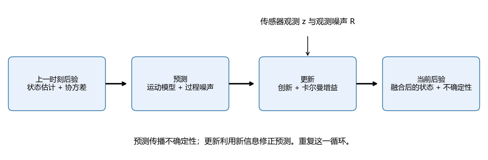

预测把状态推向未来；更新利用新观测纠正预测。没有观测也能预测，但通常会越来越不确定。

### 1.1 一个直观例子

预计目标在 2 米处，预测标准差为 2 米；传感器测到 5 米，标准差为 1 米。测量更可靠，结果应该更靠近 5 米。最终估计为 4.4 米，标准差约 0.894 米。后面会完整计算。

### 1.2 “最优”有条件

在线性系统、正确模型、初始高斯分布、相互独立的高斯白噪声等条件下，KF 给出精确的高斯后验，其均值是最小均方误差估计。若只满足适当的二阶统计条件，可解释为最优线性估计；不能据此保证任意非高斯问题的全局最优性。

EKF、UKF 通常只近似维护均值和协方差。错误关联、多峰后验和严重偏置，可能超出单高斯模型的能力。

## 二、数学准备与符号

### 2.1 符号表

| 符号 | 意义 | 维度 |
|---|---|---|
| $\mathbf x$ | 状态：位置、速度、姿态等 | $n\times1$ |
| $\mathbf z$ | 观测：像素位置等 | $m\times1$ |
| $\mathbf P$ | 状态误差协方差 | $n\times n$ |
| $\mathbf F$ | 状态转移矩阵或转移雅可比 | $n\times n$ |
| $\mathbf B,\mathbf u$ | 控制映射与已知输入 | 随输入定义 |
| $\mathbf H$ | 观测矩阵或观测雅可比 | $m\times n$ |
| $\mathbf Q$ | 一步传播的过程噪声协方差 | $n\times n$ |
| $\mathbf R$ | 观测噪声协方差 | $m\times m$ |
| $\mathbf r$ | 创新，通常为测量减预测 | $m\times1$ |
| $\mathbf S$ | 创新协方差 | $m\times m$ |
| $\mathbf K$ | 卡尔曼增益 | $n\times m$ |
| $\hat{\mathbf x}_k^-$ | 当前观测更新前的预测 | 等同 $\hat{\mathbf x}_{k\mid k-1}$ |
| $\hat{\mathbf x}_k^+$ | 当前观测更新后的估计 | 等同 $\hat{\mathbf x}_{k\mid k}$ |

全文用 $\mathbf R$ 表示测量噪声协方差，三维旋转则写成 $\mathbf R_{WB}$。

### 2.2 方差不等于标准差

像素定位标准差为 2 px，方差为 $4\ \mathrm{px}^2$。两个轴独立、精度相同，则：

$$
\mathbf R=\begin{bmatrix}4&0\\0&4\end{bmatrix}.
$$

非对角项表示误差相关性。位置与速度误差有相关性时，位置观测才能把修正传递到速度。

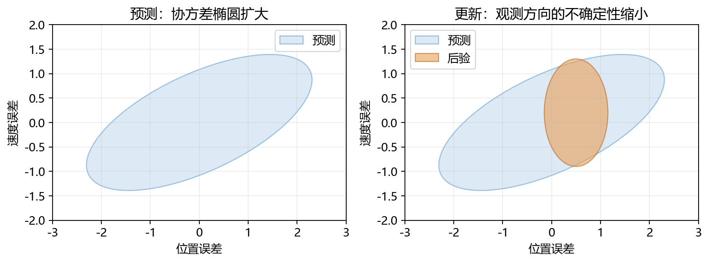

图只示意形状与方向，并非特定置信水平的计算。二维高斯的 95% 椭圆由马氏距离平方不超过 5.991 定义，不能把每个轴的 ±2σ 直接等同于二维 95% 联合区域。

### 2.3 贝叶斯观点

预测传播概率：

$$
p(\mathbf x_k\mid\mathbf z_{1:k-1})
=\int p(\mathbf x_k\mid\mathbf x_{k-1})
p(\mathbf x_{k-1}\mid\mathbf z_{1:k-1})d\mathbf x_{k-1}.
$$

更新融合观测：

$$
p(\mathbf x_k\mid\mathbf z_{1:k})
\propto p(\mathbf z_k\mid\mathbf x_k)
p(\mathbf x_k\mid\mathbf z_{1:k-1}).
$$

标准线性高斯条件下，两步都能用均值和协方差封闭表示。

## 三、标准 KF：完整公式、推导与手算

### 3.1 状态空间模型

$$
\mathbf x_k=\mathbf F_k\mathbf x_{k-1}
+\mathbf B_k\mathbf u_k+\mathbf w_k,\quad
\mathbf w_k\sim\mathcal N(\mathbf0,\mathbf Q_k),
$$
$$
\mathbf z_k=\mathbf H_k\mathbf x_k+\mathbf v_k,\quad
\mathbf v_k\sim\mathcal N(\mathbf0,\mathbf R_k).
$$

默认过程噪声、测量噪声和先前状态误差满足所需的独立或零相关条件。同一批事件的重复处理可能破坏这一条件。

### 3.2 预测

$$
\boxed{\hat{\mathbf x}_k^-=\mathbf F_k\hat{\mathbf x}_{k-1}^+
+\mathbf B_k\mathbf u_k}
$$
$$
\boxed{\mathbf P_k^-=\mathbf F_k\mathbf P_{k-1}^+\mathbf F_k^\top+\mathbf Q_k}
$$

$Q$ 描述模型没有解释的变化，例如匀速模型下的突然加速；它不是观测噪声。

### 3.3 创新、增益和更新

$$
\mathbf r_k=\mathbf z_k-\mathbf H_k\hat{\mathbf x}_k^-,
\quad
\mathbf S_k=\mathbf H_k\mathbf P_k^-\mathbf H_k^\top+\mathbf R_k,
$$
$$
\boxed{\mathbf K_k=\mathbf P_k^-\mathbf H_k^\top\mathbf S_k^{-1}}
$$
$$
\boxed{\hat{\mathbf x}_k^+=\hat{\mathbf x}_k^-+\mathbf K_k\mathbf r_k}
$$

推荐 Joseph 协方差更新：

$$
\boxed{\mathbf P_k^+=(\mathbf I-\mathbf K_k\mathbf H_k)\mathbf P_k^-
(\mathbf I-\mathbf K_k\mathbf H_k)^\top+
\mathbf K_k\mathbf R_k\mathbf K_k^\top}
$$

理论上可简化为 $(I-KH)P^-$，但 Joseph 形式通常更能抵抗浮点舍入问题。程序中应解线性方程，不必显式求逆。

### 3.4 增益为什么这样定义

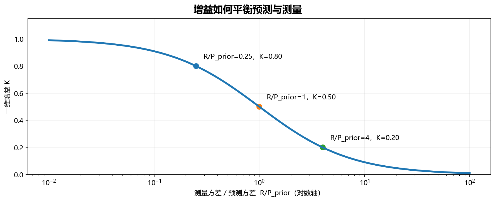

*图解：固定 H=1 时，K=1/(1+R/P_prior)。左侧测量相对可靠，更新幅度大；右侧更相信预测。*

设更新规则为 $\hat x^+=\hat x^-+K(z-H\hat x^-)$。代入误差定义，利用噪声独立性得到 Joseph 形式。最小化后验均方误差，即最小化 $\operatorname{tr}(P^+)$：

$$
\frac{\partial\operatorname{tr}(\mathbf P^+)}{\partial\mathbf K}
=-2\mathbf P^-\mathbf H^\top
+2\mathbf K(\mathbf H\mathbf P^-\mathbf H^\top+\mathbf R)=0.
$$

由此得到 $K=P^-H^\top(HP^-H^\top+R)^{-1}$。增益来自不确定性的权衡，不是随意设置的平滑系数。一般矩阵增益的元素并不一定都在 0 和 1 之间。

### 3.5 手算一维更新

给定：

$$
\hat x^-=2,\quad P^-=4,\quad z=5,\quad H=1,\quad R=1.
$$
$$
r=3,\quad S=5,\quad K=0.8,
$$
$$
\hat x^+=2+0.8\times3=4.4,\quad
P^+=(1-0.8)^2\times4+0.8^2=0.8.
$$

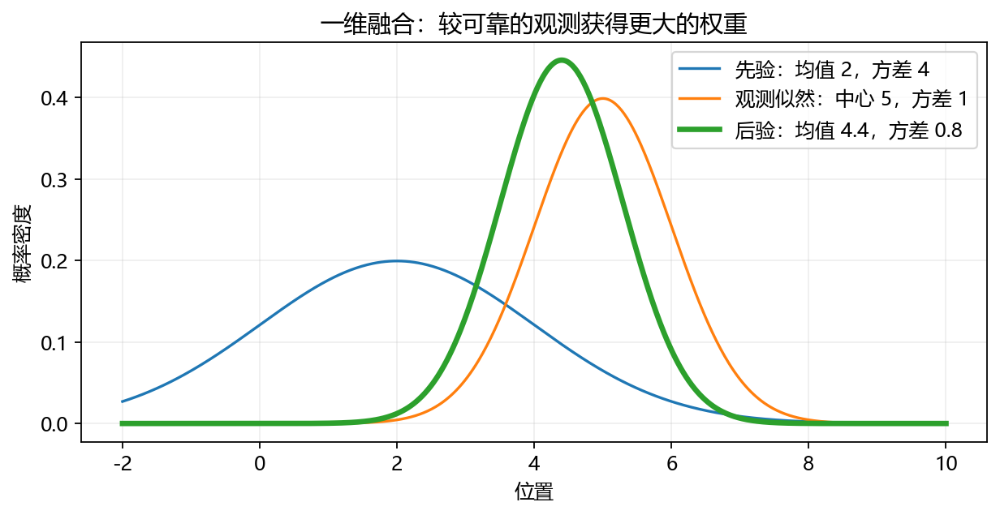

若改成 $R=16$，则 $K=0.2$，后验均值为 2.6：越不可靠的测量，权重越小。

### 3.6 只测位置，为什么速度也更新

状态为 $[p,v]^\top$。上一时刻：

$$
\hat{\mathbf x}^+=\begin{bmatrix}0\\1\end{bmatrix},\quad
\mathbf P^+=\begin{bmatrix}1&0\\0&1\end{bmatrix}.
$$

取 $\Delta t=1,Q=0$：

$$
\mathbf F=\begin{bmatrix}1&1\\0&1\end{bmatrix},\quad
\hat{\mathbf x}^-=\begin{bmatrix}1\\1\end{bmatrix},\quad
\mathbf P^-=\begin{bmatrix}2&1\\1&1\end{bmatrix}.
$$

测到 $z=1.6,R=1,H=[1\ 0]$，于是：

$$
S=3,\quad \mathbf K=\begin{bmatrix}2/3\\1/3\end{bmatrix},
$$
$$
\hat{\mathbf x}^+=\begin{bmatrix}1.4\\1.2\end{bmatrix},\quad
\mathbf P^+=\begin{bmatrix}2/3&1/3\\1/3&2/3\end{bmatrix}.
$$

位置比预测更远，滤波器推断速度可能偏小。把位置创新传给速度的桥梁是交叉协方差。

## 四、二维运动建模：特别注意时间步长

### 4.1 匀速 CV 模型

在图像中跟踪同一个特征：

$$
\mathbf x=[u,v,\dot u,\dot v]^\top,\qquad \mathbf z=[u_{\rm obs},v_{\rm obs}]^\top.
$$

位置单位 px，速度 px/s，时间 s：

$$
\mathbf F(\Delta t)=
\begin{bmatrix}
1&0&\Delta t&0\\0&1&0&\Delta t\\0&0&1&0\\0&0&0&1
\end{bmatrix},\quad
\mathbf H=\begin{bmatrix}1&0&0&0\\0&1&0&0\end{bmatrix}.
$$

图像轨迹只在短时近似匀速，相机旋转、深度变化和目标机动均可破坏假设。

### 4.2 两种不同的过程噪声

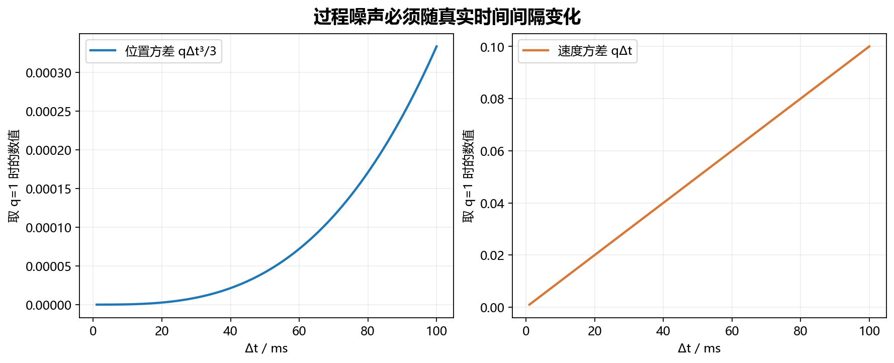

*图解：连续白加速度模型的计算曲线：时间间隔增长时，位置和速度的不确定性以不同幂次增长。两幅图纵轴单位不同。*

**模型 A：连续时间白加速度驱动。** 设谱密度为 $q$，两个轴独立：

$$
\mathbf Q(\Delta t)=q
\begin{bmatrix}
\Delta t^3/3&0&\Delta t^2/2&0\\
0&\Delta t^3/3&0&\Delta t^2/2\\
\Delta t^2/2&0&\Delta t&0\\
0&\Delta t^2/2&0&\Delta t
\end{bmatrix}.
$$

$q$ 的单位为 $\mathrm{px}^2/\mathrm{s}^3$。它适合按不同时间长度一致传播随机扰动，配套程序使用此模型。

**模型 B：区间内随机常加速度。** 若区间内加速度误差方差是 $\sigma_a^2$：

$$
\mathbf G=
\begin{bmatrix}
\Delta t^2/2&0\\0&\Delta t^2/2\\
\Delta t&0\\0&\Delta t
\end{bmatrix},\quad
\mathbf Q=\mathbf G(\sigma_a^2I)\mathbf G^\top.
$$

此时位置方差项为 $\sigma_a^2\Delta t^4/4$，$\sigma_a^2$ 的单位为 $\mathrm{px}^2/\mathrm{s}^4$。两种形式对应不同随机过程，参数不能不加区分地互换。

### 4.3 运动更复杂时

- 缓慢变化的加速度：用 CA 模型，把加速度加入状态，以白 jerk 驱动。
- 转弯：考虑协调转弯模型，配合 EKF、UKF。
- 运动模式突然切换：检查关联错误后，再考虑 IMM。
- 估计相机六自由度运动：应使用几何和惯性模型，不能只依赖图像 CV。

## 五、事件相机：从原始事件到合法观测

### 5.1 事件是什么

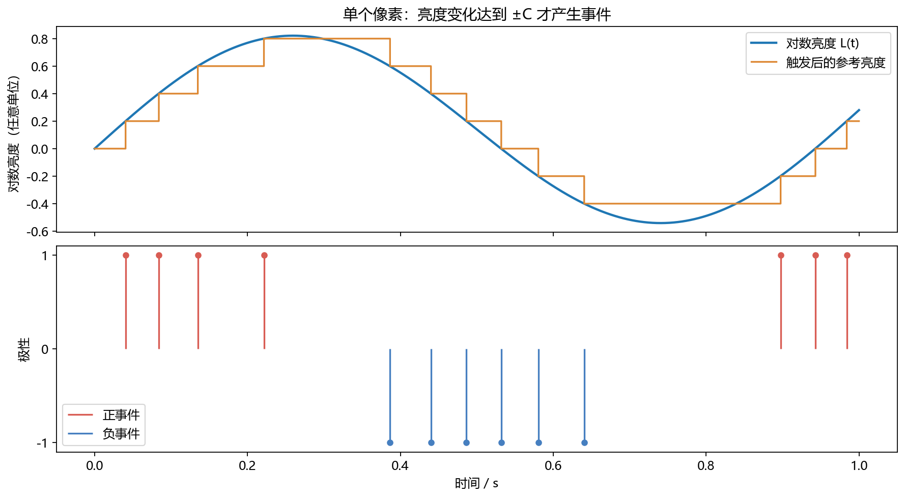

*图解：理想阈值 C=0.2 的数值模拟。事件反映亮度增量，不能直接解释为目标中心的位置测量；真实传感器还存在阈值差异和噪声。*

$$
e_i=(u_i,v_i,t_i,p_i),\qquad p_i\in\{-1,+1\}.
$$

它表示像素的对数亮度变化达到阈值。理想化表达：

$$
L(u_i,v_i,t_i)-L(u_i,v_i,t_i^{\rm ref})\approx p_iC,\qquad L=\log I.
$$

$t_i^{\rm ref}$ 是该像素的有效参考时刻，理想模型通常对应上次触发后参考值重置；不是全局前一个事件的时间。真实传感器有阈值差异、正负阈值不对称、噪声和读出限制。机制与算法全景可参考 [事件视觉综述](https://arxiv.org/abs/1904.08405)。

**原始事件的像素位置，是亮度变化发生的位置，不是目标中心，也不是自动关联好的三维地标投影。**

不能把所有事件的像素坐标都喂给一个位置 KF，并期待得到物体中心。首先要说明每条观测属于哪个目标、哪个特征，或者哪个生成模型。

### 5.2 三条路线

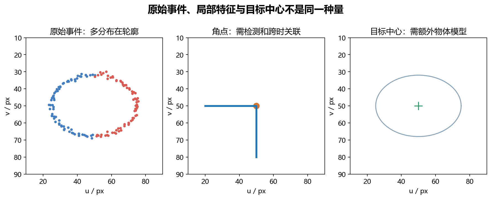

*图解：概念示意，非真实传感器数据。轮廓上的每个事件不能作为同一个中心点的独立观测。*

| 路线 | 前端输出 | 后端观测 | 方法 | 难点 |
|---|---|---|---|---|
| 特征路线 | 角点、边缘、轨迹 | 像素坐标、线距离 | KF、ESKF、MSCKF | 关联和时间戳 |
| 运动路线 | 光流、相对运动 | 速度或相对位姿 | EKF、ESKF | 前端误差与相关性 |
| 直接路线 | 原始事件或事件包 | 亮度增量等生成残差 | EKF、迭代 EKF、优化 | 地图、阈值和历史状态 |

入门优先特征路线。直接路线反而需要更完整的亮度、几何和噪声模型。

### 5.3 时间戳比帧号重要

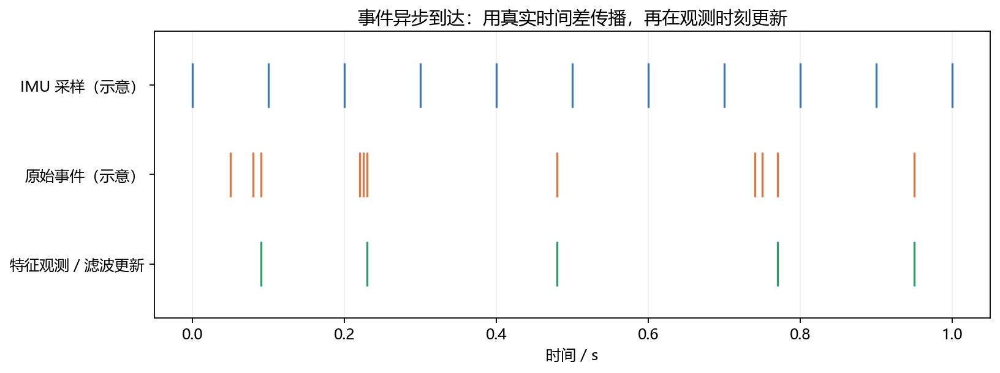

每次有效观测到来：

1. 计算 $\Delta t=t_{\rm obs}-t_{\rm state}$。
2. 用真实 $\Delta t$ 构造传播和过程噪声。
3. 传播到观测真正对应的时刻。
4. 做关联、残差检验和更新。
5. 保存新状态时间戳。

微秒先转换成秒。不要使用固定 1/30 秒处理所有事件，也不要把 CPU 收包时间当成传感器采样时间。

### 5.4 事件包策略

| 策略 | 好处 | 代价 |
|---|---|---|
| 固定时长 | 时间跨度可控 | 事件数变化大 |
| 固定事件数 | 计算量相对稳定 | 低事件率时等待很久 |
| 数量与最长时间双阈值 | 兼顾等待时间和信息量 | 仍需验证时序与运动畸变 |

跨越 $[t_a,t_b]$ 的事件包不是同一时刻的普通图像。可以先运动补偿到统一参考时刻 $t_r$，再输出对应 $t_r$ 的位置；否则需要说明有效时间和时间跨度误差。

### 5.5 多事件不等于多份独立信息

相邻事件往往共享边缘、运动、阈值误差和前端窗口。忽略相关性会导致过度自信。

同一段事件既算光流，又算特征位置，再当独立测量融合，可能重复计数。可建模交叉协方差、选用一种观测、减少窗口重叠，或通过一致性验证采取保守噪声模型。

## 六、扩展卡尔曼滤波 EKF

### 6.1 适用条件

运动或观测非线性：

$$
\mathbf x_k=f(\mathbf x_{k-1},\mathbf u_k)+\mathbf w_k,\qquad
\mathbf z_k=h(\mathbf x_k)+\mathbf v_k.
$$

三维投影涉及除以深度，姿态涉及旋转，都不是普通线性映射。

### 6.2 具体递推

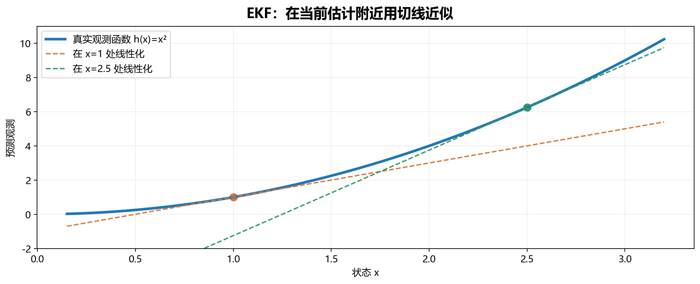

*图解：离线性化点越远，切线与曲线的差异通常越明显。EKF 用局部雅可比传播不确定性，因此初始化和更新频率很重要。*

$$
\hat{\mathbf x}_k^-=f(\hat{\mathbf x}_{k-1}^+,\mathbf u_k),\quad
\mathbf F_k=\left.\frac{\partial f}{\partial\mathbf x}\right|_{\hat{\mathbf x}_{k-1}^+},
$$
$$
\mathbf P_k^-=\mathbf F_k\mathbf P_{k-1}^+\mathbf F_k^\top+\mathbf Q_k,
$$
$$
\mathbf H_k=\left.\frac{\partial h}{\partial\mathbf x}\right|_{\hat{\mathbf x}_k^-},
\quad \mathbf r_k=\mathbf z_k-h(\hat{\mathbf x}_k^-).
$$

随后使用 KF 的增益与协方差公式。均值经过真实非线性函数传播，协方差通过局部线性化传播。

噪声若非加性进入，需要噪声雅可比 $G=\partial f/\partial w$，过程噪声项改为 $GQ_wG^\top$，观测侧同理。

### 6.3 针孔投影的具体例子

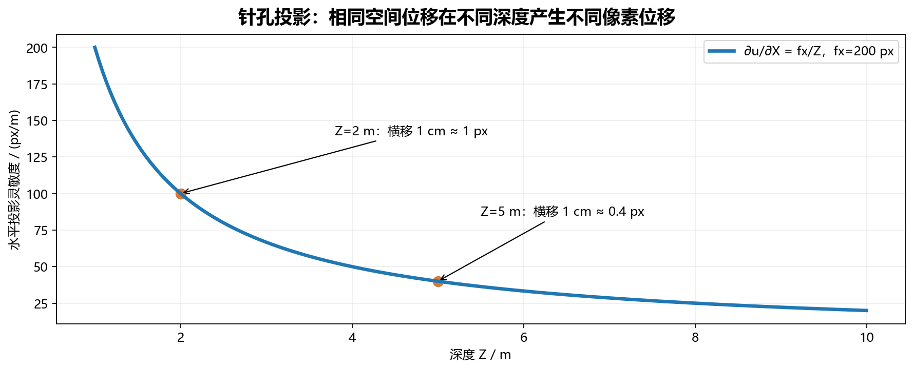

*图解：固定深度下的精确水平灵敏度。像素变化与米制位移之间依赖深度，不能直接把像素速度当成真实空间速度。*

地标在相机坐标系的位置为 $\mathbf p_C=[X,Y,Z]^\top$，去畸变后：

$$
h(\mathbf p_C)=\begin{bmatrix}f_xX/Z+c_x\\f_yY/Z+c_y\end{bmatrix},
$$
$$
\mathbf J_\pi=
\begin{bmatrix}f_x/Z&0&-f_xX/Z^2\\0&f_y/Z&-f_yY/Z^2\end{bmatrix}.
$$

取 $f_x=f_y=200,c_x=120,c_y=90,\mathbf p_C=[1,0.5,5]^\top$：

$$
\hat{\mathbf z}=[160,110]^\top,\quad
\mathbf J_\pi=\begin{bmatrix}40&0&-8\\0&40&-4\end{bmatrix}.
$$

事件前端给出 $[162,109]^\top$，创新为 $[2,-1]^\top$ px。若状态是相机位姿，完整雅可比仍需链式法则：

$$
\mathbf H=\mathbf J_\pi\frac{\partial\mathbf p_C}{\partial\mathbf x}.
$$

不能把点坐标的投影雅可比直接当作位姿雅可比。

### 6.4 怎么实现与检查

确定坐标系 → 写出 $f,h$ → 推导雅可比 → 数值差分核验 → 合成数据 → 真实事件。

$$
\mathbf H_{:,j}^{\rm num}\approx
\frac{h(\mathbf x+\epsilon\mathbf e_j)-h(\mathbf x-\epsilon\mathbf e_j)}{2\epsilon}.
$$

旋转应使用局部扰动，不能任意修改四元数四个分量。EKF 适合实时系统，但初始化不佳、强非线性、错误关联均可能使其失效。

## 七、迭代扩展卡尔曼滤波 Iterated EKF

### 7.1 解决什么

同一测量更新里反复调整线性化点，近似求解：

$$
\min_{\mathbf x}
\frac12\|\mathbf x-\hat{\mathbf x}^-\|_{(\mathbf P^-)^{-1}}^2
+\frac12\|\mathbf z-h(\mathbf x)\|_{\mathbf R^{-1}}^2.
$$

其中 $\|a\|_M^2=a^\top Ma$。

### 7.2 欧氏状态下的迭代

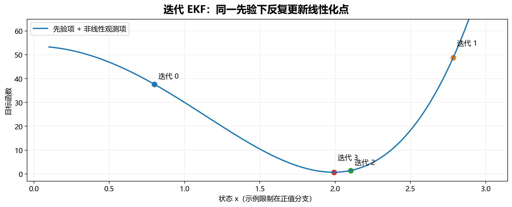

*图解：实际计算示例：h(x)=x²，先验均值 0.8、方差 1，测量 z=4、R=0.15。迭代寻找局部解，不能保证任意初始化都到达全局最优。*

令 $x_0=\hat x^-$：

$$
\mathbf H_i=\frac{\partial h}{\partial\mathbf x}\bigg|_{\mathbf x_i},\quad
\mathbf K_i=\mathbf P^-\mathbf H_i^\top
(\mathbf H_i\mathbf P^-\mathbf H_i^\top+\mathbf R)^{-1},
$$
$$
\mathbf x_{i+1}=\hat{\mathbf x}^-+
\mathbf K_i[\mathbf z-h(\mathbf x_i)
+\mathbf H_i(\mathbf x_i-\hat{\mathbf x}^-)].
$$

增量足够小或达到上限时停止，最后根据最终线性化更新一次协方差。迭代期间保留同一个先验，否则会把同一测量重复算作新信息。

### 7.3 事件例子

已知地图时，事件边缘与地图投影的残差对姿态非线性较强。每个小包可做少量重投影和重线性化。以 3～5 次作为教学实验起点，再验证收敛和耗时，不是通用最佳次数。

错误关联不会因多迭代自动正确，还需要门控和鲁棒处理。

**Iterated EKF 与 Invariant EKF 都可能缩写为 IEKF，但含义不同。本文把后者写作 InEKF。**

## 八、无迹卡尔曼滤波 UKF

### 8.1 核心思想

EKF 近似函数，UKF 用确定性代表点近似分布，再让点经过真实函数。

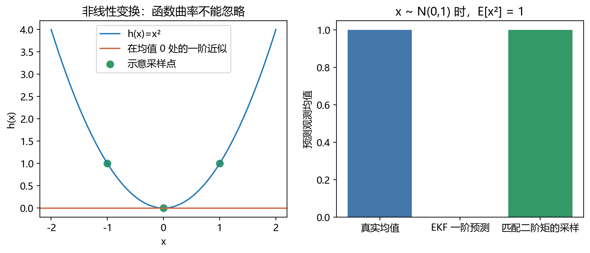

例如 $x\sim N(0,1),h(x)=x^2$，真实输出均值为 1，但在零点一阶展开为 0。图中点仅示意采样思想，不代表通用 UKF 参数。

### 8.2 Sigma 点

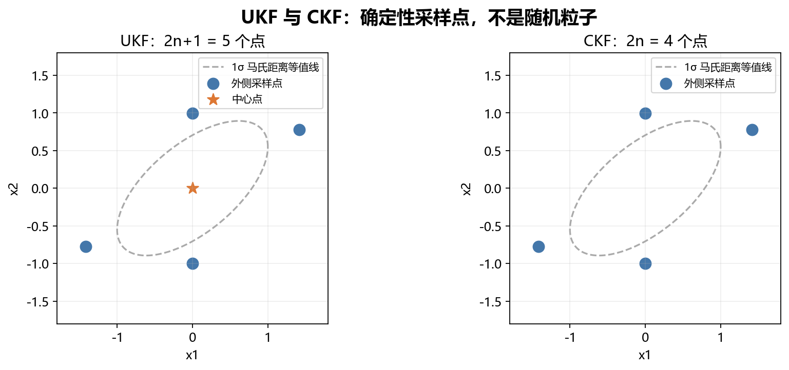

*图解：二维示例：UKF 取 α=1、κ=0，外点与 CKF 恰好重合；但 UKF 中心点的协方差权重仍与 β 有关，两者不能仅凭图形相似认定完全等价。*

对于 $n$ 维状态：

$$
\lambda=\alpha^2(n+\kappa)-n,\qquad LL^\top=P.
$$
$$
\chi_0=\mu,\quad
\chi_i=\mu+\sqrt{n+\lambda}L_{:,i},\quad
\chi_{i+n}=\mu-\sqrt{n+\lambda}L_{:,i}.
$$
$$
W_0^{(m)}=\frac{\lambda}{n+\lambda},\quad
W_0^{(c)}=\frac{\lambda}{n+\lambda}+1-\alpha^2+\beta,
$$
$$
W_i^{(m)}=W_i^{(c)}=\frac1{2(n+\lambda)}.
$$

$\alpha$ 控制点尺度，$\beta=2$ 是针对高斯常用选择，$\kappa$ 是辅助参数。过小的 $\alpha$ 可能造成巨大正负权重和数值抵消，不能机械套用。

### 8.3 加性噪声的完整步骤

$$
\chi_i^-=f(\chi_i,u),\quad
\hat x^-=\sum_iW_i^{(m)}\chi_i^-,
$$
$$
P^-=\sum_iW_i^{(c)}(\chi_i^--\hat x^-)(\chi_i^--\hat x^-)^\top+Q.
$$

为了让观测传播包含新增过程噪声，**从 $(\hat x^-,P^-)$ 重新生成 sigma 点** $\tilde\chi_i$：

$$
\zeta_i=h(\tilde\chi_i),\quad \hat z=\sum_iW_i^{(m)}\zeta_i,
$$
$$
S=\sum_iW_i^{(c)}(\zeta_i-\hat z)(\zeta_i-\hat z)^\top+R,
$$
$$
P_{xz}=\sum_iW_i^{(c)}(\tilde\chi_i-\hat x^-)(\zeta_i-\hat z)^\top,
$$
$$
K=P_{xz}S^{-1},\quad \hat x^+=\hat x^-+K(z-\hat z),\quad
P^+=P^--KSK^\top.
$$

非加性噪声通常需要增广噪声变量。角度和四元数均值、差分需要相应几何运算。

### 8.4 场景与例子

用事件前端得到的目标方位角跟踪二维位置：

$$
x=[x_p,y_p,v_x,v_y]^\top,\quad h(x)=\operatorname{atan2}(y_p,x_p).
$$

四维状态生成 9 个点，分别经过运动和方位函数，进行圆周角度平均、残差归一化，再更新。仅方位观测不一定能估计距离，还需要观察者运动、其他传感器或额外先验。

适合中低维、雅可比难实现、非线性明显的问题。它不天然解决多峰后验，也不保证比 EKF 更准。大量克隆位姿的 VIO 会使采样点和观测计算成本增加。

## 九、容积卡尔曼滤波 CKF

三阶球面径向规则使用 $2n$ 个点：

$$
\xi_i=\sqrt n\,e_i,\quad \xi_{i+n}=-\sqrt n\,e_i,\quad w_i=\frac1{2n},
$$
$$
\chi_i=\mu+L\xi_i,\qquad LL^\top=P.
$$

把它们代入 UKF 一节的函数传播与矩计算框架即可，权重统一为 $1/(2n)$。加入 $Q$ 后，观测变换前也要重新生成点，或采用一致的增广形式。

**练习：**先实现 UKF，再替换点和权重得到 CKF。四维状态使用 8 个点，在同一数据、模型、噪声下比较。

适合希望避免 UKF 尺度参数调节的中低维问题。容积规则的多项式积分精度不意味着所有非线性系统都精确，仍需关注单高斯假设和数值正定性。

## 十、误差状态卡尔曼滤波 ESKF

### 10.1 为什么事件相机 + IMU 特别适合学习它

三维旋转不能像位置一样任意相加。ESKF 用名义状态表示大运动，用小误差表示局部修正。四元数虽然存储四个数，旋转误差却只有三个自由度。

约定世界系 $W$、IMU 机体系 $B$、相机系 $C$，$R_{WB}$ 把机体系向量变到世界系。采用右乘局部旋转误差：

$$
\mathbf R_{WB}^{\rm true}
=\hat{\mathbf R}_{WB}\operatorname{Exp}([\delta\boldsymbol\theta]_\times).
$$

$[a]_\times b=a\times b$。后续公式服从这个约定，不能与左乘误差公式混用。

### 10.2 名义状态和误差状态

$$
\mathbf x=(\mathbf p_W,\mathbf v_W,\mathbf R_{WB},\mathbf b_a,\mathbf b_g),
$$
$$
\delta\mathbf x=
[\delta\mathbf p^\top,\delta\mathbf v^\top,
\delta\boldsymbol\theta^\top,\delta\mathbf b_a^\top,\delta\mathbf b_g^\top]^\top.
$$

误差状态为 15 维。这里假定重力、内外参已知。若在线估计重力、外参或时间偏移，需要增广状态并重新分析可观性。

### 10.3 IMU 名义传播

IMU 测量模型：

$$
\mathbf a_m=\mathbf R_{WB}^\top(\dot{\mathbf v}_W-\mathbf g_W)
+\mathbf b_a+\mathbf n_a,\quad
\boldsymbol\omega_m=\boldsymbol\omega+\mathbf b_g+\mathbf n_g.
$$

名义状态无噪声传播：

$$
\dot{\mathbf p}_W=\mathbf v_W,\quad
\dot{\mathbf v}_W=\mathbf R_{WB}(\mathbf a_m-\mathbf b_a)+\mathbf g_W,
$$
$$
\dot{\mathbf R}_{WB}=\mathbf R_{WB}[\boldsymbol\omega_m-\mathbf b_g]_\times,
\quad\dot{\mathbf b}_a=\mathbf0,\quad\dot{\mathbf b}_g=\mathbf0.
$$

偏置不确定性通过随机游走进入误差系统。简单离散化：

$$
\mathbf a_W=\hat{\mathbf R}_{WB}(\mathbf a_m-\hat{\mathbf b}_a)+\mathbf g_W,
$$
$$
\hat{\mathbf p}_{k+1}=\hat{\mathbf p}_k+\hat{\mathbf v}_k\Delta t
+\tfrac12\mathbf a_W\Delta t^2,\quad
\hat{\mathbf v}_{k+1}=\hat{\mathbf v}_k+\mathbf a_W\Delta t,
$$
$$
\hat{\mathbf R}_{k+1}=
\hat{\mathbf R}_k\,\operatorname{Exp}(
[\boldsymbol\omega_m-\hat{\mathbf b}_g]_\times\Delta t).
$$

高速旋转时考虑中值积分等更准确方案；均值和协方差的离散化也要一致。

### 10.4 误差动力学

记 $\hat a=a_m-\hat b_a,\hat\omega=\omega_m-\hat b_g$：

$$
\delta\dot{\mathbf p}=\delta\mathbf v,
$$
$$
\delta\dot{\mathbf v}
=-\hat{\mathbf R}[\hat{\mathbf a}]_\times\delta\boldsymbol\theta
-\hat{\mathbf R}\delta\mathbf b_a-\hat{\mathbf R}\mathbf n_a,
$$
$$
\delta\dot{\boldsymbol\theta}
=-[\hat{\boldsymbol\omega}]_\times\delta\boldsymbol\theta
-\delta\mathbf b_g-\mathbf n_g,
$$
$$
\delta\dot{\mathbf b}_a=\mathbf n_{ba},\qquad
\delta\dot{\mathbf b}_g=\mathbf n_{bg}.
$$

写成 $\delta\dot x=A\delta x+Gn$：

$$
\mathbf A=
\begin{bmatrix}
0&I&0&0&0\\
0&0&-\hat R[\hat a]_\times&-\hat R&0\\
0&0&-[\hat\omega]_\times&0&-I\\
0&0&0&0&0\\
0&0&0&0&0
\end{bmatrix}.
$$

每块为 $3\times3$。噪声按 $(n_a,n_g,n_{ba},n_{bg})$ 排列时，$G$ 非零块依次为速度行的 $-\hat R$、姿态行的 $-I$、两个偏置行的 $I$。

区间内冻结线性化时：

$$
\Phi=e^{A\Delta t},\quad
Q_d=\int_0^{\Delta t}e^{A\tau}GQ_cG^\top e^{A^\top\tau}d\tau,
$$
$$
P^-=\Phi P^+\Phi^\top+Q_d.
$$

短区间可以用一阶近似，但精度必须验证。IMU 噪声密度、每采样噪声方差、偏置随机游走是不同量，不能直接混用。

### 10.5 视觉更新、误差注入与重置

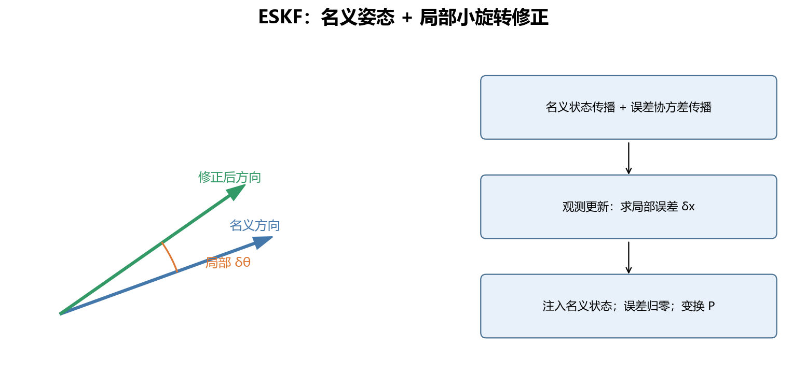

*图解：左图以二维方向示意局部旋转，不是完整 SO(3) 参数化。注入后切空间参考点改变，因此除了把误差均值清零，还要变换协方差。*

$$
r=z-h(\hat x)\approx H_\delta\delta x+v.
$$

用 KF 求出 $\delta\hat x=Kr$，注入名义状态：

$$
\hat p\leftarrow\hat p+\delta\hat p,\quad
\hat v\leftarrow\hat v+\delta\hat v,
$$
$$
\hat R\leftarrow\hat R\,\operatorname{Exp}([\delta\hat\theta]_\times),
\quad
\hat b_a\leftarrow\hat b_a+\delta\hat b_a,\quad
\hat b_g\leftarrow\hat b_g+\delta\hat b_g.
$$

然后误差均值归零，并变换更新后的协方差：

$$
P\leftarrow J_{\rm reset}P J_{\rm reset}^\top.
$$

本文右乘局部误差约定下，旋转块一阶近似：

$$
J_{{\rm reset},\theta}\approx I-\tfrac12[\delta\hat\theta]_\times.
$$

其他加性状态块为单位阵。忘记协方差重置、左右扰动混用、四元数乘法方向错误都是常见问题。可结合 [Solà 的旋转与 ESKF 教程](https://arxiv.org/abs/1711.02508) 深入学习。

### 10.6 先做物理检查

静止且姿态已知时，应满足：

$$
R_{WB}(a_m-b_a)+g_W\approx0.
$$

若静止时积分出快速下坠，先检查重力符号、坐标变换和单位，不要靠增大噪声掩盖错误。

## 十一、不变扩展卡尔曼滤波 InEKF

### 11.1 和 ESKF 有何不同

ESKF 是在局部误差上滤波的一般思路；InEKF 利用系统的李群结构与对称性定义误差，二者相关但不等同。

对群元素 $X$，一种右不变误差定义是：

$$
\eta^R=\hat X X^{-1},\qquad \xi=\log(\eta^R)^\vee.
$$

同时右乘任意群元素 $G$ 后：

$$
(\hat XG)(XG)^{-1}=\hat XX^{-1},
$$

误差不变。文献可能采用倒数误差，必须核对定义。

### 11.2 价值与条件

对满足相应结构条件的系统，适当误差动力学具有特殊自治或对数线性性质，可以改善线性化行为与一致性。这不是任意系统上的无条件稳定保证。理论范围见 [Barrau 与 Bonnabel 原论文](https://arxiv.org/abs/1410.1465)。

### 11.3 怎样使用

导航中可把姿态、速度、位置组织到 $SE_2(3)$：

$$
X=\begin{bmatrix}
R&v&p\\0^\top&1&0\\0^\top&0&1
\end{bmatrix}.
$$

先定义群运算，再推导误差传播、观测雅可比和注入。按本文误差 $\eta^R=\hat XX^{-1}$，若 $\hat\xi$ 估计的是该误差，一种对应修正是：

$$
\hat X^+=\operatorname{Exp}(-\hat\xi^\wedge)\hat X^-.
$$

换误差定义时符号与乘法方向也变。加入偏置、外参或地标后，需要重新检查理论条件。

**事件场景：**先把事件惯性 ESKF 实现稳定，再研究大姿态变化和一致性时可考虑 InEKF。它不能替代时间同步、标定和可靠关联。

## 十二、多状态约束卡尔曼滤波 MSCKF

### 12.1 为什么保留历史位姿

未知三维点的一次二维观测无法确定完整相机位姿，多时刻特征轨迹才形成几何约束。MSCKF 保留一段历史相机位姿，即克隆状态，并维护它们与当前 IMU 状态的交叉协方差。

它利用轨迹约束位姿，通常不长期把每个地标加入状态。

### 12.2 消掉地标误差

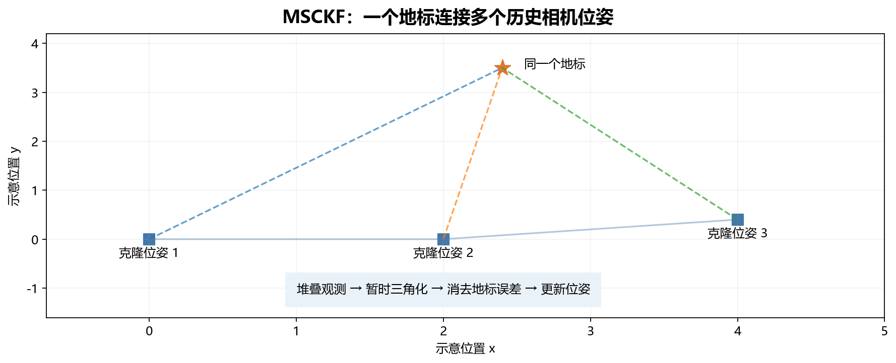

*图解：二维布局仅说明跨时间几何约束。实际相机是三维位姿，且需要维护克隆与当前状态的交叉协方差。*

某地标的多次观测残差：

$$
r_f\approx H_x\delta x+H_f\delta p_f+n.
$$

找 $H_f$ 左零空间正交基 $N$，使 $N^\top H_f=0$：

$$
r_o=N^\top r_f\approx N^\top H_x\delta x+N^\top n,
$$
$$
H_o=N^\top H_x,\qquad R_o=N^\top R_fN.
$$

用 $(r_o,H_o,R_o)$ 更新即可。通常仍需暂时三角化地标来计算投影和雅可比；“结构消除”并不等于“不需要深度”。

有 $m$ 次二维观测且 $\operatorname{rank}(H_f)=3$ 时，投影后最多 $2m-3$ 维残差；退化情况按实际秩处理。

### 12.3 事件 VIO 流程

1. 用 IMU 传播名义状态与协方差。
2. 事件前端维护带时间戳的特征轨迹。
3. 在选择时刻克隆相机位姿，正确增广交叉协方差。
4. 轨迹结束或窗口收缩时三角化地标。
5. 排除视差不足、负深度和重投影异常。
6. 零空间投影，必要时 QR 压缩，再门控和更新。
7. 删除无用克隆，保留剩余状态的边缘均值与协方差。

各特征时间不同，不能未经补偿绑定到同一克隆。可使用传播、插值、运动补偿或明确的时序观测模型。

事件轨迹与惯性融合的经典实例使用结构消除的 EKF 模型，并用估计运动辅助跟踪，见 [Zhu 等，CVPR 2017](https://openaccess.thecvf.com/content_cvpr_2017/html/Zhu_Event-Based_Visual_Inertial_CVPR_2017_paper.html)。

### 12.4 场景与局限

适合没有预先地图、希望实时估计轨迹、且能得到可靠跨时间关联的事件相机 + IMU 系统。难点包括小视差、轨迹短、纯旋转、时延和线性化一致性。

首次估计雅可比等策略可用于避免向不可观方向注入虚假信息，但应按完整算法实现，不能只固定几个雅可比就认为问题解决。

## 十三、其他实用扩展

### 13.1 自适应 KF / EKF

**用途：**事件特征质量随速度、纹理和窗口长度变化时，调整观测噪声。先用前端质量构造 $R_k$，再用创新统计验证。

创新协方差匹配的一种启发式：

$$
\widehat C_{r,k}=(1-\rho)\widehat C_{r,k-1}+\rho r_kr_k^\top,
$$
$$
\widehat R_k\approx\widehat C_{r,k}-H_kP_k^-H_k^\top.
$$

短窗口结果未必正定，而且模型错误和离群点也会增大创新。必须限制适应速率、设置特征值上下界，不要无约束同时估计 $Q,R$。

**例子：**特征沿长边缘方向定位不稳定，可增大该方向方差；不能只按事件数把 $R$ 无限缩小。

### 13.2 鲁棒 KF / EKF

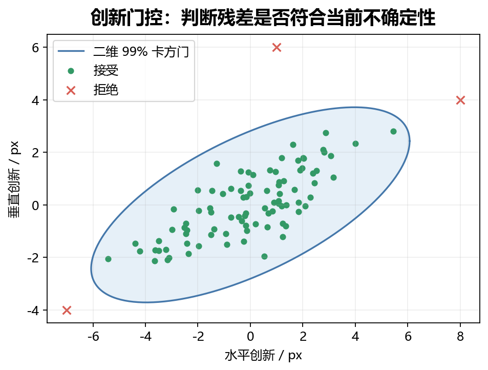

*图解：按 rᵀS⁻¹r≤9.210 判定。门是与协方差相关的椭圆，不是固定半径圆；假设错误时，真实观测也可能被拒绝。*

**用途：**抑制错误关联和离群点。先做创新门控：

$$
d^2=r^\top S^{-1}r.
$$

二维测量在合理高斯条件下，99% 卡方阈值约为 9.210。超过阈值可以拒绝。

软鲁棒化的一种近似：对白化残差使用 Huber 等损失得到 $0<w\le1$，以 $R_{\rm eff}=R/w$ 降低异常观测权重。共同加权还是分量加权，应匹配损失定义。

这是工程近似，不等同于完整最优后验。门控太严也会拒绝真实机动，应检查模型与 $Q$。

### 13.3 平方根滤波 SR-KF / SR-UKF

维护 $P=LL^\top$ 的因子而非直接更新 $P$。预测时构造：

$$
M=[FL\quad L_Q],\qquad Q=L_QL_Q^\top.
$$

对 $M^\top$ 做 QR 分解，三角因子的转置可作为新平方根，必要时统一对角线符号。

适合长期、高频、数值尺度差异大的系统。它改善数值稳定，不能修复物理模型。SR-UKF 遇到负权重可能需要 Cholesky downdate，不能把带符号项全当普通平方根列拼接。

### 13.4 IMM：交互多模型

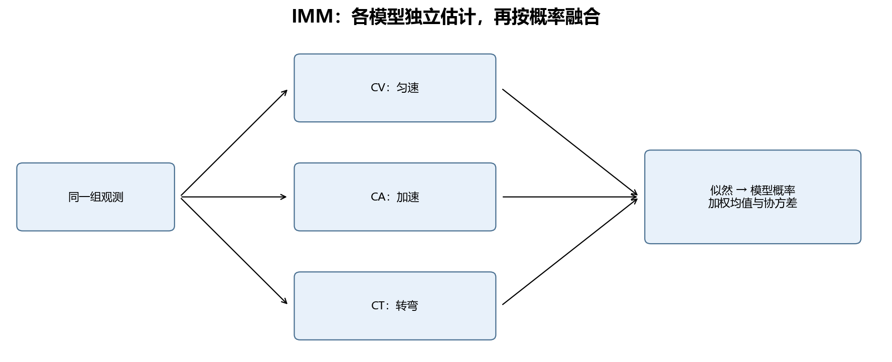

*图解：这是结构示意，省略了完整 IMM 的交互混合步骤。融合协方差必须包含模型之间均值差异，不能只平均各模型的协方差。*

目标可匀速、加速或转弯时，同时运行多个滤波器。设：

$$
\pi_{ij}=P(M_k=j\mid M_{k-1}=i).
$$

由旧模型概率 $\mu_i$ 计算混合权重：

$$
\bar c_j=\sum_i\pi_{ij}\mu_i,\qquad
\mu_{i\mid j}=\frac{\pi_{ij}\mu_i}{\bar c_j}.
$$

用这些权重混合初始均值与协方差，各自传播更新，再以观测似然 $\Lambda_j$ 更新模式概率：

$$
\mu_j^+=\frac{\Lambda_j\bar c_j}{\sum_\ell\Lambda_\ell\bar c_\ell}.
$$

融合结果：

$$
\bar x=\sum_j\mu_j\hat x_j,
$$
$$
\bar P=\sum_j\mu_j[P_j+(\hat x_j-\bar x)(\hat x_j-\bar x)^\top].
$$

**例子：**事件相机跟踪机动目标，用 CV 与协调转弯模型。状态维数不同需先定义映射。异步间隔变化大时，可以从连续时间模式率矩阵 $\Gamma$ 构造 $\Pi(\Delta t)=e^{\Gamma\Delta t}$，避免固定每次更新的切换概率随事件率改变含义。

### 13.5 信息滤波

定义信息矩阵与向量：

$$
\Lambda=P^{-1},\quad \eta=P^{-1}\hat x.
$$

线性独立观测更新：

$$
\Lambda^+=\Lambda^-+H^\top R^{-1}H,\qquad
\eta^+=\eta^-+H^\top R^{-1}z.
$$

适合某些稀疏、多测量融合场景，但预测未必更便宜；转换形式也不能消除观测相关性。

### 13.6 RTS 平滑

滤波用当前及过去数据，平滑还用未来数据修正历史。线性模型下保存前向结果，然后反向：

$$
G_k=P_k^+F_{k+1}^\top(P_{k+1}^-)^{-1},
$$
$$
\hat x_k^s=\hat x_k^++G_k(\hat x_{k+1}^s-\hat x_{k+1}^-),
$$
$$
P_k^s=P_k^++G_k(P_{k+1}^s-P_{k+1}^-)G_k^\top.
$$

适合离线事件轨迹分析。旋转需流形差分，不能直接相减矩阵。固定滞后平滑也会增加输出延迟。

### 13.7 EnKF 与粒子滤波

EnKF 用状态集合近似协方差，适合某些高维系统。扰动观测版本的代表性更新：

$$
x_j^+=x_j^-+K(z+\epsilon_j-h(x_j^-)),\quad
\epsilon_j\sim N(0,R).
$$

$K$ 用集合样本交叉协方差和观测协方差构造；也存在确定性版本。样本不足会产生虚假相关性，通常不是小型事件 VIO 的首选。

粒子滤波不是 KF 的一种，而是用带权粒子表示后验的另一类贝叶斯方法。事件关联产生明显多峰时，可以考虑粒子滤波或多假设跟踪，但高维退化和计算成本更突出。

### 13.8 方法选型表

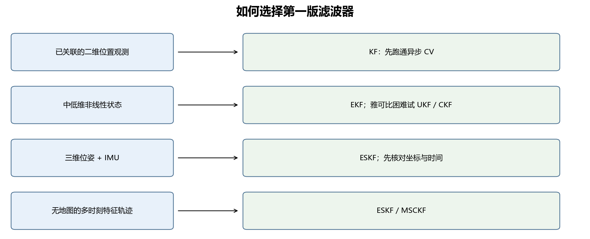

*图解：按观测模型、状态几何和维数选择第一版方法。鲁棒、自适应、平方根等技术可以在基础模型验证后叠加。*

| 方法 | 解决问题 | 事件场景例子 | 主要局限 |
|---|---|---|---|
| KF | 线性估计 | 已关联图像特征跟踪 | 不直接处理一般三维几何 |
| EKF | 非线性局部估计 | 已知地标重投影 | 雅可比与初始化敏感 |
| 迭代 EKF | 更新线性化误差 | 事件边缘地图对齐 | 迭代耗时 |
| UKF | 无解析雅可比的矩传播 | 低维非线性跟踪 | 高维成本 |
| CKF | 固定容积点传播 | 与 UKF 比较的实验 | 单高斯近似 |
| ESKF | 惯性与三维旋转 | 事件相机 + IMU | 坐标与重置复杂 |
| InEKF | 利用群结构 | 导航一致性研究 | 理论条件限制 |
| MSCKF | 多时刻视觉约束 | 无地图事件 VIO | 轨迹、克隆与可观性 |
| 自适应 | 噪声变化 | 特征质量波动 | 统计易受异常污染 |
| 鲁棒 | 离群点 | 错误关联 | 不修复系统性偏置 |
| 平方根 | 数值稳定 | 高频长期运行 | 实现复杂 |
| IMM | 模式切换 | 急转弯目标 | 多模型成本 |

这些不是互斥选项：可以组合鲁棒 ESKF、平方根 UKF，MSCKF 也常结合误差状态惯性模型。

## 十四、事件相机的三个落地案例

### 案例 A：跟踪图像中的角点

**输入：**前端已经输出 $(t_k,u_k,v_k,R_k,\mathrm{id})$，完成去噪、特征提取与关联。

**状态：**$[u,v,\dot u,\dot v]$，采用 CV-KF。

**步骤：**

1. 首次观测初始化位置，速度设零但给较大速度方差。
2. 同一 ID 的观测到来，按真实时间差预测。
3. 门控通过则更新，否则保留预测。
4. 连续失配达到超时或不确定性上限时终止轨迹。
5. 身份不确定时重新建轨，不强行拼接旧目标。

**数值例子：**预测 $(160,110)$，观测 $(162,109)$，若 $S=4I$，则：

$$
d^2=(2^2+(-1)^2)/4=1.25<9.210.
$$

可接受该观测。输出是图像运动，不直接给出米制速度或相机六自由度位姿，多目标交叉还需要额外关联方法。

### 案例 B：事件相机 + IMU 的视觉惯性里程计

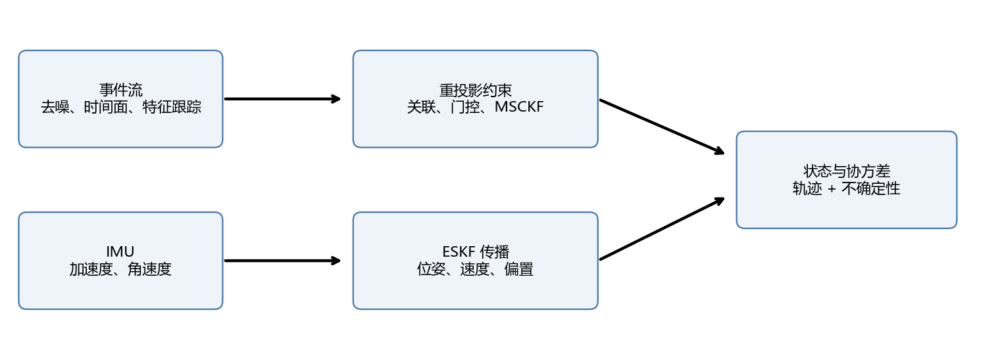

**输入：**事件、IMU、内外参和时间关系。**输出：**位姿、速度与偏置。

前端：去噪 → 时间面/局部事件表示 → 特征跟踪 → 带时戳和质量的轨迹。

后端：ESKF 传播；已知地图用地标更新，无地图可用 MSCKF。

定义外参 $R_{CB},t_{CB}$ 满足 $p_C=R_{CB}p_B+t_{CB}$。世界地标变到相机：

$$
p_f^C=R_{CB}R_{WB}^\top(p_f^W-p_W)+t_{CB},
$$
$$
z_{f,k}=\pi(p_f^C)+v_{f,k}.
$$

落地顺序：

1. 验证单位、轴向、变换方向和时间同步。
2. 静止片段初始化陀螺偏置与重力方向；单个静止姿态不能唯一分离所有加速度偏置和重力误差。
3. 验证纯 IMU 短时传播，再接合成视觉观测。
4. 接真实事件特征，记录创新和门控结果。
5. 引入克隆、三角化、零空间消元与窗口管理。

**可观性：**无绝对参考的一般 VIO 中，全局位置和绕重力的全局航向通常不可观。单目视觉没有米制尺度；有 IMU、足够运动激励和正确标定时尺度可估，但纯旋转等退化仍会带来困难。

**无事件时：**仍可 IMU 传播，但误差累积。事件少不等于速度为零，低纹理等情况也会产生少事件。

### 案例 C：已知亮度地图的直接事件更新

设 $L_{\rm map}(\mathcal W(u,x))$ 为通过几何变换从地图查询的对数亮度。简化示意：

$$
z_i=p_iC,
$$
$$
h_i=L_{\rm map}(\mathcal W(u_i,x(t_i)))
-L_{\rm map}(\mathcal W(u_i,x(t_i^{\rm ref}))).
$$

残差 $r_i=z_i-h_i$，当前状态导数包含：

$$
\frac{\partial h_i}{\partial x(t_i)}
=\nabla L_{\rm map}\frac{\partial\mathcal W}{\partial x(t_i)}.
$$

参考时刻状态若不确定，也要纳入相应雅可比与相关性，不能无条件把第二项当常数。

流程：建立亮度与几何地图 → 维护每个像素参考亮度 → 传播到事件时刻 → 预测亮度变化 → 构造残差 → 鲁棒更新。

这是建模示意，不是可直接部署的完整事件似然。还需处理阈值分布、地图误差、遮挡与事件选择机制。可读 [生成式事件位姿估计原论文](https://arxiv.org/abs/1510.01972)。

## 十五、可运行的异步跟踪实验

### 15.1 实验内容与运行方式

配套代码：[下载异步特征跟踪示例 event_kf_demo.py](/downloads/kalman-filter-guide/event_kf_demo.py)。示例模拟的是已经关联好的特征位置，不是原始事件流：

- 四维 CV 状态，观测间隔随机为 5～25 ms；
- 像素噪声标准差 1.5 px，少量明显离群点；
- 真实时间差构造 $F,Q$，NIS 门控，Joseph 更新；
- 固定随机种子 42，便于复现。

运行命令和完整代码集中放在文末代码附录，本节先说明实验设计与结果。

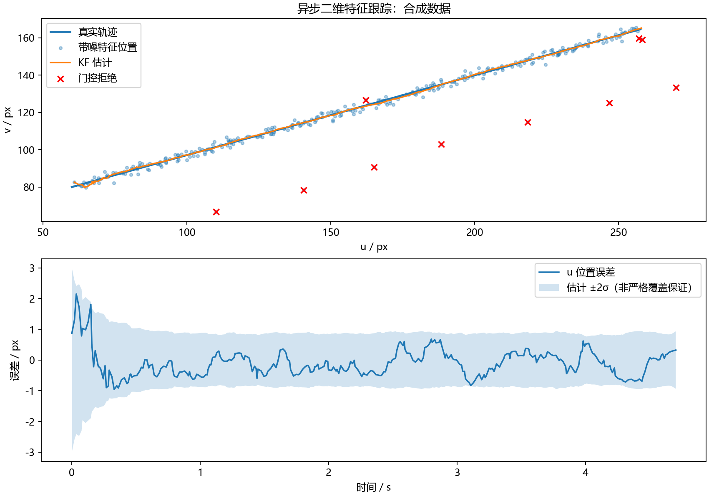

原学习资料记录的这次合成实验，在启动 0.5 秒后统计二维位置 RMSE：原始观测 **5.978 px**，KF **0.508 px**；320 次更新候选中拒绝 **10 次**。原始 RMSE 包含人为加入的离群点，因此改善同时来自门控与时序滤波，不能把全部收益归因于平滑。真值正好匀速，对 CV 模型友好，这不是实测事件相机性能。

### 15.2 更新步骤与数值处理

核心实现见文末代码附录的“公共运算、标准 KF 与异步运动模型”。更新先计算创新和 NIS，门控通过后求解增益，最后使用 Joseph 形式更新协方差。

对称化只能去除微小非对称，不能修复错误算法造成的非正定。原配套实验还检查协方差最小特征值。

### 15.3 接真实数据

处理流程：原始事件 → 去噪 → 时间面或局部窗口 → 特征检测与关联 → 输出带时间戳、ID、位置和协方差的观测 → 每个特征 ID 维护一个滤波器。

替换合成时间和位置数组即可接前端，但工程系统还需轨迹生命周期、视野边界、同步和丢包管理。示例遇乱序时间直接报错；实际可缓存排序、丢弃过期观测或回滚重放，不能用负时间步长直接传播。

### 15.4 三个实验改动

1. 去掉离群点、关闭门控，观察高斯条件下结果。
2. 2 秒后加入加速，观察 CV 滞后，再调 $q$ 或换 CA。
3. 设置无观测区间，观察不确定性增长和恢复后的收敛。

比较方法要用相同数据、相同评价区间与公平调参，不能只比较曲线是否平滑。

## 十六、调参、诊断与评估

### 16.1 参数含义

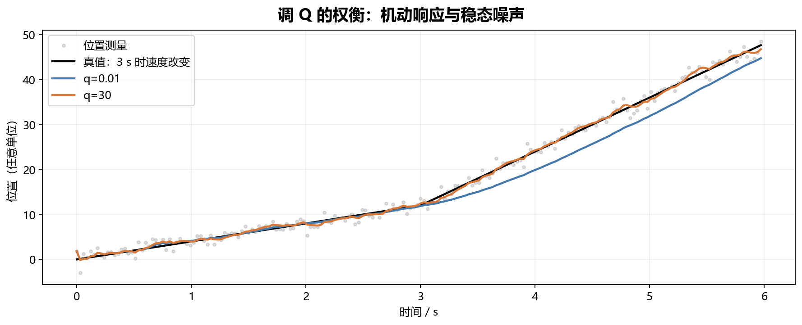

*图解：合成一维 CV 实验，观测 R=1，不使用门控。较小 q 在速度突变后滞后；较大 q 响应更快，但也更容易受测量扰动。*

| 参数 | 表达什么 | 过小 | 过大 |
|---|---|---|---|
| $Q$ | 未建模运动 | 急转弯滞后 | 更依赖测量 |
| $R$ | 测量不确定性 | 追随噪声 | 更新弱 |
| $P_0$ | 初始误差 | 错误初始化难纠正 | 初期大幅修正 |

先检查模型、时间和单位，再调参数。初始速度未知时，应给速度大方差，不应让所有 $P_0$ 都接近零。

### 16.2 创新与 NIS

理想线性高斯条件下，创新近似零均值且跨时间不相关：

$$
\mathrm{NIS}_k=r_k^\top S_k^{-1}r_k.
$$

观测维度为 $m$ 时，未被门控选择的理想创新有 $\mathbb E[\mathrm{NIS}]\approx m$。应关注长期统计而不是一次超过阈值。

只统计通过门控的创新会使 NIS 偏小，评估时应保留门控前结果，并区分真实离群点。

### 16.3 有真值时看 NEES

$$
e_k=x_k^{\rm true}-\hat x_k,\qquad
\mathrm{NEES}_k=e_k^\top P_k^{-1}e_k.
$$

旋转误差须用相同切空间约定。理想情况下，可观的 $n$ 维状态有期望约为 $n$。VIO 有规范自由度，应统一参考系或评估可观子空间，不能把未对齐轨迹直接代入。

严格检验宜用多次独立随机试验，并考虑样本相关性。单条平滑曲线不能证明一致性。

### 16.4 事件系统评价指标

- 位置、速度与姿态误差；
- ATE、RPE，注明时序匹配和 SE(3)/Sim(3) 对齐；
- 端到端延迟，不只是矩阵更新耗时；
- 事件吞吐量、CPU 占用、丢包率；
- 轨迹存活率、关联错误率和门控拒绝率；
- 高速旋转、低纹理、光照变化下的退化表现；
- 协方差和真实误差是否匹配。

米制 VIO 随意使用允许尺度变化的 Sim(3) 对齐可能掩盖尺度错误，必须说明评价选择。

### 16.5 故障速查

| 现象 | 优先检查 |
|---|---|
| 静止时快速漂移 | 重力、偏置、轴向、单位 |
| 越来越不接受观测 | $Q$ 太小、重复计数、协方差错误 |
| 事件密集时协方差趋零 | 相关性、窗口重叠 |
| 高速旋转发散 | 时间偏移、积分、外参、运动补偿 |
| 平滑但滞后 | $R$ 大、$Q$ 小、前端时延 |
| 观测恢复却一直拒绝 | 模型失配、门控、需重定位 |
| 协方差非正定 | 数值抵消、UKF 权重、错误更新 |
| 角度跨越 $\pm\pi$ 时跳变 | 角度残差未归一化 |

### 16.6 时间偏移的数量级

像素速度 $2000\ \mathrm{px/s}$，时间误差 1 ms：

$$
\Delta u\approx\dot u\Delta t=2000\times0.001=2\ \mathrm{px}.
$$

这可能超过特征定位噪声。精细事件时间戳不等于整条链路自动同步。

### 16.7 可观性比换滤波器更根本

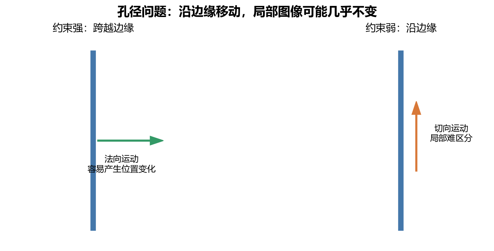

*图解：无限长均匀直边缘的概念示意；角点、纹理、端点或额外传感器可以增加约束。应使用各向异性噪声或点到线残差。*

直边缘通常只提供法向运动约束，即孔径问题。可用各向异性协方差：

$$
R=\sigma_n^2nn^\top+\sigma_t^2tt^\top,\qquad
\sigma_t^2\gg\sigma_n^2.
$$

$n,t$ 是单位法向和切向。也可用点到线标量残差：

$$
r=n^\top(z-h(x)),\quad H_r=n^\top H.
$$

不要把长边缘当成两方向都精确的角点。没有信息时，UKF 或重复迭代也无法创造可观性。

## 十七、学习路线与练习

### 17.1 四阶段学习

| 阶段 | 学习内容 | 必须完成 |
|---|---|---|
| 1 | 高斯、协方差、KF | 手算更新，跑通二维示例 |
| 2 | 非线性、EKF、UKF | 投影模型与雅可比差分验证 |
| 3 | 旋转、IMU、ESKF | 静止与简单转动的合成验证 |
| 4 | 事件前端、MSCKF | 真数据轨迹与完整时序对齐 |

基础薄弱时先补矩阵、正定、导数和条件概率。不要同时接入前端、外参、ESKF、MSCKF，否则很难定位错误。

### 17.2 练习与答案

**1.** 先验均值 10、方差 9，观测 13、方差 1，后验？

答案：$K=0.9,\hat x^+=12.7,P^+=0.9$。

**2.** 连续白加速度模型中，时间步长翻倍，位置方差、交叉项、速度方差各变多少？

答案：分别乘以 8、4、2，不是全部乘以 2。

**3.** 只测位置为何能估速度？

答案：运动模型关联速度和未来位置，多时刻观测提供信息，交叉协方差传递修正。

**4.** 同一包事件输出十个相似位置，能否当十条独立高精度观测？

答案：通常不能，共享信息和误差会导致重复计数。

**5.** 事件少能否立刻施加零速约束？

答案：不能，低纹理等也会产生少事件；需要可靠静止检测。

**6.** EKF 偏差大，换 UKF 是否必然解决？

答案：不一定，先查时间、单位、关联、噪声和可观性。

**7.** 迭代 EKF 每次都把上次后验作为新先验会怎样？

答案：同一测量被重复计数，应固定同一次更新的原始先验。

### 17.3 写代码前回答六个问题

1. 状态、单位、坐标系是什么？
2. 动力学是什么，真实时间差来自哪里？
3. 测量究竟测到什么，是原始事件还是前端估计？
4. 噪声是否独立，有无重复利用数据？
5. 哪些状态可观，何时退化？
6. 用什么合成数据、真值和统计来验证？

### 17.4 公式速查

$$
\boxed{\begin{aligned}
\hat x^-&=F\hat x^++Bu\\
P^-&=FP^+F^\top+Q\\
r&=z-H\hat x^-\\
S&=HP^-H^\top+R\\
K&=P^-H^\top S^{-1}\\
\hat x^+&=\hat x^-+Kr\\
P^+&=(I-KH)P^-(I-KH)^\top+KRK^\top
\end{aligned}}
$$

EKF 用 $f,h$ 传播均值和预测观测，用正确线性化点的雅可比替代 $F,H$。ESKF 还需名义/误差状态分离、注入和重置。

## 十八、参考资料

优先列出原论文、大学和作者入口。正文推导与教学例子为本教程整理；文献之间状态顺序、扰动方向和噪声约定可能不同，应统一后使用。

1. [Welch & Bishop：An Introduction to the Kalman Filter](https://www.cs.unc.edu/~welch/media/pdf/kalman_intro.pdf) — 入门 KF、EKF。
2. [Julier & Uhlmann：Unscented Filtering and Nonlinear Estimation](https://doi.org/10.1109/JPROC.2003.823141) — UKF 经典论文。
3. [Arasaratnam & Haykin：Cubature Kalman Filters](https://doi.org/10.1109/TAC.2009.2019800) — CKF 原论文。
4. [Solà：Quaternion Kinematics for the Error-State Kalman Filter](https://arxiv.org/abs/1711.02508) — 旋转与 ESKF。
5. [Barrau & Bonnabel：The Invariant Extended Kalman Filter as a Stable Observer](https://arxiv.org/abs/1410.1465) — 不变滤波的条件与理论。
6. [Mourikis & Roumeliotis：A Multi-State Constraint Kalman Filter for Vision-Aided Inertial Navigation](https://doi.org/10.1109/ROBOT.2007.364024) — MSCKF。
7. [Gallego 等：Event-based Vision: A Survey](https://arxiv.org/abs/1904.08405) — 事件视觉综述。
8. [Zhu 等：Event-Based Visual Inertial Odometry](https://openaccess.thecvf.com/content_cvpr_2017/html/Zhu_Event-Based_Visual_Inertial_CVPR_2017_paper.html) — 事件轨迹与惯性融合。
9. [Gallego 等：Event-based Camera Pose Tracking Using a Generative Event Model](https://arxiv.org/abs/1510.01972) — 生成式观测模型。
10. [The Event-Camera Dataset and Simulator](https://arxiv.org/abs/1610.08336) 与 [数据集主页](https://rpg.ifi.uzh.ch/davis_data.html) — 事件、IMU 与真值学习数据；各序列包含的数据类型需分别确认。
11. [The Multi Vehicle Stereo Event Camera Dataset](https://arxiv.org/abs/1801.10202) — 双目事件与三维感知数据。

建议阅读：1 → 跑本教程例子 → 4 → 7 → 8 → 6；需要无导数方法时读 2、3，需要不变滤波理论时读 5。

## 十九、代码附录：按方法查阅与运行

本节集中放置全文的程序代码。建议先理解对应章节，再从最小示例开始替换模型。代码采用 Python 和 NumPy，中文注释说明了状态顺序、输入输出、矩阵含义及适用范围。

**完整文件：** [下载 kalman_methods.py](/downloads/kalman-filter-guide/kalman_methods.py)。下方各代码块按顺序拼接，也可得到这个文件；单独复制某一方法时，需要同时复制它调用的公共函数。

| 代码分组 | 实现范围 |
|---|---|
| KF、EKF、迭代 EKF、UKF、CKF | 欧氏状态的教学递推；EKF 等由调用者传入模型函数 |
| ESKF | 15 维误差状态的 IMU 传播与误差注入，视觉雅可比需按模型提供 |
| InEKF | 更新核心接口；群传播、误差坐标、注入和重置由具体模型提供 |
| MSCKF | 多视角残差白化与地标零空间消元；不含完整 VIO 前后端 |
| 自适应、鲁棒、平方根 | 基础递推的扩展；平方根 UKF 限本文指定的非负协方差权重 |
| IMM、信息滤波、RTS | 同维模型交互、信息形式递推和离线欧氏状态平滑 |
| EnKF、粒子滤波 | 集合与粒子方法的基础对照；粒子滤波不属于 KF |

函数默认传入维度匹配的浮点数组，状态向量形如 `(n,)`，协方差形如 `(n, n)`。需要求解的创新协方差须可逆，Cholesky 分解的矩阵须正定。角度、四元数、关联错误和时序同步需要额外处理，不应直接套用欧氏残差。

### 19.1 安装依赖与运行

下载脚本后，在保存脚本的文件夹打开终端：

```powershell
# 基础算法文件只依赖 NumPy；运行后会执行一维手算验证。
python -m pip install numpy
python kalman_methods.py

# 原文的二维异步跟踪实验还需要 Matplotlib，并会保存结果图片。
python -m pip install matplotlib
python event_kf_demo.py
```

原二维实验脚本：[event_kf_demo.py](/downloads/kalman-filter-guide/event_kf_demo.py)。它仍用于复现第十五节的随机观测、离群点和轨迹图；新文件用于逐个理解不同方法，二者不是同一个实验。

最小示例的预期结果：KF、UKF、CKF 在该线性问题下均得到均值 **4.4**、方差 **0.8**。这个检查验证实现之间的一致性，不说明非线性任务中它们精度相同。

### 19.2 文件说明与依赖

```python
"""卡尔曼滤波教学代码。数组均为 NumPy 浮点数组，状态为一维向量。
欧氏算法可直接调用；ESKF、InEKF、MSCKF 提供核心算子，不是完整 VIO。
"""
import numpy as np
```

### 19.3 公共运算、标准 KF 与异步运动模型

```python
def sym(P):
    """消除浮点运算产生的微小非对称，不修复错误模型。"""
    return (P + P.T) / 2


def correct(x, P, residual, H, R, gate=np.inf):
    """由残差更新状态；返回状态、协方差、NIS 和是否接受观测。"""
    S = sym(H @ P @ H.T + R)
    nis = float(residual @ np.linalg.solve(S, residual))
    if nis > gate:
        return x.copy(), P.copy(), nis, False
    # 解线性方程求增益，避免显式求逆。
    K = np.linalg.solve(S, H @ P).T
    A = np.eye(len(x)) - K @ H
    return x + K @ residual, sym(A @ P @ A.T + K @ R @ K.T), nis, True


def kf_predict(x, P, F, Q, control=None):
    """control 是已计算好的 B @ u，没有控制时传 None。"""
    return F @ x + (0 if control is None else control), sym(F @ P @ F.T + Q)


def kf_update(x, P, z, H, R, gate=np.inf):
    return correct(x, P, z - H @ x, H, R, gate)


def cv_model(dt, q):
    """二维匀速模型；dt 单位秒，q 为连续白加速度谱密度。"""
    if dt < 0 or q < 0:
        raise ValueError("时间差和谱密度不能为负")
    F = np.eye(4)
    F[:2, 2:] = dt * np.eye(2)
    Q = q * np.block([[dt**3/3*np.eye(2), dt**2/2*np.eye(2)],
                      [dt**2/2*np.eye(2), dt*np.eye(2)]])
    return F, Q
```

### 19.4 EKF 与迭代 EKF

```python
def ekf_predict(x, P, f, jac_f, Q):
    """加性噪声模型；输入和 dt 可由调用者封装在 f、jac_f 中。"""
    F = jac_f(x)
    return f(x), sym(F @ P @ F.T + Q)


def ekf_update(x, P, z, h, jac_h, R):
    """只处理欧氏残差；角度观测需要另外实现角度归一化。"""
    return correct(x, P, z - h(x), jac_h(x), R)


def iterated_ekf(x, P, z, h, jac_h, R, max_iter=10, tol=1e-8):
    """固定同一个先验，反复重线性化；最后仅更新一次协方差。"""
    if max_iter < 1:
        raise ValueError("max_iter 至少为 1")
    xi = x.copy()
    for _ in range(max_iter):
        H = jac_h(xi)
        K = np.linalg.solve(H @ P @ H.T + R, H @ P).T
        xn = x + K @ (z - h(xi) + H @ (xi - x))
        if np.linalg.norm(xn - xi) < tol:
            xi = xn
            break
        xi = xn
    H = jac_h(xi)
    # 最终线性化的 Joseph 更新；不把每次迭代看成新测量。
    _, Pn, _, _ = correct(x, P, z - h(xi), H, R)
    return xi, Pn
```

### 19.5 UKF 与 CKF

```python
def sigma_points(x, P, kind="ukf", alpha=1., beta=2., kappa=0.):
    """P 须正定。返回代表点、均值权重和协方差权重。"""
    n = len(x)
    L = np.linalg.cholesky(P)
    if kind == "ckf":
        offsets = np.sqrt(n) * L.T
        w = np.full(2*n, 1/(2*n))
        return np.vstack((x + offsets, x - offsets)), w, w.copy()
    if kind != "ukf":
        raise ValueError("kind 只能是 ukf 或 ckf")
    c = alpha**2 * (n + kappa)
    if c <= 0:
        raise ValueError("sigma 点尺度必须为正")
    offsets = np.sqrt(c) * L.T
    wm = np.full(2*n+1, 1/(2*c))
    wm[0] = (c-n)/c
    wc = wm.copy()
    wc[0] += 1-alpha**2+beta
    return np.vstack((x, x+offsets, x-offsets)), wm, wc


def moment(points, wm, wc, noise):
    mean = wm @ points
    delta = points - mean
    return mean, sym((delta.T * wc) @ delta + noise)


def sigma_step(x, P, z, f, h, Q, R, kind="ukf"):
    """UKF/CKF 的完整一步，限欧氏状态、加性噪声。"""
    points, wm, wc = sigma_points(x, P, kind)
    xp, Pp = moment(np.array([f(p) for p in points]), wm, wc, Q)
    # 加入 Q 后重新生成点，使测量传播包含过程噪声。
    points, wm, wc = sigma_points(xp, Pp, kind)
    obs = np.array([h(p) for p in points])
    zp, S = moment(obs, wm, wc, R)
    cross = ((points-xp).T * wc) @ (obs-zp)
    K = np.linalg.solve(S, cross.T).T
    return xp + K @ (z-zp), sym(Pp-K @ S @ K.T)
```

### 19.6 ESKF：右乘局部姿态误差的核心算子

```python
def skew(v):
    a, b, c = v
    return np.array([[0., -c, b], [c, 0., -a], [-b, a, 0.]])


def so3_exp(v):
    """旋转向量转旋转矩阵；小角度使用级数避免除零。"""
    t = np.linalg.norm(v)
    W = skew(v)
    a = 1-t*t/6 if t < 1e-6 else np.sin(t)/t
    b = .5-t*t/24 if t < 1e-6 else (1-np.cos(t))/t**2
    return np.eye(3) + a*W + b*W@W


def eskf_predict(state, P, am, wm, gravity, Qc, dt):
    """state=(p,v,Rwb,ba,bg)，误差顺序 p,v,theta,ba,bg。
    Qc 为 12x12 连续噪声谱密度，顺序 na,ng,nba,nbg。
    使用短时间一阶协方差离散化；高动态场景需更准确积分。
    """
    if dt < 0:
        raise ValueError("dt 不能为负")
    p, v, R, ba, bg = state
    a, w = am-ba, wm-bg
    aw = R @ a + gravity
    nominal = (p+v*dt+.5*aw*dt**2, v+aw*dt, R@so3_exp(w*dt), ba.copy(), bg.copy())
    A = np.zeros((15, 15))
    A[:3, 3:6] = np.eye(3)
    A[3:6, 6:9], A[3:6, 9:12] = -R@skew(a), -R
    A[6:9, 6:9], A[6:9, 12:15] = -skew(w), -np.eye(3)
    G = np.zeros((15, 12))
    G[3:6, :3], G[6:9, 3:6] = -R, -np.eye(3)
    G[9:12, 6:9], G[12:15, 9:12] = np.eye(3), np.eye(3)
    Phi = np.eye(15) + A*dt
    return nominal, sym(Phi@P@Phi.T + G@Qc@G.T*dt)


def eskf_correct(state, P, residual, H_error, R_obs):
    """H_error 必须相对于本文右乘误差推导，不是四元数四分量雅可比。"""
    dx, Pn, _, _ = correct(np.zeros(15), P, residual, H_error, R_obs)
    p, v, R, ba, bg = state
    state = (p+dx[:3], v+dx[3:6], R@so3_exp(dx[6:9]), ba+dx[9:12], bg+dx[12:15])
    J = np.eye(15)
    J[6:9, 6:9] -= .5*skew(dx[6:9])  # 注入后，协方差也须重置。
    return state, sym(J@Pn@J.T)
```

### 19.7 InEKF：由具体群模型提供误差传播与注入

```python
def inekf_core(X, P, residual, H, R, inject_and_reset):
    """不是通用导航器：调用者必须提供与群误差定义一致的残差、H 和注入。
    回调接收 (X, dx)，返回 (更新后的群状态, 误差重置雅可比)。
    对正文 eta= Xhat @ inv(Xtrue)，注入为 Exp(-hat(dx)) @ Xhat。
    偏置、外参与观测的处理取决于具体群模型，不能照搬 ESKF 的 J。
    """
    dx, Pn, _, _ = correct(np.zeros(P.shape[0]), P, residual, H, R)
    Xn, J = inject_and_reset(X, dx)
    return Xn, sym(J @ Pn @ J.T)
```

### 19.8 MSCKF：白化后消除地标误差

```python
def msckf_project(residual, Hx, Hf, R):
    """输入堆叠后的多视角线性残差；返回消元后的残差、状态雅可比和单位噪声。
    前端关联、位姿克隆、三角化和可观性修正仍需由完整系统实现。
    """
    L = np.linalg.cholesky(R)
    r = np.linalg.solve(L, residual)
    A = np.linalg.solve(L, Hx)
    B = np.linalg.solve(L, Hf)
    U, s, _ = np.linalg.svd(B, full_matrices=True)
    threshold = np.finfo(float).eps * max(B.shape) * (s[0] if len(s) else 0)
    rank = np.count_nonzero(s > threshold)
    N = U[:, rank:]  # N.T @ B 约为零，地标误差被消去。
    return N.T@r, N.T@A, np.eye(N.shape[1])
```

### 19.9 自适应测量噪声与鲁棒更新

```python
def adaptive_R(R, residual, H, P_prior, rate=.02, floor=1e-6):
    """协方差匹配教学近似：用当前创新估计下一次更新的 R。
    输入必须是门控前统计；实际应使用窗口并处理离群点和相关性。
    """
    if not 0 < rate <= 1 or floor <= 0:
        raise ValueError("rate 需在 (0,1] 内，floor 为正")
    estimate = sym((1-rate)*R + rate*(np.outer(residual,residual)-H@P_prior@H.T))
    vals, vecs = np.linalg.eigh(estimate)
    return sym((vecs*np.maximum(vals, floor))@vecs.T)


def robust_update(x, P, z, H, R, huber=2.5, gate=np.inf):
    """先用原始创新门控，再用一个整体 Huber 权重放大 R；工程近似。"""
    r = z-H@x
    S = H@P@H.T+R
    d2 = float(r@np.linalg.solve(S,r))
    if d2 > gate:
        return x.copy(), P.copy(), d2, False
    weight = min(1., huber/max(np.sqrt(d2), 1e-12))
    return correct(x, P, r, H, R/weight)
```

### 19.10 平方根 KF 与正权重的平方根 UKF

```python
def qr_factor(columns):
    """返回 L，使 L@L.T = columns@columns.T；统一三角因子符号。"""
    _, T = np.linalg.qr(columns.T, mode="reduced")
    signs = np.where(np.diag(T) < 0, -1., 1.)
    return T.T * signs


def sr_kf_step(x, L, z, F, H, Lq, Lr):
    """L、Lq、Lr 分别是 P、Q、R 的平方根。更新用 Joseph 因子的 QR。"""
    xp = F@x
    Lp = qr_factor(np.hstack((F@L,Lq)))
    S = H@Lp@Lp.T@H.T + Lr@Lr.T
    K = np.linalg.solve(S, H@Lp@Lp.T).T
    Ln = qr_factor(np.hstack(((np.eye(len(x))-K@H)@Lp, K@Lr)))
    return xp+K@(z-H@xp), Ln


def sr_ukf_step(x, L, z, f, h, Lq, Lr):
    """固定 alpha=1,beta=2,kappa=0，使协方差权重非负。
    用 QR 构造预测、创新和更新因子；不支持负权重参数。
    """
    pts, wm, wc = sigma_points(x, L@L.T)
    propagated = np.array([f(p) for p in pts])
    xp = wm@propagated
    Lp = qr_factor(np.hstack(((propagated-xp).T*np.sqrt(wc),Lq)))
    pts, wm, wc = sigma_points(xp,Lp@Lp.T)
    obs = np.array([h(p) for p in pts])
    zp = wm@obs
    X, Z = (pts-xp).T, (obs-zp).T
    Ls = qr_factor(np.hstack((Z*np.sqrt(wc),Lr)))
    cross = (X*wc)@Z.T
    K = np.linalg.solve(Ls.T,np.linalg.solve(Ls,cross.T)).T
    Ln = qr_factor(np.hstack(((X-K@Z)*np.sqrt(wc),K@Lr)))
    return xp+K@(z-zp), Ln
```

### 19.11 IMM：相同状态维度、不同线性运动模型

```python
def imm_step(xs, Ps, mu, transition, models, z, H, R):
    """transition[i,j]=从模型 i 转到 j 的概率，models 是 (F,Q) 列表。
    要求所有模型共用状态坐标；每个目标模型的预测概率必须为正。
    """
    prior = mu@transition
    if np.any(prior <= 0):
        raise ValueError("各模型预测概率须为正")
    new_x, new_P, log_likelihood = [], [], []
    for j, (F,Q) in enumerate(models):
        weights = mu*transition[:,j]/prior[j]
        xm = weights@xs
        Pm = sum(w*(P+np.outer(x-xm,x-xm)) for w,x,P in zip(weights,xs,Ps))
        xp,Pp = kf_predict(xm,Pm,F,Q)
        r,S = z-H@xp, H@Pp@H.T+R
        # 对数似然，避免连续更新后概率下溢。
        log_likelihood.append(-.5*(len(z)*np.log(2*np.pi)+np.linalg.slogdet(S)[1]+r@np.linalg.solve(S,r)))
        xn,Pn,_,_ = kf_update(xp,Pp,z,H,R)
        new_x.append(xn); new_P.append(Pn)
    logw = np.log(prior)+log_likelihood
    weights = np.exp(logw-np.max(logw)); weights /= weights.sum()
    xs,Ps = np.array(new_x),np.array(new_P)
    mean = weights@xs
    cov = sum(w*(P+np.outer(x-mean,x-mean)) for w,x,P in zip(weights,xs,Ps))
    return xs,Ps,weights,mean,sym(cov)
```

### 19.12 信息滤波与 RTS 平滑

```python
def information_update(info, eta, z, H, R):
    """info=P^-1，eta=info@x；仅融合与已有信息独立的观测。"""
    return sym(info+H.T@np.linalg.solve(R,H)), eta+H.T@np.linalg.solve(R,z)


def information_predict(info, eta, F, Q):
    """教学实现先恢复均值与协方差再传播，未利用稀疏结构。"""
    P = np.linalg.solve(info,np.eye(len(eta)))
    xp,Pp = kf_predict(P@eta,P,F,Q)
    out = np.linalg.solve(Pp,np.eye(len(eta)))
    return sym(out),out@xp


def rts_smooth(filtered_x, filtered_P, predicted_x, predicted_P, F):
    """F[k] 从 k 传播到 k+1；predicted_*[k+1] 是该时刻更新前预测。
    输入按时间正序保存，输出使用未来观测修正后的欧氏状态序列。
    """
    xs,Ps = np.array(filtered_x,copy=True),np.array(filtered_P,copy=True)
    for k in range(len(xs)-2,-1,-1):
        G = np.linalg.solve(predicted_P[k+1], F[k]@filtered_P[k]).T
        xs[k] = filtered_x[k]+G@(xs[k+1]-predicted_x[k+1])
        Ps[k] = sym(filtered_P[k]+G@(Ps[k+1]-predicted_P[k+1])@G.T)
    return xs,Ps
```

### 19.13 EnKF 与 bootstrap 粒子滤波

```python
def enkf_step(ensemble, z, f, h, Q, R, rng):
    """每行一个状态样本；使用扰动观测版本，至少需要两个样本。"""
    count,n = ensemble.shape
    if count < 2:
        raise ValueError("集合至少包含两个样本")
    X = np.array([f(x) for x in ensemble])+rng.multivariate_normal(np.zeros(n),Q,count)
    Z = np.array([h(x) for x in X])
    A,B = X-X.mean(axis=0),Z-Z.mean(axis=0)
    K = np.linalg.solve(B.T@B/(count-1)+R, B.T@A/(count-1)).T
    noise = rng.multivariate_normal(np.zeros(len(z)),R,count)
    return X+(z+noise-Z)@K.T


def particle_step(particles, weights, z, f, h, Q, R, rng):
    """bootstrap PF，欧氏加性高斯模型；返回重采样后的等权粒子。
    这是贝叶斯方法对照，不属于卡尔曼滤波。此教学版每步重采样。
    """
    count,n = particles.shape
    X = np.array([f(x) for x in particles])+rng.multivariate_normal(np.zeros(n),Q,count)
    residuals = z-np.array([h(x) for x in X])
    with np.errstate(divide="ignore"):
        logw = np.log(weights)-.5*np.sum(residuals*np.linalg.solve(R,residuals.T).T,axis=1)
    logw -= np.max(logw)
    w = np.exp(logw); w /= w.sum()
    # 系统重采样：一个随机起点加等间距采样，保留高权重粒子。
    positions = (rng.random()+np.arange(count))/count
    cdf = np.cumsum(w); cdf[-1] = 1.
    return X[np.searchsorted(cdf,positions)],np.full(count,1/count)
```

### 19.14 可直接运行的最小示例

```python
def demo():
    """验证正文的一维手算，并比较线性模型下的几种实现。"""
    x,P = np.array([2.]),np.array([[4.]])
    z,H,R = np.array([5.]),np.array([[1.]]),np.array([[1.]])
    xn,Pn,_,_ = kf_update(x,P,z,H,R)
    print("KF 后验均值、方差：",xn[0],Pn[0,0])
    np.testing.assert_allclose(xn,[4.4])
    np.testing.assert_allclose(Pn,[[.8]])
    f,h = lambda v:v,lambda v:v
    for name in ("ukf","ckf"):
        a,b = sigma_step(x,P,z,f,h,np.zeros((1,1)),R,name)
        np.testing.assert_allclose(a,xn)
        np.testing.assert_allclose(b,Pn)
        print(name.upper(),a[0],b[0,0])
    print("最小示例通过。更多方法需按各函数说明提供模型和输入。")


if __name__ == "__main__":
    demo()
```

